# Enterprise Agent Factory Service

**Give every delivery team its own isolated, budget-capped software factory of AI agents, run centrally on
AWS EKS.**

The Enterprise Agent Factory Service (AFS) is an internal platform-engineering product. A platform team
operates it once; every team in the enterprise then gets its own namespace environment running a team of
containerized AI agents, with human teammates, agent identities, secrets, model access, budgets and log
delivery managed through one API, one CLI and one web console.

This repository is the front door: the service overview, the product requirements, the cross-repo design and
contracts, and links to the four repositories that hold the code.

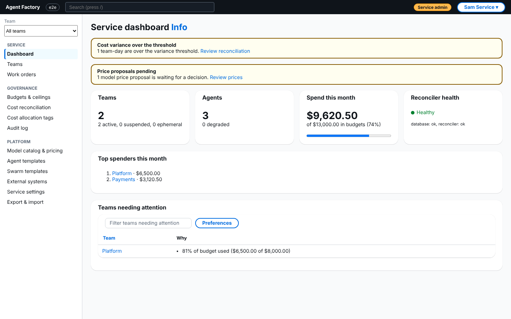

| | |
|---|---|
| **Use it** | [Adopt AFS](user-docs/adoption-guide.md) · [Getting started](user-docs/getting-started.md) · [User docs by repository](#documentation-for-users) |
| **Understand it** | [Architecture](#architecture) · [Isolation](#per-tenant-isolation) · [Solution design](docs/solution-design.md) · [Diagrams](docs/diagrams/README.md) |
| **Build it** | [Contributing](CONTRIBUTING.md) · [Repositories](#the-repositories) · [Contracts](docs/contracts/README.md) · [AGENTS.md](AGENTS.md) |

## Contents

- [Why AFS](#why-afs)
- [What a team gets](#what-a-team-gets)
- [See it](#see-it)
- [Architecture](#architecture)
- [Per-tenant isolation](#per-tenant-isolation)
- [Budgets that cannot run away](#budgets-that-cannot-run-away)
- [Swarms and CVE remediation](#swarms-and-cve-remediation)
- [Roles](#roles)
- [The repositories](#the-repositories)
- [Related projects](#related-projects)
- [Documentation for users](#documentation-for-users)
- [Contributing](#contributing)
- [Status](#status)

## Why AFS

Teams want to work alongside AI agents, but each team building and securing its own agent infrastructure
does not scale and is hard to govern. AFS makes it a managed service:

- **Long-running agentic teams first.** The primary use is a standing team of agents that develops and
  maintains a team's systems day after day: a reviewer, a triager, a nightly maintainer, each with its own
  identity, persistent disk, configuration and secrets.
- **Swarms with hard cost caps next.** The same platform runs short-lived *swarms*: ephemeral teams of agent
  pools, spun up for one job with a lifetime budget the gateway enforces, and torn down when the work is done.
- **CVE remediation as the flagship swarm.** A security team files one work order for a vulnerability. AFS
  builds a remediation swarm, opens pull requests across every affected repository, notifies the owning teams
  and tracks each repository to merge against the remediation SLA.
- **Centrally managed, team self-service.** Service admins set the guardrails (models, prices, budget
  ceilings, external systems, identity providers, tags). Teams manage everything inside them.

The goals and non-goals are in [INTENT.md](INTENT.md); the full requirements are in the
[initial PRD](enterprise-agent-factory-service-initial-PRD.md).
Proposed changes to it are change PRDs at this root:
[Paperclip team collaboration](paperclip-team-collaboration-PRD.md) (built, release 1.0.1),
[Team orchestration agent](team-orchestration-agent-PRD.md) (built, release 1.1.0), which makes an
orchestration agent part of every team and adds service, team and agent model access,
[Team model gateway](model-endpoint-gateway-PRD.md) (built, release 1.2.0), a per-namespace gateway that
meters and caps OpenAI-compatible model endpoints, including internal inference, with a switch per provider, and
[Governed MCP servers](mcp-gateway-PRD.md) (built, release 1.3.0), which adds MCP to that gateway
with an enterprise catalog teams opt into, team-managed servers, tool-level policy and search-first discovery.

## What a team gets

| Capability | What it means in practice |
|---|---|
| **An isolated namespace** | `afs-t-<team>` on EKS with default-deny networking, Pod Security `restricted`, quotas and admission policy |
| **Agents as first-class objects** | One agent is one pod with one identity and an encrypted EBS volume with scheduled snapshots |
| **Agent identity** | A Kubernetes service account and an IAM role (shared per team or dedicated per agent) through EKS Pod Identity, plus cross-account role links filtered by allowed accounts |
| **Secrets without exposure** | Write-only values in AWS Secrets Manager under a managed path, delivered as env vars or files with no change to the container |
| **An orchestration agent** | Created with every team: one container with a hidden orchestration runtime and a collaboration tool (Paperclip AI by default, or Buzz). It is the only part of a team reachable from outside the cluster, with its Web UI and Web API each Off, Private or Public within a limit the service admin sets |
| **Metered model access** | Bedrock through the AFS gateway with a per-team inference profile; Bedrock and Anthropic SDKs work unchanged. Service admins choose the models enabled for the service and for each team (both default to All); team-admins can narrow each agent's list and set its default model. Since 1.2.0 a team can run its own gateway in its namespace that also fronts OpenAI-compatible routes (OpenAI, OpenRouter, Nous Portal, OpenCode, Azure, Google, internal inference), metered and capped the same way |
| **Governed MCP tools** | Since 1.3.0 agents reach MCP servers only through the team gateway: a reviewed enterprise catalog teams opt into, team servers under a three-level approval policy, tool-level policy, credentials held by AFS and an append-only call ledger |
| **Hard budgets** | Every call reserves its worst-case cost first; at the cap calls stop, and an IAM deny backs it up |
| **Reporting and showback** | Real-time usage, daily billed cost from CUR, activity and external traffic per agent, grouped by cost-allocation tags |
| **Human access** | Okta or Entra ID sign-in, roles per team, API keys for pipelines, a full audit trail |
| **Portability** | Versioned, audited desired state that can be exported, imported and re-applied to a new cluster |

## See it

Real screenshots of the built console, captured from the website's Playwright suite against its fake API.
Every screen is role-aware: actions a role cannot take are disabled with a tooltip naming the role needed.

| Team agents (team admin) | Create agent, with the equivalent CLI command |
|---|---|
| 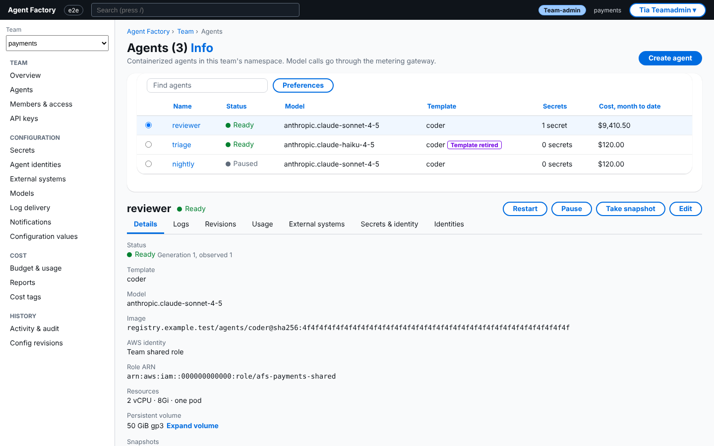 | 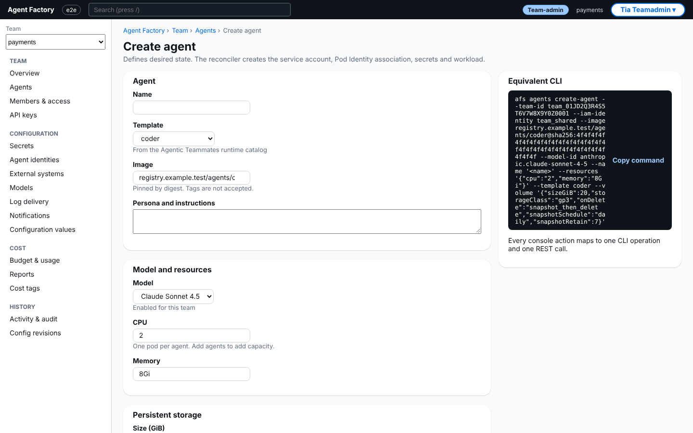 |
| **Budget and usage** | **Secrets, as a team viewer: metadata only** |
| 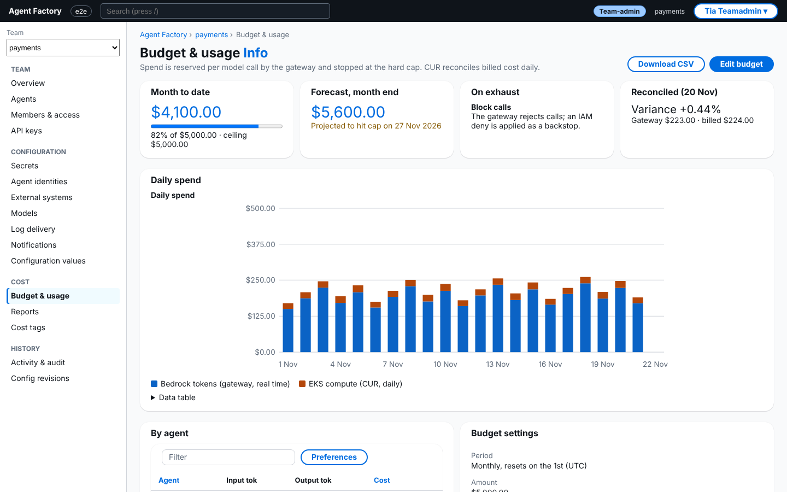 | 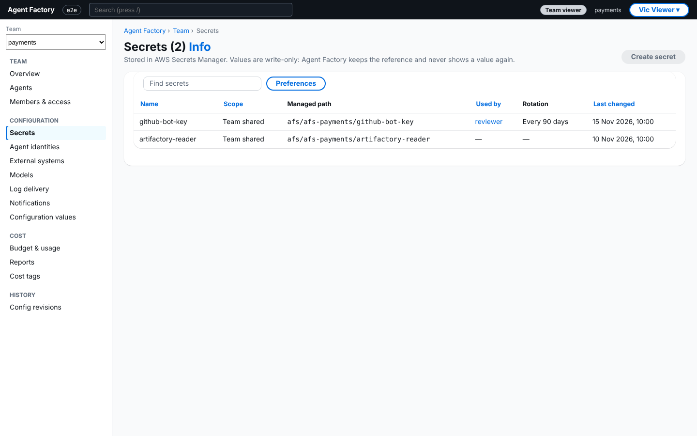 |
| **Swarm pools and stages** | **CVE work order, as the security operator** |
| 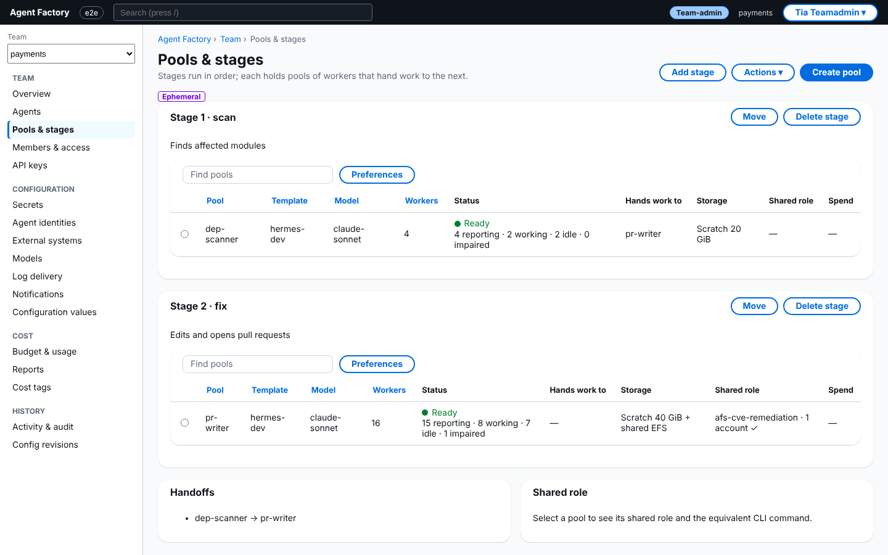 | 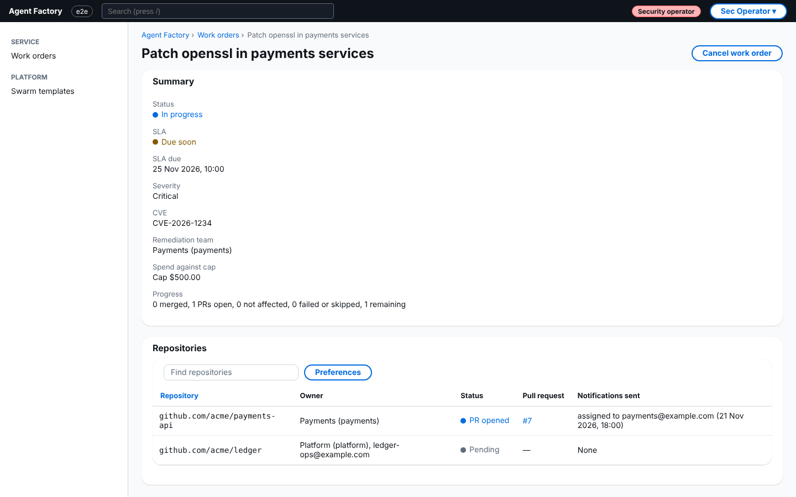 |

More screens are in the [console guide](https://github.com/stainedhead/enterprise-agent-factory-service-website/blob/main/user-docs/console.md),
and the original design mockups for every role are in [docs/ui/](docs/ui/).

## Architecture

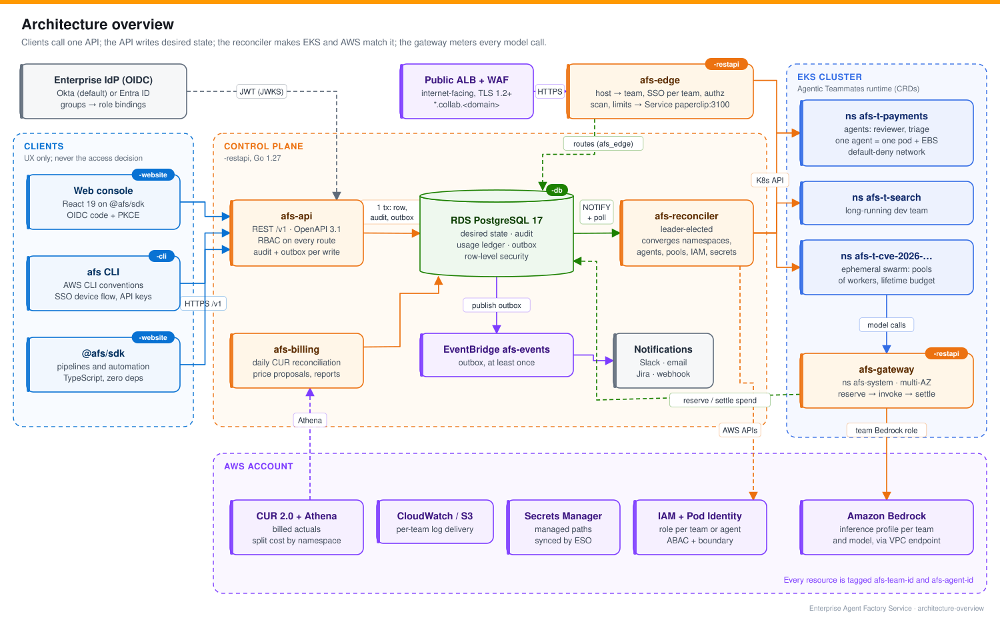

### The orchestration agent and model access (1.1.0)

Every team gets one orchestration agent when the team is created, shown apart from the team's other agents.
Only it has endpoints outside the cluster: `afs-edge` forwards a public or a private hostname to it at the level
the team-admin chose, capped by the service admin's limit. Every model call passes the service, team and agent
model lists at the gateway. The full design is in the [team orchestration agent PRD](team-orchestration-agent-PRD.md).

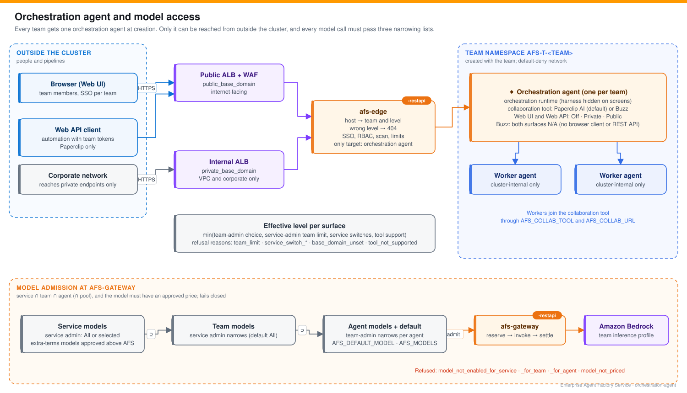

| Orchestration endpoints (service admin) | Orchestration agent, collaboration tab (team admin) |
|---|---|
| 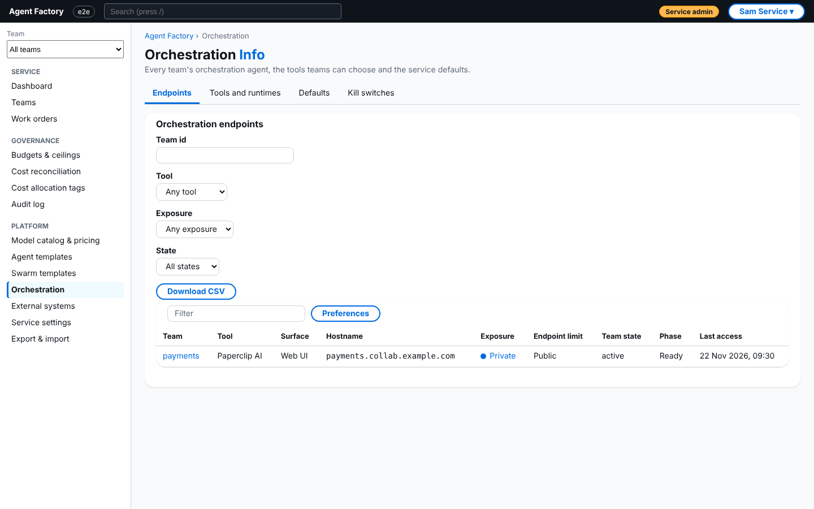 | 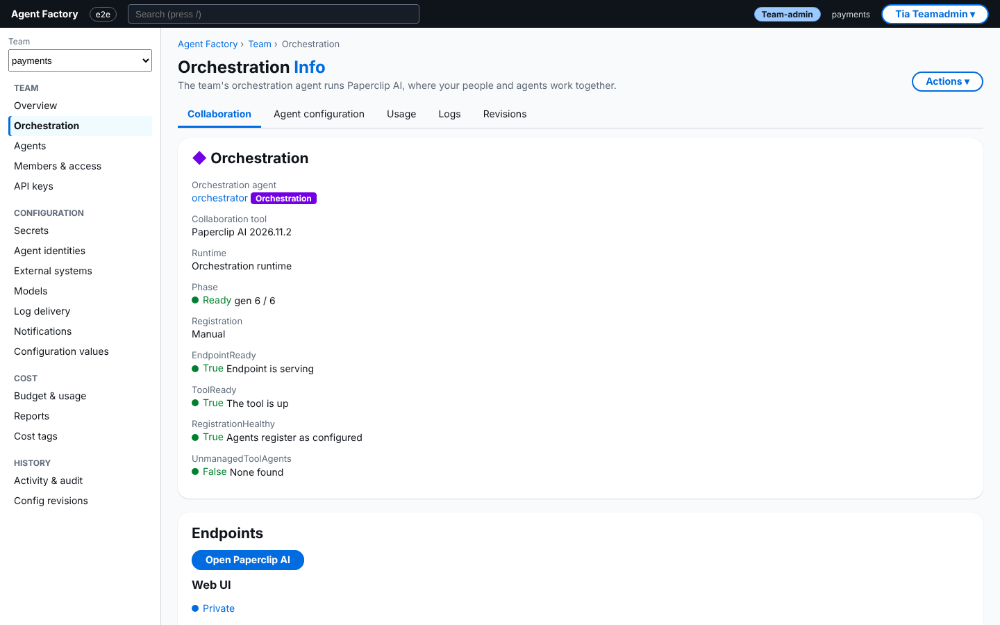 |
| **Orchestration agent configuration** | **Orchestration agent, as a team viewer** |
| 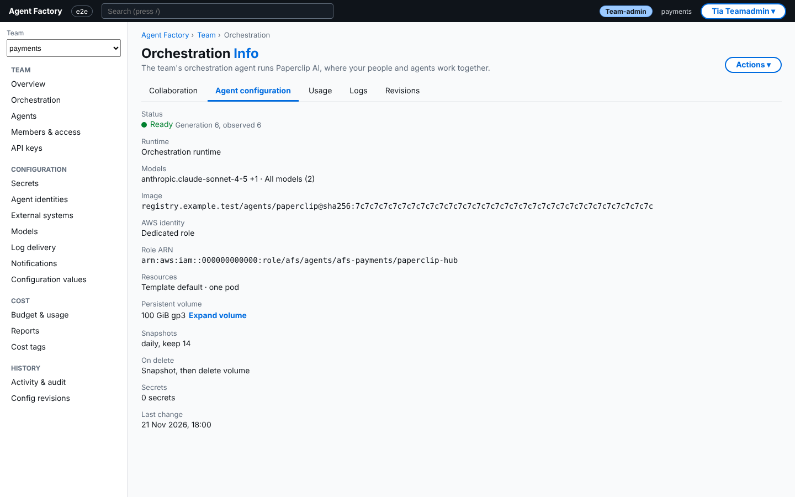 | 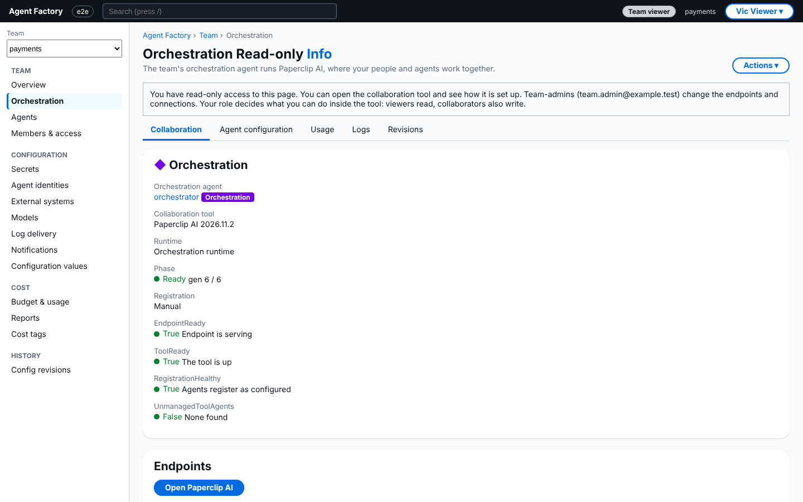 |

### The team model gateway (1.2.0)

A team can run its own `afs-gateway` in its namespace. Besides Bedrock, it fronts OpenAI-compatible **routes**: service
endpoints the team opts in to (OpenAI, OpenRouter, Nous Portal, OpenCode, Azure OpenAI, Vertex AI) and the team's own,
including inference it runs itself. Agents get one base URL per route (`AFS_LLM_<ROUTE>_BASE_URL`) and never hold the
upstream key; per-token routes are reserved and settled against the team budget like Bedrock, and `afs-billing`
reconciles each provider's bill. Service admins switch each provider on or off, Bedrock included. Design:
[team model gateway PRD](model-endpoint-gateway-PRD.md); wire format: [gateway contract §12](docs/contracts/gateway-contract.md#12-model-routes-team-gateway-and-provider-switches-v120).

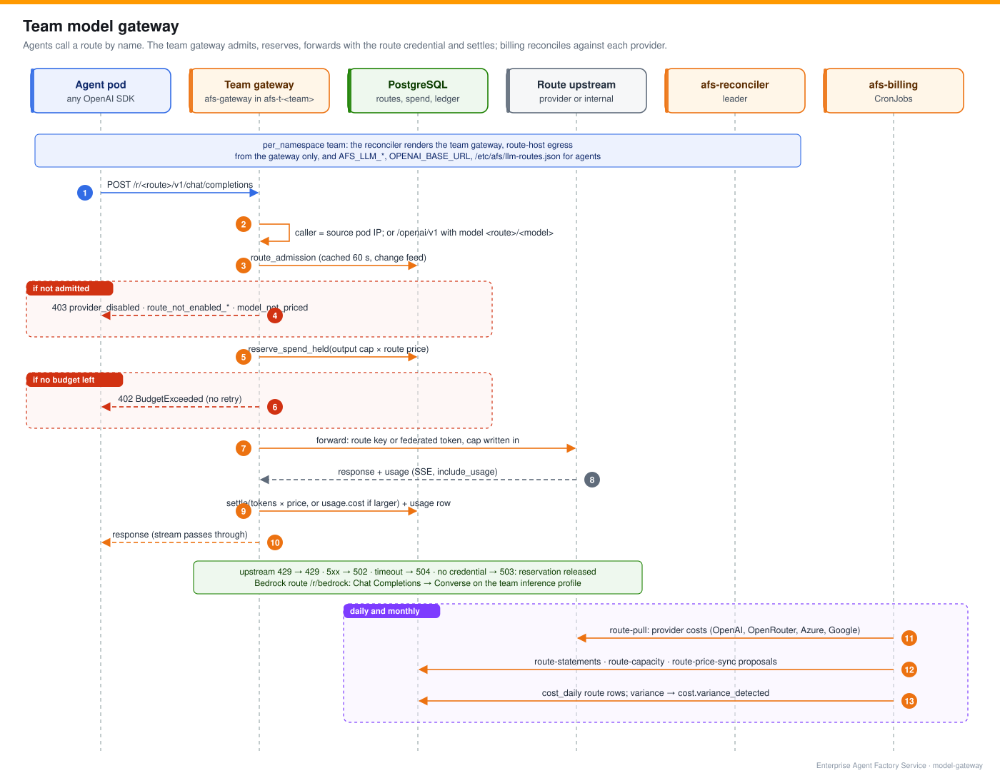

### Governed MCP servers (1.3.0)

The same team gateway serves MCP at `$(AFS_GATEWAY_URL)/mcp`. Service admins and security operators keep a catalog of
reviewed servers (remote, corporate, or hosted in the team namespace behind `afs-mcp-bridge`); teams switch servers on,
may register their own when allowed, and narrow them per agent. Every tool, resource and prompt is pinned by digest and
changes are held for review; policy narrows service → team → agent and a block anywhere wins. The gateway holds every
credential (static, OAuth, workload federation, SigV4), never passes a token through, and records each call in an
append-only ledger. Large catalogs use a search mode with three meta-tools. Design: [MCP gateway PRD](mcp-gateway-PRD.md);
wire format: [gateway contract §13](docs/contracts/gateway-contract.md).

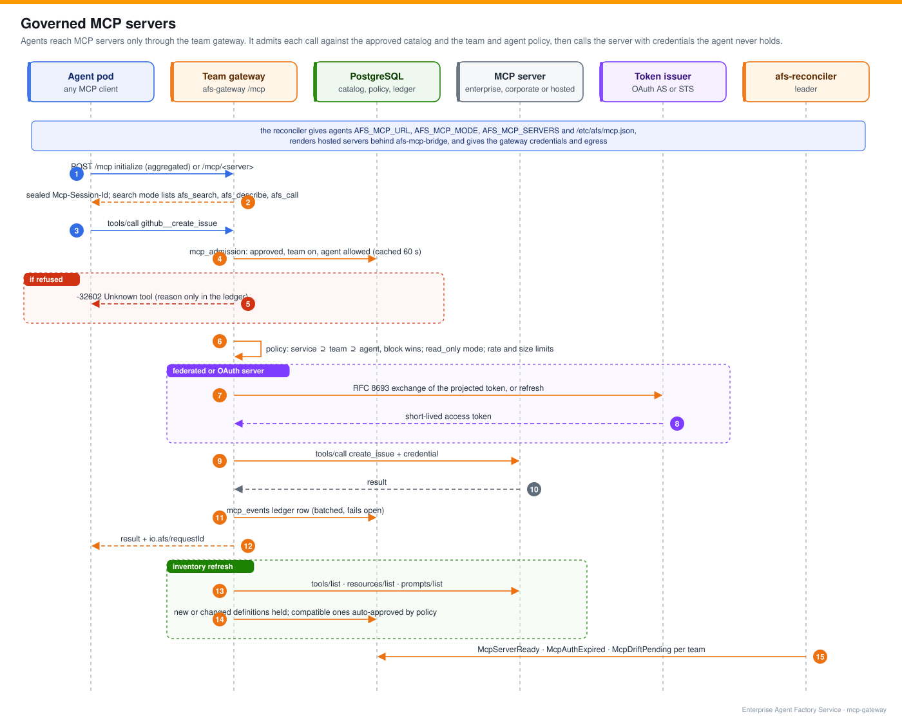

| Component | Repository | Role |
|---|---|---|
| `afs-api` | [-restapi](https://github.com/stainedhead/enterprise-agent-factory-service-restapi) | The REST API and the security boundary. Authenticates, authorizes every route, writes desired state with an audit record and an outbox event in one transaction |
| `afs-reconciler` | -restapi | Leader-elected. Listens to the database change feed and converges namespaces, workloads, policies, IAM, secrets, inference profiles and log delivery; reverts drift |
| `afs-gateway` | -restapi | The only path from agents to Bedrock and, since 1.2.0, to OpenAI-compatible model routes. Shared in `afs-system` or one per team namespace. Identifies the caller by pod, admits, reserves spend, invokes, settles; fails closed |
| `afs-billing` | -restapi | Daily CUR reconciliation, provider cost pulls and statements for routes, price proposals from the AWS Price List and LiteLLM's list, scheduled reports |
| PostgreSQL schema | [-db](https://github.com/stainedhead/enterprise-agent-factory-service-db) | Desired state, audit, usage ledger, outbox; roles per service and row-level security |
| `afs` CLI | [-cli](https://github.com/stainedhead/enterprise-agent-factory-service-cli) | AWS CLI conventions for people and automation |
| `@afs/sdk` and console | [-website](https://github.com/stainedhead/enterprise-agent-factory-service-website) | TypeScript SDK generated from the API contract, and the web console built on it |

The API writes intent; the reconciler makes the world match it and reports status back. That keeps the API
free of Kubernetes and lets a restored database plus a new cluster converge with no manual steps.

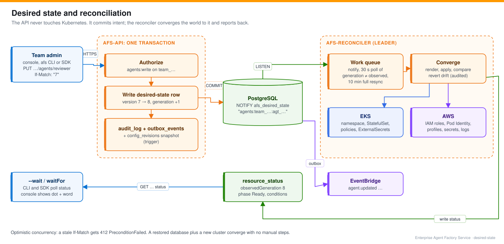

More diagrams, each with its source: [identity and access](docs/diagrams/identity-access.svg),
[repositories and contracts](docs/diagrams/repository-map.svg) and the [diagram index](docs/diagrams/README.md).
The design itself is [docs/solution-design.md](docs/solution-design.md), with decisions in
[docs/architectural-decision-record.md](docs/architectural-decision-record.md).

## Per-tenant isolation

Isolation is the default, in eight layers. Namespace restrictions are the primary network boundary; IAM
attribute-based access, managed secret paths and PostgreSQL row-level security back it up.

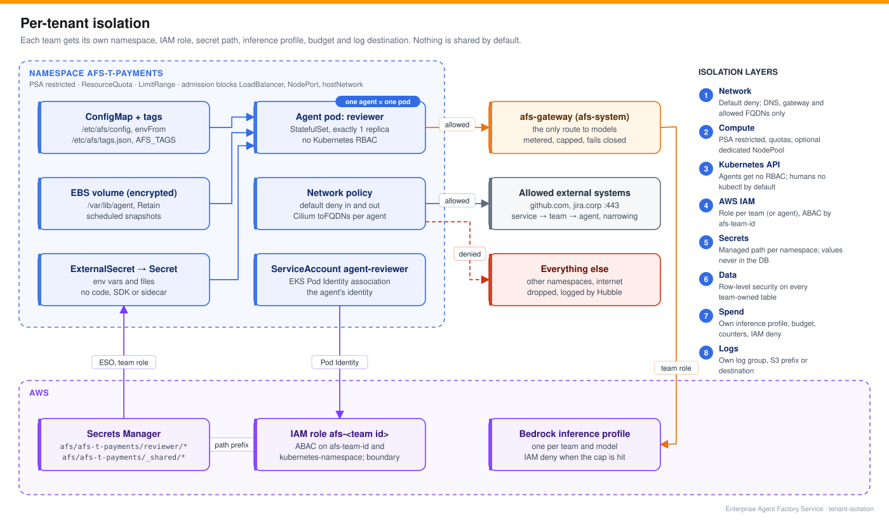

Namespaces share a kernel, which is acceptable for internal tenants. Teams that handle regulated data can be
given a dedicated Karpenter NodePool (`isolationTier: dedicated`).

## Budgets that cannot run away

Spend is enforced near real time on every model call, not discovered in next month's bill. The gateway
reserves the worst-case cost before invoking Bedrock and settles to the actual tokens after; the daily
billing job reconciles the estimate against the AWS Cost and Usage Report and alerts on variance.

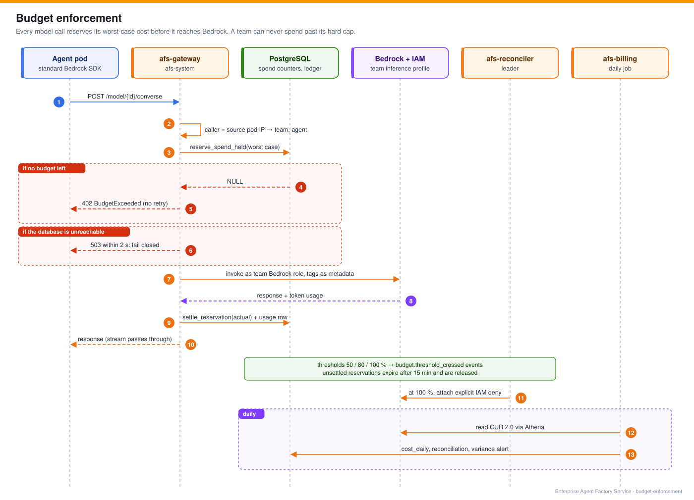

## Swarms and CVE remediation

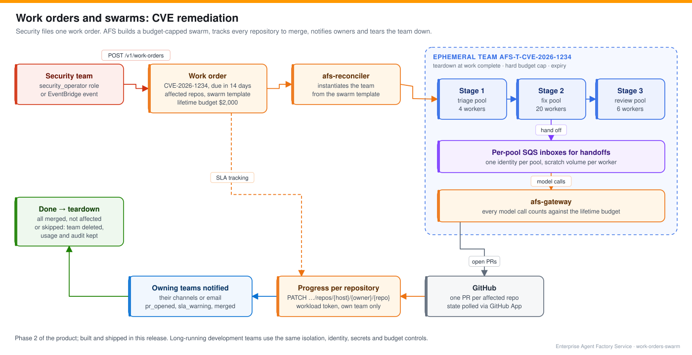

A work order names the vulnerability, the affected repositories, a swarm template, a due date and a lifetime
budget. The reconciler creates the ephemeral team, its pools report progress per repository with a workload
token, owners are notified through their own channels, and the team is torn down when every repository is
merged, not affected or skipped. Usage and audit are kept.

## Roles

| Role | Scope | Can |
|---|---|---|
| `service_admin` | Whole service | Everything: teams, ceilings, model catalog and prices, identity providers, tags, external systems catalog, export and import |
| `team_admin` | One team | Agents, members, secrets, budgets up to the ceiling, configuration, identities, log delivery, notifications, pools |
| `team_viewer` | One team | Read configuration, status, usage, reports and audit; secrets show metadata, never values |
| `security_operator` | Work orders | Create and track work orders and read swarm templates; no team access |

Bindings go to users or IdP groups. The full permission catalog is in the
[API contract](docs/contracts/api-contract.md#3-permission-catalog).

## The repositories

Each child is an independent repository. Clone them next to this one (see
[getting started](user-docs/getting-started.md)); the root `.gitignore` keeps them untracked.

| Repository | Language | What it is | Read first | User docs |
|---|---|---|---|---|
| [enterprise-agent-factory-service-db](https://github.com/stainedhead/enterprise-agent-factory-service-db) | SQL, Go 1.27 | PostgreSQL 17 schema and migrations, roles and row-level security, `afs-migrate`; migrations 000001–000026, release 1.3.0; lockstep with `-restapi` | [README](https://github.com/stainedhead/enterprise-agent-factory-service-db#readme) | [user-docs](https://github.com/stainedhead/enterprise-agent-factory-service-db/blob/main/user-docs/README.md) |
| [enterprise-agent-factory-service-restapi](https://github.com/stainedhead/enterprise-agent-factory-service-restapi) | Go 1.27 | `afs-api`, `afs-reconciler`, `afs-gateway`, `afs-billing`, `afs-edge`; release 1.3.0 (API 1.6.0, 276 operations; governed MCP servers and `afs-mcp-bridge`), lockstep with `-db`; owns `api/openapi.yaml` | [README](https://github.com/stainedhead/enterprise-agent-factory-service-restapi#readme) | [user-docs](https://github.com/stainedhead/enterprise-agent-factory-service-restapi/blob/main/user-docs/README.md) |
| [enterprise-agent-factory-service-cli](https://github.com/stainedhead/enterprise-agent-factory-service-cli) | Go 1.27 | `afs` CLI, AWS CLI conventions; release 1.3.0, 273 commands for 276 operations | [README](https://github.com/stainedhead/enterprise-agent-factory-service-cli#readme) | [user-docs](https://github.com/stainedhead/enterprise-agent-factory-service-cli/blob/main/user-docs/README.md) |
| [enterprise-agent-factory-service-website](https://github.com/stainedhead/enterprise-agent-factory-service-website) | TypeScript 7, Bun | `@afs/sdk` and the web console; release 1.3.0 on `main` (PR #15, MCP screens), after 1.2.0 (PR #14) | [README](https://github.com/stainedhead/enterprise-agent-factory-service-website#readme) | [user-docs](https://github.com/stainedhead/enterprise-agent-factory-service-website/blob/main/user-docs/README.md) |

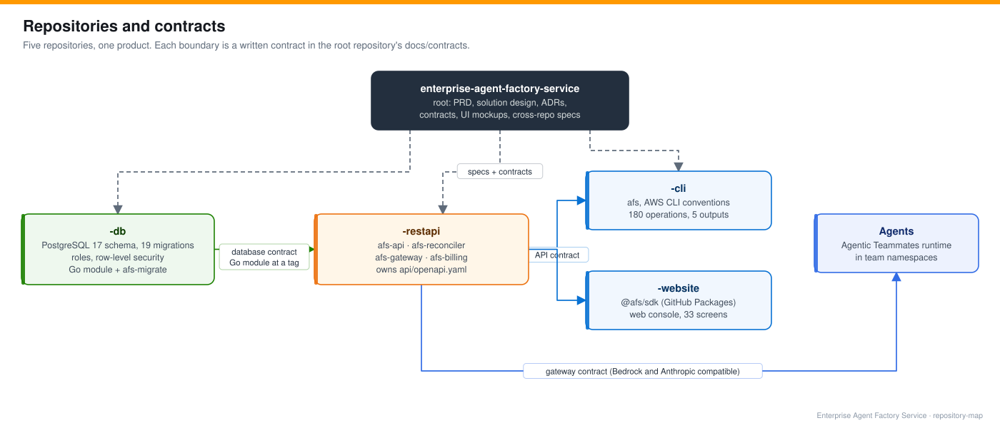

## Related projects

- [agentic-teams](https://github.com/stainedhead/agentic-teams): the map of the repositories that let
  autonomous SDLC agents work as attributable teammates (Hermes and CLI harness images, Paperclip, Okta-backed
  credentials). AFS runs those agents; it does not build them.
- [software-factory-manager](https://github.com/stainedhead/software-factory-manager): builds `facman`, a
  terminal UI and headless CLI that gives lab machines and CI runners a consistent toolset for working in
  software factories. A related project from the same author.

## Documentation for users

Start with the [adoption guide](user-docs/adoption-guide.md), then go to the guide for what you are doing:

| You are | You want to | Go to |
|---|---|---|
| Platform engineer | Provision the database and apply migrations | [-db getting started](https://github.com/stainedhead/enterprise-agent-factory-service-db/blob/main/user-docs/getting-started.md), [operations](https://github.com/stainedhead/enterprise-agent-factory-service-db/blob/main/user-docs/operations.md) |
| Platform engineer | Deploy and configure the control plane | [-restapi deployment](https://github.com/stainedhead/enterprise-agent-factory-service-restapi/blob/main/user-docs/deployment.md), [configuration](https://github.com/stainedhead/enterprise-agent-factory-service-restapi/blob/main/user-docs/configuration.md), [reconciler](https://github.com/stainedhead/enterprise-agent-factory-service-restapi/blob/main/user-docs/reconciler.md), [observability](https://github.com/stainedhead/enterprise-agent-factory-service-restapi/blob/main/user-docs/observability.md) |
| Platform engineer | Host the console | [-website configuration](https://github.com/stainedhead/enterprise-agent-factory-service-website/blob/main/user-docs/configuration.md) |
| Service admin or team admin | Manage teams, agents, secrets and budgets in a browser | [Using the console](https://github.com/stainedhead/enterprise-agent-factory-service-website/blob/main/user-docs/console.md), [console examples](https://github.com/stainedhead/enterprise-agent-factory-service-website/blob/main/user-docs/console-examples.md) |
| Anyone | Use the command line | [afs getting started](https://github.com/stainedhead/enterprise-agent-factory-service-cli/blob/main/user-docs/getting-started.md), [command reference](https://github.com/stainedhead/enterprise-agent-factory-service-cli/blob/main/user-docs/reference/README.md) |
| Pipeline author | Automate in TypeScript | [Installing the SDK](https://github.com/stainedhead/enterprise-agent-factory-service-website/blob/main/user-docs/sdk.md), [SDK examples](https://github.com/stainedhead/enterprise-agent-factory-service-website/blob/main/user-docs/sdk-examples.md) |
| Integrator | Call the REST API directly | [API usage examples](https://github.com/stainedhead/enterprise-agent-factory-service-restapi/blob/main/user-docs/usage-examples.md), [authentication and limits](https://github.com/stainedhead/enterprise-agent-factory-service-restapi/blob/main/user-docs/authentication-and-limits.md) |
| FinOps | Reports, reconciliation, showback | [reports](https://github.com/stainedhead/enterprise-agent-factory-service-restapi/blob/main/user-docs/reports.md), [billing](https://github.com/stainedhead/enterprise-agent-factory-service-restapi/blob/main/user-docs/billing.md), [CLI budgets and reports](https://github.com/stainedhead/enterprise-agent-factory-service-cli/blob/main/user-docs/budgets-and-reports.md) |
| Security team | Run CVE work orders | [work orders (API)](https://github.com/stainedhead/enterprise-agent-factory-service-restapi/blob/main/user-docs/work-orders.md), [work orders (CLI)](https://github.com/stainedhead/enterprise-agent-factory-service-cli/blob/main/user-docs/work-orders.md) |
| Agent builder | Point an agent at the gateway | [Gateway contract](docs/contracts/gateway-contract.md) |

Agent-facing tool docs (for AI agents that drive `afs`) are in [skills/](skills/README.md).

## Contributing

Contributions are welcome in every repository. Read [CONTRIBUTING.md](CONTRIBUTING.md) first: it explains
where a change belongs, the spec-driven workflow, the quality gate each repository runs and how pull
requests are reviewed. Each repository also has an `AGENTS.md` with its rules for human and AI contributors.

| Change | Where |
|---|---|
| A feature that spans repositories | A spec in this repository's [specs/](specs/README.md), then one PR per child |
| An API change | `api/openapi.yaml` in -restapi first; the SDK and CLI follow |
| A table, role or policy | -db only, as a new migration |
| Requirements, design, contracts, diagrams | This repository |

## Status

All four code repositories are feature complete on `main` against the PRD and pass their quality gates in
CI. Still to come: end-to-end runs on a real EKS cluster and AWS account (restore drill and full-scale load
test included), and publishing the releases: `-db` and `-restapi` share version 1.3.0 (lockstep, tags pending), the `afs` CLI, `@afs/sdk` and the console are 1.3.0 on `main`; all tags are pending J. Release 1.2.0 adds the team model gateway and 1.3.0 governed MCP servers; live Azure and Google federation, provider billing fixtures, hosted MCP servers on EKS and IdP federation wait for cloud access ([1.2.0 deferred](model-endpoint-gateway-PRD.md#16-built-and-deferred-120), [1.3.0 deferred](mcp-gateway-PRD.md#21-built-and-deferred-130)). Until the releases are published, build from source as each repository's getting-started guide shows.

## License

[MIT](LICENSE)
