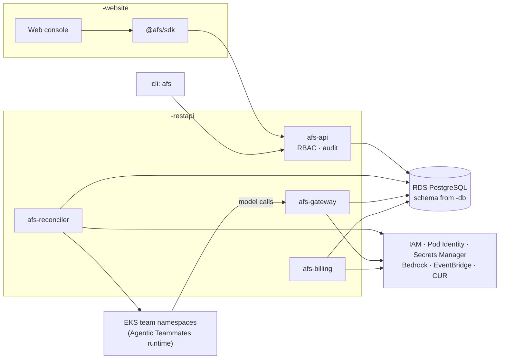

# enterprise-agent-factory-service

**The root of the Enterprise Agent Factory Service (AFS).** AFS is an internal platform-engineering
service that gives teams across the enterprise their own isolated software factory on AWS EKS: a
namespace environment running a team of containerized AI agents, with human teammates, agent identities,
secrets, model access, budgets and log delivery managed centrally. Long-running development and
maintenance teams come first; budgeted workloads, POCs and CVE remediation teams follow.

This repository is documentation only: product requirements, cross-repo design, UI mockups and
cross-repo specs. The code lives in four child repositories.

| Start here | |
|---|---|
| [INTENT.md](INTENT.md) | Why the product exists, goals and non-goals |
| [enterprise-agent-factory-service-initial-PRD.md](enterprise-agent-factory-service-initial-PRD.md) | Requirements and the console UI by role |
| [docs/solution-design.md](docs/solution-design.md) | Architecture: tenancy, identity, secrets, budgets, API and CLI |
| [AGENTS.md](AGENTS.md) | Rules for agents and contributors |

## The repositories

| Repository | Language | What it is |
|---|---|---|
| [enterprise-agent-factory-service-db](https://github.com/stainedhead/enterprise-agent-factory-service-db) | SQL, Go 1.27 | RDS PostgreSQL schema and migrations, roles and row-level security, `afs-migrate` |
| [enterprise-agent-factory-service-restapi](https://github.com/stainedhead/enterprise-agent-factory-service-restapi) | Go 1.27 | REST API with RBAC, reconciler, Bedrock metering gateway, billing reconciliation, OpenAPI contract |
| [enterprise-agent-factory-service-cli](https://github.com/stainedhead/enterprise-agent-factory-service-cli) | Go 1.27 | `afs` CLI following AWS CLI conventions |
| [enterprise-agent-factory-service-website](https://github.com/stainedhead/enterprise-agent-factory-service-website) | TypeScript 7 | `@afs/sdk` accelerator SDK and the web management console |



## Getting the set

```bash
git clone https://github.com/stainedhead/enterprise-agent-factory-service.git
cd enterprise-agent-factory-service
for r in db restapi cli website; do
  git clone https://github.com/stainedhead/enterprise-agent-factory-service-$r.git
done
```

The root `.gitignore` keeps the children untracked. See
[user-docs/getting-started.md](user-docs/getting-started.md) for toolchains.

## Developer workflow

Every repository uses the `dev-flow` and `repo` plugins from
[shared-plugins](https://github.com/stainedhead/shared-plugins). Cross-repo features are specified in this
repository's `specs/`; single-repo features in that repository's `specs/`.

## License

[MIT](LICENSE)
