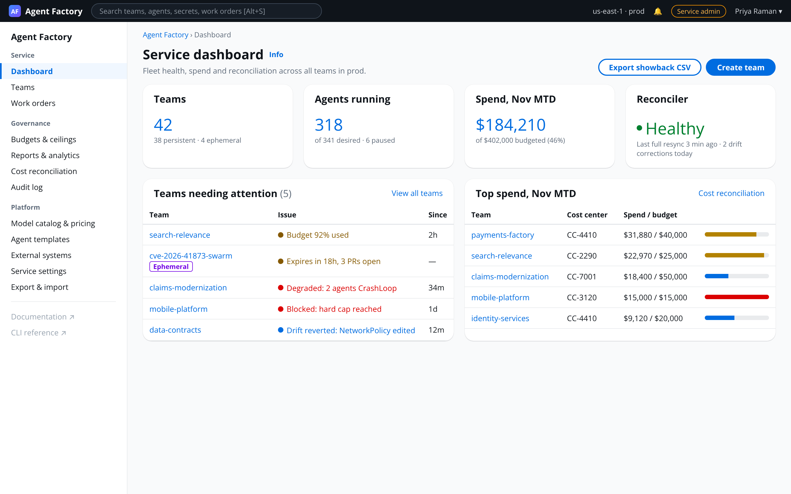
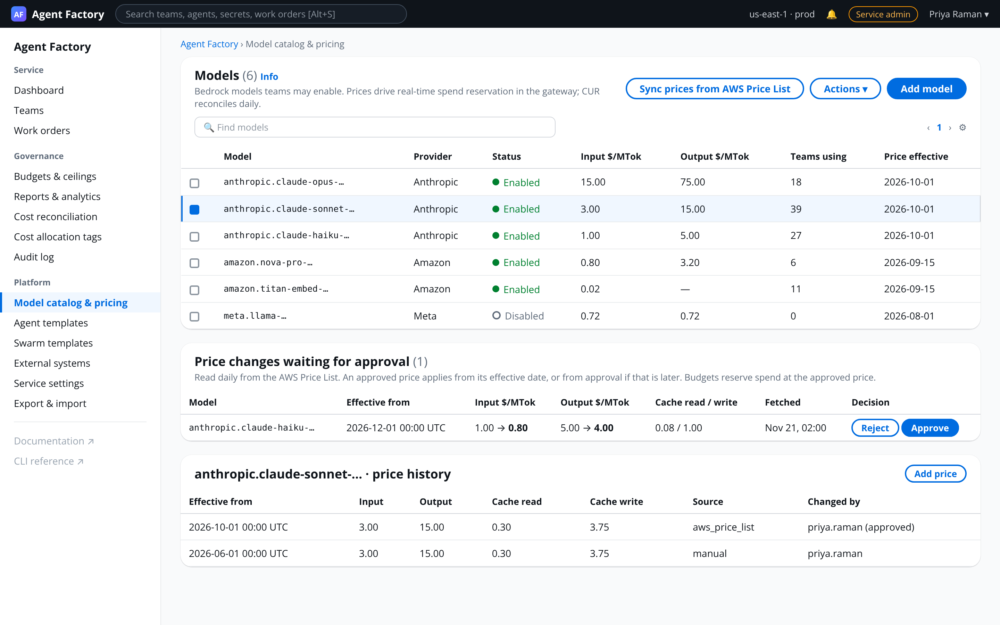

# Enterprise Agent Factory Service — Initial PRD

| | |
|---|---|
| **Status** | Draft for review |
| **Author** | J (Enterprise Architecture), drafted with Claude |
| **Date** | 2026-11-20 |
| **Repositories** | `enterprise-agent-factory-service` (this root), `-db`, `-restapi`, `-cli`, `-website` |
| **Design reference** | [docs/solution-design.md](docs/solution-design.md) |

---

## 1. Summary

The Enterprise Agent Factory Service (AFS) is an internal platform-engineering product. It gives
delivery teams across one enterprise their own **software factory**: an isolated environment on the
shared EKS platform that runs a team of containerized AI agents (the Agentic Teammates runtime), with the
team's people, agent identities, secrets, model access, budget and log delivery managed in one place.

A central platform team runs the service. Teams manage their own factory inside guardrails the platform
team sets. Phase 1 serves **long-running teams** that develop and maintain software. Later phases add
**short-lived, budgeted workloads**: proof-of-concept efforts and "swarm rentals" with a hard cost cap and
an expiry, and security-driven **CVE remediation** work orders.

Everything is reachable three ways, all through one REST API that enforces role-based access: a web
console that feels familiar to people who use the AWS Management Console, an `afs` CLI that follows
AWS CLI conventions, and a TypeScript SDK for automation.

## 2. Problem

- Teams want agents working on their backlog now, but each team building its own agent hosting creates
  duplicated infrastructure, uncontrolled model spend and unreviewed access to code and credentials.
- AWS billing data lags by hours, so a runaway agent can spend far past any budget before anyone sees it.
- Security needs every agent action to be attributable to a named agent and team, with secrets that never
  pass through ad-hoc tooling.
- Platform engineering needs one place to see the whole fleet, set guardrails and recover the environment
  from configuration alone.

## 3. Goals and non-goals

### Goals

| ID | Goal | Measure |
|---|---|---|
| G1 | A team-admin can stand up a working agent team without a platform ticket | New team to first running agent in under 30 minutes, self-service |
| G2 | Teams are isolated from each other | Zero cross-team network, IAM, secret or data access in isolation tests |
| G3 | Model spend never exceeds a team's hard cap | Overspend bounded by one in-flight request per agent; verified by load test |
| G4 | Every change and every agent action is attributable | 100% of mutations in the audit log; AWS calls carry team and agent session tags |
| G5 | The environment is recoverable from configuration | Fresh cluster + restored DB converges to full state with no manual steps |
| G6 | One API, three clients, one access model | Every console action has a CLI operation and an SDK method; RBAC enforced only in the API |

### Non-goals (this release)

- Building the agent runtime itself (Agentic Teammates owns images and harnesses).
- Multi-enterprise or external customers. This is single-enterprise, internal.
- Chargeback invoicing. AFS produces showback data by cost center; finance systems do the rest.
- Running ephemeral swarms and CVE work orders end to end (designed now, built in phases 2 and 3).

## 4. Users and roles

| Role | Who | Scope | Typical jobs |
|---|---|---|---|
| **Service admin** | Central platform engineering team | Whole service | Create and retire teams, set budget ceilings and quotas, manage the model catalog and prices, watch fleet health and spend, review audit, export/import configuration |
| **Team-admin** | Tech lead or engineering manager of a delivery team | One or more teams they are granted | Define agents, manage members and API keys, create and bind secrets, set the budget up to the ceiling, configure egress, log delivery and notifications |
| **Team viewer** | Engineers, product owners, FinOps, SRE, auditors | One or more teams | See configuration, status, usage, costs and history. Never see secret values |

Roles are granted to people or to IdP groups, per team. A person can be team-admin on one team and viewer
on another. Only service admins grant service admin.

### Permission summary

| Capability | Service admin | Team-admin | Team viewer |
|---|:-:|:-:|:-:|
| Create / delete teams, set ceilings and quotas | ✓ | | |
| Edit team settings, suspend / resume | ✓ | ✓ | |
| Agents: create, edit, scale, pause, restart, delete | ✓ | ✓ | |
| Members and API keys | ✓ | ✓ (team roles only) | |
| Secrets: create, rotate, bind | ✓ | ✓ | |
| Secrets: see names, references, usage | ✓ | ✓ | ✓ |
| Budget: set amount (≤ ceiling), thresholds | ✓ | ✓ | |
| Usage, costs, reconciliation | ✓ | ✓ | ✓ |
| Audit and config revisions (own team) | ✓ | ✓ | ✓ |
| Model catalog, pricing, service settings, export / import | ✓ | | |

The full matrix is in [solution design §5.3](docs/solution-design.md#53-permission-matrix) and is
implemented once, in the REST API.

## 5. User experience

### 5.1 Design principles

1. **Familiar to AWS console users.** Dark global header with search, region/environment and identity;
   left service navigation; breadcrumbs; page header with *Info* link and actions on the right; tables
   with a text filter, property filters, pagination and a preferences gear; one primary (filled) action per
   page; *Actions* dropdown for the rest; create flows as multi-step wizards with a final review step;
   status shown as a coloured dot plus a word, never colour alone.
2. **The role is always visible.** The header shows the active role and team (orange: service admin,
   blue: team-admin, grey: team viewer). The team switcher in the left navigation lists only teams the
   user is bound to.
3. **Controls follow permissions.** Actions a role cannot perform are disabled, with a tooltip naming the
   role required ("Requires team-admin"), rather than hidden, so viewers understand what exists. Admin-only
   areas (model catalog, service settings) are hidden from team roles. The API's decision is final; a 403
   shows an access-denied alert.
4. **Every action is scriptable.** Create forms show the equivalent `afs` CLI command; every screen maps to
   documented API operations.
5. **Secrets are write-only everywhere.** The UI shows names, references, rotation and usage; values are
   entered once and never displayed.
6. **Desired state vs. actual state.** Resources show reconcile status (`Pending`, `Reconciling`, `Ready`,
   `Degraded`) and the generation observed, so users can see when a change has been applied.
7. **Accessible.** WCAG 2.2 AA: keyboard reachable, labelled inputs, status and alert regions announced.

### 5.2 Information architecture

```
Service admin (global navigation)            Team context (team-admin / team viewer)
├─ Service                                    ├─ Team
│  ├─ Dashboard                               │  ├─ Overview
│  ├─ Teams                                   │  ├─ Agents
│  └─ Work orders            (phase 3)        │  ├─ Members & access
├─ Governance                                 │  └─ API keys                (team-admin)
│  ├─ Budgets & ceilings                      ├─ Configuration
│  ├─ Cost reconciliation                     │  ├─ Secrets
│  └─ Audit log                               │  ├─ Agent identities
└─ Platform                                   │  ├─ Network egress
   ├─ Model catalog & pricing                 │  ├─ Models
   ├─ Agent templates                         │  ├─ Log delivery
   ├─ Service settings                        │  └─ Notifications
   └─ Export & import                         ├─ Cost
                                              │  └─ Budget & usage
                                              └─ History
                                                 ├─ Activity & audit
                                                 └─ Config revisions
```

Service admins can open any team and see the team context with full rights.

### 5.3 Screens by role

The mockups below are high-fidelity wireframes for review. Data is illustrative. HTML sources are in
[docs/ui/source/](docs/ui/source/) and can be opened in a browser.

#### Service admin

**S1 · Service dashboard.** Fleet at a glance: team and agent counts, month-to-date spend against total
budget, reconciler health, teams needing attention (budget pressure, expiring ephemeral teams, degraded
agents, hard-cap blocks, reverted drift), top spenders, and a banner when daily CUR reconciliation finds
variance over threshold.



**S2 · Teams.** Every team with kind (persistent or ephemeral), state, agent count, spend against budget,
cost center and expiry. Filter by kind and state; select a team for *View details* or *Actions*
(suspend, resume, set ceiling, delete).


**S3 · Create team, step 1.** Wizard: details → models & network → budget → members → review. Step 1
chooses the lifecycle (persistent, or ephemeral for budgeted workloads and POCs), names the team (which
fixes its namespace), and sets the guardrails only service admins control: budget ceiling, compute quota
and isolation tier.


**S4 · Model catalog and pricing.** Bedrock models teams may enable, with effective-dated prices that the
gateway uses for real-time spend reservation. Prices sync from the AWS Price List and can be adjusted
when reconciliation shows variance.



**S5 · Audit log.** Append-only record of every state change, every denied request and every drift
correction, filterable by team, actor, action and outcome, downloadable as CSV.


#### Team-admin

**T1 · Team overview.** Identity of the environment (namespace, cluster, IAM role, cost center), reconcile
status and conditions, budget burn, agent health and recent activity.


**T2 · Agents.** Agents with status, model, runtime template, bound secrets and cost. Selecting an agent
opens its detail panel with *Restart*, *Pause* and *Edit*, and tabs for secrets and identity, usage, logs
and revisions. An agent is one identity and runs as exactly one pod, so there is no replica count or
*Scale* action. A team adds capacity by adding agents (see AGT-7).


**T3 · Create agent.** Template from the Agentic Teammates catalog, image pinned by digest, persona, model
(limited to models enabled for the team), resources, and secret bindings as environment variables or
files. There is no replicas field: each agent is a single pod with its own ServiceAccount and IAM identity.
Binding lists only the team's shared secrets and this agent's own secrets. The side panel shows the
equivalent CLI command.


**T4 · Secrets, with create dialog.** Secrets are stored in AWS Secrets Manager. *Create secret* asks
only for a scope (*Team shared* or one agent), a name, a description and the value, and sends the value
once, straight to Secrets Manager. The user never types or edits the Secrets Manager path. AFS builds it
from the hierarchy `<service>/<namespace>/<agent>/<secret-name>`, or `<service>/<namespace>/_shared/<secret-name>`
for team-shared secrets (SEC-5), and shows it read-only. The table shows scope, the managed path, usage,
rotation and last change; the value column always reads "Write-only".


**T5 · Budget and usage.** Month-to-date spend, month-end forecast with projected cap date, the action at
exhaustion, the latest reconciliation result, daily spend split between Bedrock tokens (real time) and EKS
compute (daily from CUR), and spend by agent.


**T6 · Members and access.** Role bindings for people and IdP groups. Team-admins grant team-admin or
team viewer on their own team; API keys for pipelines are on the second tab.


#### Team viewer

**V1 · Team overview, read-only.** The same page as T1 with an information banner. *Edit*, *Actions* and
*Create agent* are disabled with a "Requires team-admin" tooltip. The *API keys* navigation item is not
shown.


**V2 · Secrets, read-only.** Viewers see which secrets exist, their scope, managed path and where they
are used, so they can troubleshoot, but cannot create, rotate or bind them, and nobody sees values.


#### Later phases: budgeted workloads, POCs and CVE remediation

**P2 · Ephemeral team budget (phase 2).** For a POC or swarm rental the budget step asks for a lifetime
hard cap, an expiry and the teardown rule, and shows an estimate of daily cost and when the cap would be
reached.

**Swarms and pools (phase 2).** A swarm is an ephemeral team, and it still runs several agents with
different identities that work together, for example a scanner, a PR writer and a reviewer. The
difference is that each of those agents can be a **pool**: one definition with its own identity (one
ServiceAccount, one IAM role, its own secrets and GitHub identity) and a worker count. Workers in a pool do
similar work across many repositories, so they share the pool's identity instead of having one each. The
model is swarm (ephemeral team, one lifetime budget and expiry) → pools (one identity each, N workers) →
workers (pods). Pools in a swarm can be grouped (for example "scan" and "fix" stages) and hand work to
each other. Audit and usage are attributed to the pool, with the worker's pod name recorded for
troubleshooting. Long-running team agents stay one identity, one pod (AGT-7).


**P3 · Work orders (phase 3).** CVE work orders from the security team with affected repos, PR progress,
owning teams to notify, SLA due date and the remediation team assigned.


### 5.4 Key flows

| Flow | Role | Steps |
|---|---|---|
| Onboard a team | Service admin | Teams → Create team → details, guardrails → models & egress → budget → first team-admin → review → team appears `Reconciling`, then `Ready` |
| Stand up agents | Team-admin | Secrets → Create secret → Agents → Create agent → bind secrets → status `Running` |
| Respond to budget alert | Team-admin | Alert (Slack/email) → Budget & usage → see top agents → pause or scale an agent, or raise budget up to ceiling |
| Hard cap reached | System → team-admin | Gateway blocks calls → agents receive `BudgetExceeded` → team shows `Blocked (cap)` → team-admin asks service admin for a higher ceiling or waits for reset |
| Investigate | Team viewer | Overview → conditions → Activity & audit → Config revisions |
| Recover environment | Service admin | Restore DB (PITR) or import bundle → reconciler converges → dashboard shows `Healthy` |
| POC (phase 2) | Service admin / team-admin | Create team → Ephemeral → cap + expiry → run → automatic teardown; config and audit retained |

## 6. Functional requirements

Priorities: **P0** required for the first production release (phase 1), **P1** phase 1 follow-up,
**P2** later phase (designed now).

### 6.1 Teams and environments

| ID | Requirement | Pri |
|---|---|---|
| TEAM-1 | Service admins create, update, suspend, resume and delete teams | P0 |
| TEAM-2 | Each team gets one namespace `afs-t-<name>` with Pod Security `restricted`, ResourceQuota and LimitRange | P0 |
| TEAM-3 | Default-deny NetworkPolicy for ingress and egress; allow DNS, the LLM gateway and the team's egress allow-list only | P0 |
| TEAM-4 | Admission policy blocks teams from altering their own isolation (NetworkPolicies, LoadBalancer/NodePort Services, hostNetwork, privileged pods) | P0 |
| TEAM-5 | Team status shows reconcile phase, observed generation and conditions | P0 |
| TEAM-6 | Optional isolation tier assigns a dedicated node pool | P1 |
| TEAM-7 | Ephemeral teams require an expiry and lifetime budget, and are torn down automatically | P2 |

### 6.2 Agents and identity

| ID | Requirement | Pri |
|---|---|---|
| AGT-1 | Team-admins create, update, pause, restart and delete agents | P0 |
| AGT-2 | Agents use templates from the Agentic Teammates catalog; images are pinned by digest | P0 |
| AGT-3 | Each agent gets its own ServiceAccount; AWS access via EKS Pod Identity with session tags `afs-team-id`, `afs-agent-id` | P0 |
| AGT-4 | Agents have no direct Bedrock permission; model calls go through the gateway | P0 |
| AGT-5 | External identities (GitHub App installation, bot accounts) are modeled per agent with credentials as secret references | P1 |
| AGT-6 | Optional per-agent IAM role for least privilege | P1 |
| AGT-7 | One agent is one identity and one pod (a StatefulSet with one replica, so the name, ServiceAccount, IAM session and audit trail stay stable). There is no replica count. A team scales by adding agents. Phase 2 swarm pools are the exception (AGT-8) | P0 |
| AGT-8 | Swarms (ephemeral teams) hold several pools that work together. Each pool has its own identity, secrets and a worker count; its workers share that identity. Pools can be grouped into stages. The swarm has one lifetime budget; usage and audit are attributed to the pool, with the worker pod recorded | P2 |

### 6.3 Secrets

| ID | Requirement | Pri |
|---|---|---|
| SEC-1 | AFS stores Secrets Manager references and metadata only; no secret value is stored, logged or returned | P0 |
| SEC-2 | Create through AFS only: the user gives scope, name and value; the value goes straight to Secrets Manager. Registering an arbitrary existing ARN is not offered, because it would bypass the managed hierarchy | P0 |
| SEC-3 | Bind secrets to agents as env vars or files; delivered by External Secrets Operator. A team-shared secret can be bound to any agent in the team; an agent secret only to its own agent | P0 |
| SEC-4 | Rotate: new value, rolling restart of bound agents | P1 |
| SEC-5 | AFS alone sets the Secrets Manager name: `<service>/<namespace>/<agent-name>/<secret-name>`, or `<service>/<namespace>/_shared/<secret-name>`. `<service>` is the installation's prefix (service setting, default `afs`). Users cannot set or change the path; team slug, agent name and secret name are immutable once created. IAM policies are prefix rules on this path: `afs-api` writes under `<service>/*`, a team's secret store reads `<service>/<namespace>/*`, and a per-agent role reads only `<service>/<namespace>/<agent-name>/*` plus `_shared/*`. The `afs-team-id` tag stays as a second check | P0 |

### 6.4 Budgets, usage and cost

| ID | Requirement | Pri |
|---|---|---|
| BUD-1 | Service admins set a budget ceiling per team; team-admins set the budget up to it | P0 |
| BUD-2 | Gateway reserves worst-case cost before each model call and settles to actual; rejects with `BudgetExceeded` when the cap would be exceeded | P0 |
| BUD-3 | IAM explicit deny on the team's Bedrock role when the cap is reached (backstop), removed on reset or increase | P0 |
| BUD-4 | Alerts at configurable thresholds (default 50/80/100%), once per period per threshold | P0 |
| BUD-5 | Usage by agent, model and day in near real time | P0 |
| BUD-6 | Daily CUR reconciliation of Bedrock (by inference-profile tag) and EKS compute (split cost allocation by namespace); variance alerts over 3% | P1 |
| BUD-7 | Showback export by cost center | P1 |
| BUD-8 | Lifetime budgets with expiry for ephemeral teams | P2 |

### 6.5 People and access

| ID | Requirement | Pri |
|---|---|---|
| ACC-1 | SSO via the enterprise OIDC IdP: auth code + PKCE (web), device code (CLI) | P0 |
| ACC-2 | Roles service admin, team-admin, team viewer, bound to users or IdP groups, per team | P0 |
| ACC-3 | RBAC enforced in the REST API on every operation; `GET /v1/me` returns effective permissions for client UX | P0 |
| ACC-4 | Team API keys (team-admin or viewer, max 90 days, hashed, shown once) | P1 |
| ACC-5 | Optional read-only `kubectl` for team viewers via EKS access entries scoped to the namespace | P2 |

### 6.6 Configuration, recovery and audit

| ID | Requirement | Pri |
|---|---|---|
| CFG-1 | RDS PostgreSQL is the source of truth for desired state, with optimistic concurrency (`ETag`/`If-Match`) | P0 |
| CFG-2 | Reconciler applies desired state at startup and continuously; manual drift is reverted and audited | P0 |
| CFG-3 | Every change is versioned (config revisions) and every mutation is audited (append-only) | P0 |
| CFG-4 | PITR backups and cross-region/cross-account snapshot copies | P0 |
| CFG-5 | Export a versioned, checksummed bundle (no secret values); import with ARN/account mapping and dry-run plan | P1 |
| CFG-6 | Restore a team to a previous revision | P1 |

### 6.7 Delivery and notifications

| ID | Requirement | Pri |
|---|---|---|
| OPS-1 | Per-team log delivery to CloudWatch, S3, OTLP, Splunk HEC or Datadog | P1 |
| OPS-2 | Events (team, agent, budget, drift, work order) published to EventBridge via a transactional outbox | P0 |
| OPS-3 | Notification channels per team: Slack, email, webhook, Jira | P1 |

### 6.8 Work orders (phase 3)

| ID | Requirement | Pri |
|---|---|---|
| WO-1 | Security creates CVE work orders (CVE id, affected repos, owning teams, SLA) by API or EventBridge | P2 |
| WO-2 | AFS assigns a capped remediation team, tracks PRs and notifies owning teams against the SLA | P2 |

### 6.9 Interfaces

| ID | Requirement | Pri |
|---|---|---|
| IF-1 | REST API `/v1`, OpenAPI 3.1 contract, AWS-style `maxResults`/`nextToken` pagination, error `{code, message, requestId}` | P0 |
| IF-2 | `afs` CLI: `afs <service> <operation>`, profiles, `--output json|table|text|yaml`, `--query`, pagination flags, `--cli-input-json`, `--generate-cli-skeleton`, AWS CLI exit codes | P0 |
| IF-3 | `@afs/sdk` TypeScript SDK generated from the contract with ergonomic resource clients and async pagination | P0 |
| IF-4 | Web console as specified in section 5, built on `@afs/sdk` with clean architecture | P0 |

## 7. Non-functional requirements

| Area | Requirement |
|---|---|
| Availability | API and gateway 99.9% monthly, multi-AZ. Gateway fails closed on spend |
| Performance | API p99 < 300 ms for reads; gateway adds < 25 ms p99; reconcile lag p95 < 60 s |
| Scale (initial) | 200 teams, 2,000 agents, 500 gateway requests/s |
| Security | No long-lived AWS keys; least privilege; secrets never in DB or logs; OWASP ASVS L2 for the API and console |
| Recovery | RPO 5 min (PITR); RTO 1 h for full environment rebuild |
| Audit retention | 400 days online, then archived |
| Accessibility | WCAG 2.2 AA |
| Supportability | OpenTelemetry traces and metrics from every service; runbooks for restore, rebuild, revoke |

## 8. Architecture and repositories

The architecture is in [docs/solution-design.md](docs/solution-design.md). Responsibilities map to
repositories:

| Repository | Language | Owns |
|---|---|---|
| [enterprise-agent-factory-service](https://github.com/stainedhead/enterprise-agent-factory-service) | Docs | This PRD, solution design, cross-repo specs, ADRs, UI mockups |
| [enterprise-agent-factory-service-db](https://github.com/stainedhead/enterprise-agent-factory-service-db) | SQL, Go | PostgreSQL schema and migrations, roles and row-level security, `afs-migrate`, embedded migrations Go module |
| [enterprise-agent-factory-service-restapi](https://github.com/stainedhead/enterprise-agent-factory-service-restapi) | Go 1.27 | `afs-api` (REST, RBAC, audit), `afs-reconciler`, `afs-gateway`, `afs-billing`, OpenAPI contract |
| [enterprise-agent-factory-service-cli](https://github.com/stainedhead/enterprise-agent-factory-service-cli) | Go 1.27 | `afs` CLI |
| [enterprise-agent-factory-service-website](https://github.com/stainedhead/enterprise-agent-factory-service-website) | TypeScript 7 | `@afs/sdk` (packages/sdk) and the web console (apps/console) |

Dependencies: `-restapi` imports `-db` (migrations) as a Go module; `-cli` and `-website` depend only on
the REST API contract in `-restapi/api/openapi.yaml`.

## 9. Release plan

| Milestone | Scope | Exit criteria |
|---|---|---|
| M0 Foundations | Repos, CI, schema v1, OpenAPI skeleton, auth middleware, `/v1/me` | All gates green; isolation and RLS tests pass |
| M1 Teams & access | TEAM-1..5, ACC-1..3, CFG-1..3, reconciler for namespace/network/IAM; console S1–S3, T1, T6, V1; CLI `teams`, `members` | A service admin onboards a team end to end in dev |
| M2 Agents & secrets | AGT-1..4, AGT-7, SEC-1..3, SEC-5; console T2–T4, V2; CLI `agents`, `secrets` | Agents run with bound secrets; viewers cannot change anything (tested) |
| M3 Spend control | BUD-1..5, OPS-2; gateway; console T5, S4 | Load test proves the hard cap; alerts fire once per threshold |
| M4 Production readiness | CFG-4, BUD-6/7, OPS-1/3, ACC-4, AGT-5/6, CFG-5/6, S5 | DR rebuild drill passes; security review signed off |
| Phase 2 | TEAM-7, BUD-8, AGT-8, P2 screen | First POC team runs and tears itself down |
| Phase 3 | WO-1/2, P3 screen | One CVE remediated across repos within SLA |

## 10. Risks and open questions

| # | Item | Owner | Proposed answer |
|---|---|---|---|
| Q1 | Which IdP: Entra ID or Okta? Groups claim available? | J | Assume OIDC with groups claim; both supported |
| Q2 | Network policy engine: VPC CNI or Cilium (FQDN egress)? | Platform | Cilium, for FQDN rules to SaaS endpoints |
| Q3 | Agentic Teammates interface: CRD or Helm chart? | Agentic Teammates | Reconciler renders whichever; confirm before M2 |
| Q4 | One shared cluster per environment, or per business unit? | J | Shared to start; `cluster_id` on teams allows split later |
| Q5 | Who may raise a ceiling during an incident (break-glass)? | J | Service admins only, audited, with an expiry |
| R1 | Namespace isolation shares the kernel | Security | Isolation tier with dedicated nodes for regulated work; gVisor/Kata later |
| R2 | Gateway is on the critical path for every model call | Platform | Multi-AZ, fail closed, latency SLO, load tested in M3 |
| R3 | Model price changes make estimates drift | FinOps | Daily reconciliation and variance alerts; price sync |
| R4 | TypeScript 7 tooling maturity (no ESLint type-aware rules yet) | Web | Biome for lint, `tsc` 7 for types; revisit when typescript-eslint supports TS 7 |

## 11. Glossary

| Term | Meaning |
|---|---|
| Software factory / team | An isolated namespace environment with its agents, people, secrets and budget |
| Persistent team | Long-running team with a monthly budget |
| Ephemeral team | Time-boxed team (POC, swarm rental, CVE remediation) with a lifetime cap and expiry |
| Gateway | `afs-gateway`, the metering proxy between agents and Bedrock |
| Reconciler | `afs-reconciler`, which applies desired state from the database to EKS and AWS |
| Ceiling | Maximum budget a service admin allows a team-admin to set |
| CUR | AWS Cost and Usage Report, the billed source of truth used for daily reconciliation |
