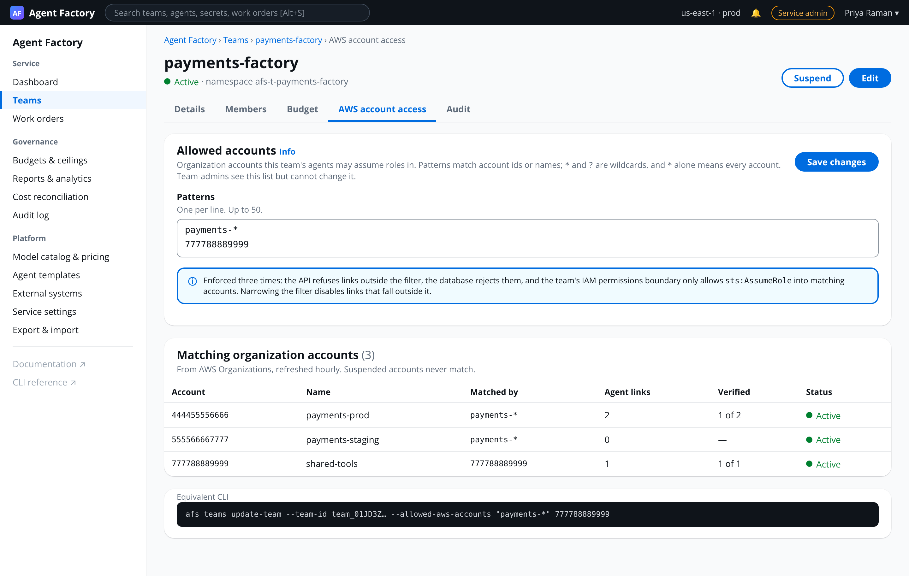
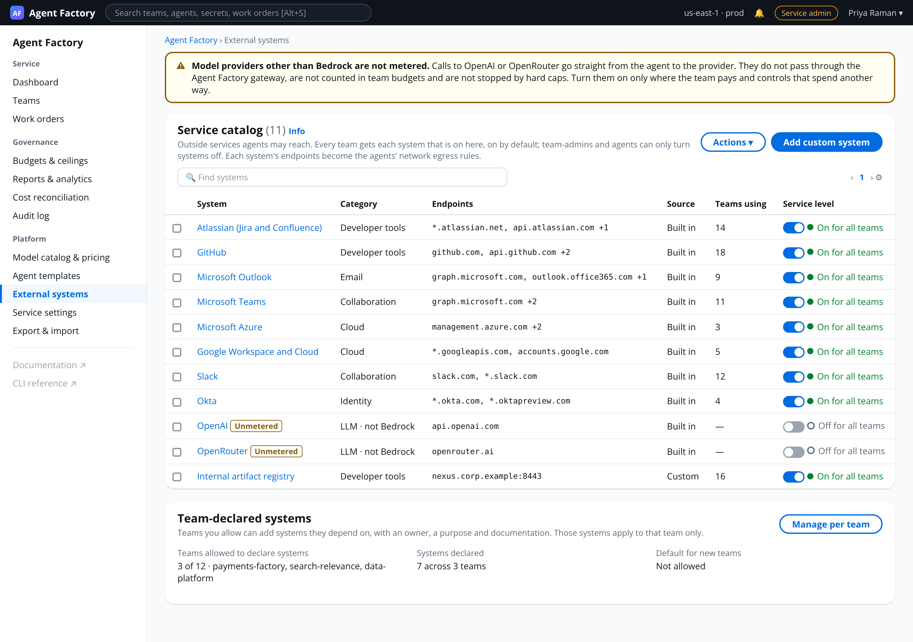
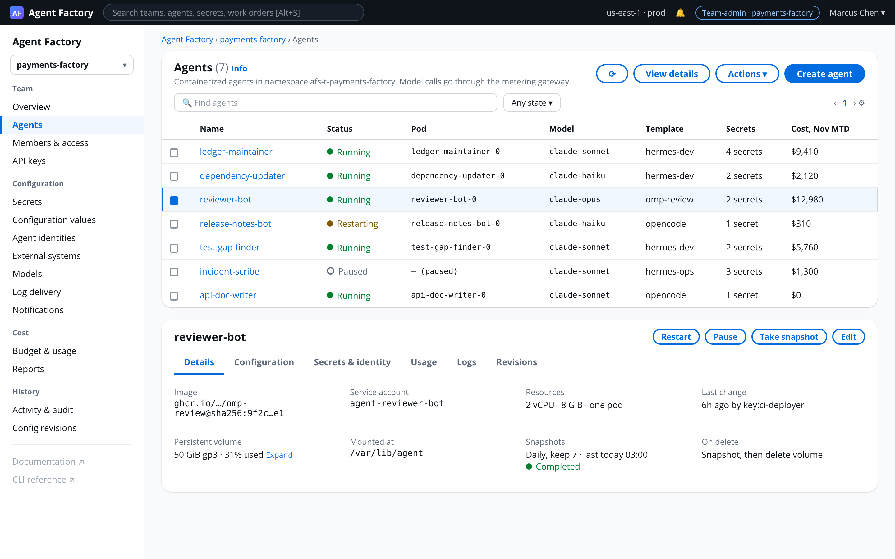
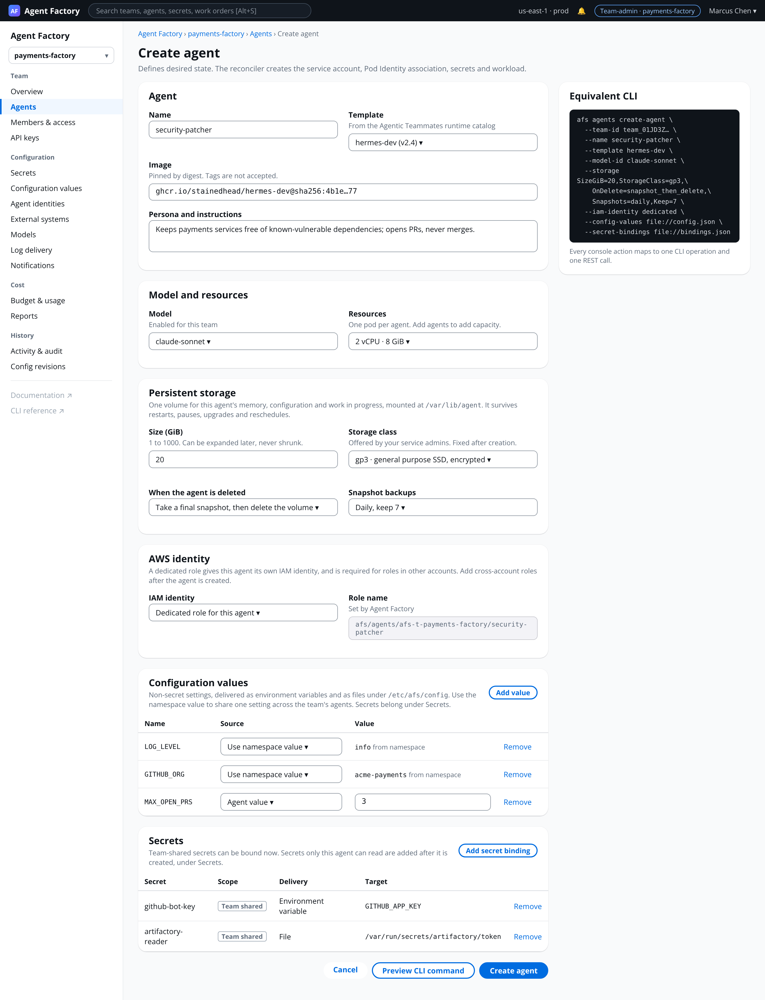
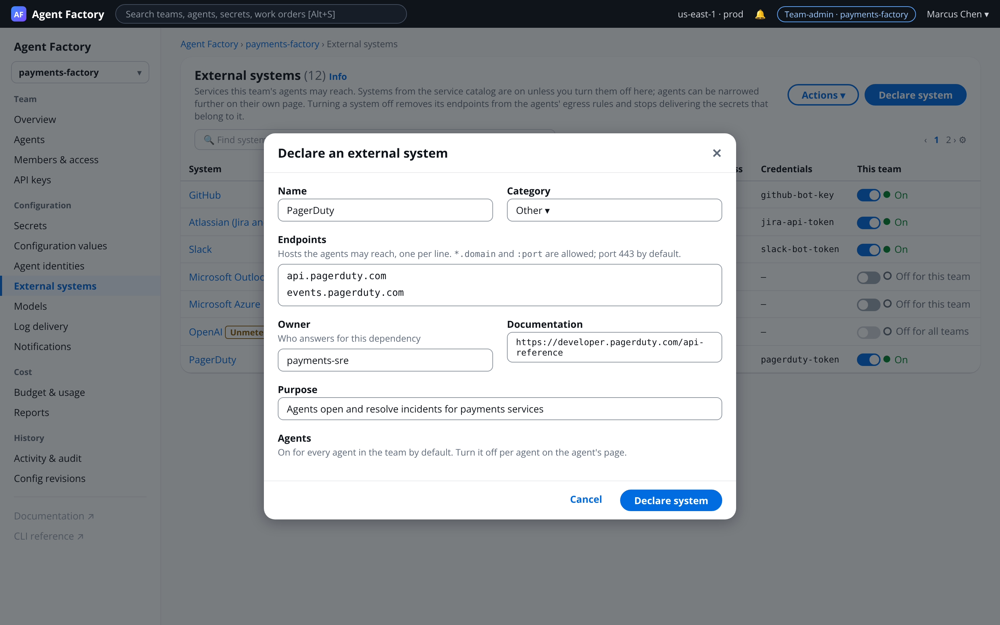
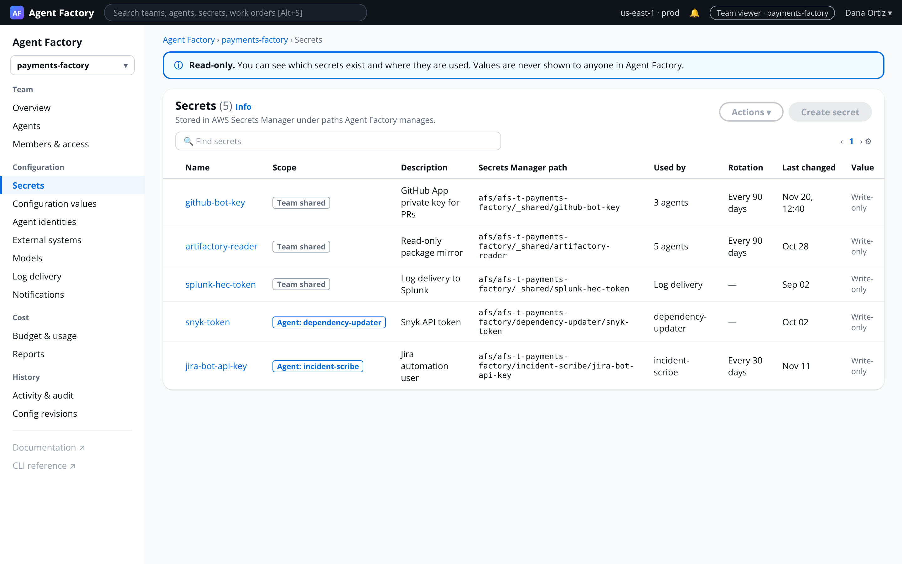
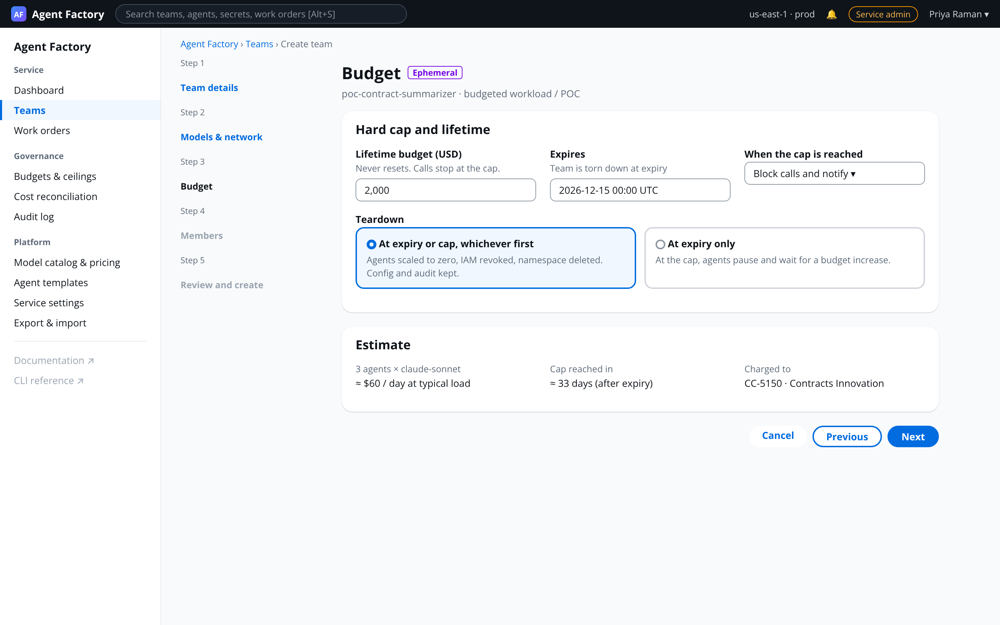

# Enterprise Agent Factory Service — Initial PRD

| | |
|---|---|
| **Status** | Draft for review |
| **Author** | J (Enterprise Architecture), drafted with Claude |
| **Date** | 2026-11-20 |
| **Repositories** | `enterprise-agent-factory-service` (this root), `-db`, `-restapi`, `-cli`, `-website` |
| **Design reference** | [docs/solution-design.md](docs/solution-design.md) |

---

## 1. Summary

The Enterprise Agent Factory Service (AFS) is an internal platform-engineering product. It gives
delivery teams across one enterprise their own **software factory**: an isolated environment on the
shared EKS platform that runs a team of containerized AI agents (the Agentic Teammates runtime), with the
team's people, agent identities, secrets, model access, budget and log delivery managed in one place.

A central platform team runs the service. Teams manage their own factory inside guardrails the platform
team sets. Phase 1 serves **long-running teams** that develop and maintain software. Later phases add
**short-lived, budgeted workloads**: proof-of-concept efforts and "swarm rentals" with a hard cost cap and
an expiry, and security-driven **CVE remediation** work orders.

Everything is reachable three ways, all through one REST API that enforces role-based access: a web
console that feels familiar to people who use the AWS Management Console, an `afs` CLI that follows
AWS CLI conventions, and a TypeScript SDK for automation.

## 2. Problem

- Teams want agents working on their backlog now, but each team building its own agent hosting creates
  duplicated infrastructure, uncontrolled model spend and unreviewed access to code and credentials.
- AWS billing data lags by hours, so a runaway agent can spend far past any budget before anyone sees it.
- Security needs every agent action to be attributable to a named agent and team, with secrets that never
  pass through ad-hoc tooling.
- Platform engineering needs one place to see the whole fleet, set guardrails and recover the environment
  from configuration alone.

## 3. Goals and non-goals

### Goals

| ID | Goal | Measure |
|---|---|---|
| G1 | A team-admin can stand up a working agent team without a platform ticket | New team to first running agent in under 30 minutes, self-service |
| G2 | Teams are isolated from each other | Zero cross-team network, IAM, secret or data access in isolation tests |
| G3 | Model spend never exceeds a team's hard cap | Overspend bounded by one in-flight request per agent; verified by load test |
| G4 | Every change and every agent action is attributable | 100% of mutations in the audit log; AWS calls carry team and agent session tags |
| G5 | The environment is recoverable from configuration | Fresh cluster + restored DB converges to full state with no manual steps |
| G7 | Spend, usage and agent activity are visible at service, team and agent level | Reports within 5 minutes of real time; every number exportable to CSV; idle agents identifiable at a glance |
| G6 | One API, three clients, one access model | Every console action has a CLI operation and an SDK method; RBAC enforced only in the API |

### Non-goals (this release)

- Building the agent runtime itself (Agentic Teammates owns images and harnesses).
- Multi-enterprise or external customers. This is single-enterprise, internal.
- Chargeback invoicing. AFS produces showback data by cost center; finance systems do the rest.
- Budgets for model providers other than Bedrock. OpenAI, OpenRouter and similar providers can be allowed
  as external systems (EXT-6), but their calls are not metered, counted in team budgets or stopped by hard
  caps (J, 2026-11-21).
- Running ephemeral swarms and CVE work orders end to end (designed now, built in phases 2 and 3).

## 4. Users and roles

| Role | Who | Scope | Typical jobs |
|---|---|---|---|
| **Service admin** | Central platform engineering team | Whole service | Create and retire teams, set budget ceilings and quotas, manage the model catalog and prices, watch fleet health and spend, review audit, export/import configuration |
| **Team-admin** | Tech lead or engineering manager of a delivery team | One or more teams they are granted | Define agents, manage members and API keys, create and bind secrets, set the budget up to the ceiling, configure egress, log delivery and notifications |
| **Team viewer** | Engineers, product owners, FinOps, SRE, auditors | One or more teams | See configuration, status, usage, costs and history. Never see secret values |

Roles are granted to people or to IdP groups, per team. A person can be team-admin on one team and viewer
on another. Only service admins grant service admin.

### Permission summary

| Capability | Service admin | Team-admin | Team viewer |
|---|:-:|:-:|:-:|
| Create / delete teams, set ceilings and quotas | ✓ | | |
| Edit team settings, suspend / resume | ✓ | ✓ | |
| Agents: create, edit, pause, restart, delete; expand volume, take snapshot | ✓ | ✓ | |
| Members and API keys | ✓ | ✓ (team roles only) | |
| Secrets: create, rotate, bind | ✓ | ✓ | |
| Secrets: see names, references, usage | ✓ | ✓ | ✓ |
| Configuration values (namespace and agent): create, edit, delete | ✓ | ✓ | |
| Configuration values: see names, values, sources | ✓ | ✓ | ✓ |
| Team's allowed AWS accounts: set the filter | ✓ | ✓ (when the team may manage it) | |
| Let a team manage its own AWS accounts or declare external systems | ✓ | | |
| Identity providers (Okta, Entra ID) for the service or a team | ✓ | | |
| Agent IAM identity and cross-account roles: add, remove, verify | ✓ | ✓ | |
| Allowed accounts, agent roles, link status, trust policies: see | ✓ | ✓ | ✓ |
| External systems catalog: add custom systems, turn systems off for all teams, allow teams to declare their own | ✓ | | |
| External systems: turn off for the team or an agent; declare team systems (when allowed) | ✓ | ✓ | |
| External systems: see effective access per team and agent | ✓ | ✓ | ✓ |
| Budget: set amount (≤ ceiling), thresholds | ✓ | ✓ | |
| Usage, costs, reconciliation | ✓ | ✓ | ✓ |
| Reports: all teams (service level) | ✓ | | |
| Reports: own team and its agents, CSV export, scheduled reports | ✓ | ✓ | ✓ |
| Audit and config revisions (own team) | ✓ | ✓ | ✓ |
| Model catalog, pricing, service settings, export / import | ✓ | | |

The full matrix is in [solution design §5.3](docs/solution-design.md#53-permission-matrix) and is
implemented once, in the REST API.

## 5. User experience

### 5.1 Design principles

1. **Familiar to AWS console users.** Dark global header with search, region/environment and identity;
   left service navigation; breadcrumbs; page header with *Info* link and actions on the right; tables
   with a text filter, property filters, pagination and a preferences gear; one primary (filled) action per
   page; *Actions* dropdown for the rest; create flows as multi-step wizards with a final review step;
   status shown as a coloured dot plus a word, never colour alone.
2. **The role is always visible.** The header shows the active role and team (orange: service admin,
   blue: team-admin, grey: team viewer). The team switcher in the left navigation lists only teams the
   user is bound to.
3. **Controls follow permissions.** Actions a role cannot perform are disabled, with a tooltip naming the
   role required ("Requires team-admin"), rather than hidden, so viewers understand what exists. Admin-only
   areas (model catalog, service settings) are hidden from team roles. The API's decision is final; a 403
   shows an access-denied alert.
4. **Every action is scriptable.** Create forms show the equivalent `afs` CLI command; every screen maps to
   documented API operations.
5. **Secrets are write-only everywhere.** The UI shows names, references, rotation and usage; values are
   entered once and never displayed.
6. **Desired state vs. actual state.** Resources show reconcile status (`Pending`, `Reconciling`, `Ready`,
   `Degraded`) and the generation observed, so users can see when a change has been applied.
7. **Accessible.** WCAG 2.2 AA: keyboard reachable, labelled inputs, status and alert regions announced.

### 5.2 Information architecture

```
Service admin (global navigation)            Team context (team-admin / team viewer)
├─ Service                                    ├─ Team
│  ├─ Dashboard                               │  ├─ Overview
│  ├─ Teams                                   │  ├─ Agents
│  └─ Work orders            (phase 3)        │  ├─ Members & access
├─ Governance                                 │  └─ API keys                (team-admin)
│  ├─ Budgets & ceilings                      ├─ Configuration
│  ├─ Cost reconciliation                     │  ├─ Secrets
│  ├─ Cost allocation tags                    │  ├─ Agent identities
│  └─ Audit log                               │  │
└─ Platform                                   │  ├─ External systems
   ├─ Model catalog & pricing                 │  ├─ Models
   ├─ Agent templates                         │  ├─ Log delivery
   ├─ External systems                        │  └─ Notifications
   ├─ Service settings                        ├─ Cost
   └─ Export & import                         │  ├─ Budget & usage
                                              │  ├─ Reports
                                              │  └─ Cost tags
                                              └─ History
                                                 ├─ Activity & audit
                                                 └─ Config revisions
```

Service admins can open any team and see the team context with full rights.

### 5.3 Screens by role

The mockups below are high-fidelity wireframes for review. Data is illustrative. HTML sources are in
[docs/ui/source/](docs/ui/source/) and can be opened in a browser.

#### Service admin

**S1 · Service dashboard.** Fleet at a glance: team and agent counts, month-to-date spend against total
budget, reconciler health, teams needing attention (budget pressure, expiring ephemeral teams, degraded
agents, hard-cap blocks, reverted drift) and top spenders. A banner flags any team whose gateway figure
differs from billed cost by more than the variance threshold, and model price changes waiting for
approval (BUD-6, BUD-9).


**S2 · Teams.** Every team with kind (persistent or ephemeral), state, agent count, spend against budget,
cost center and expiry. Filter by kind and state; select a team for *View details* or *Actions*
(suspend, resume, set ceiling, delete).


**S3 · Create team, step 1.** Wizard: details → models & network → budget → members → review. Step 1
chooses the lifecycle (persistent, or ephemeral for budgeted workloads and POCs), names the team (which
fixes its namespace), and sets the guardrails only service admins control: budget ceiling, compute quota
and isolation tier. It also picks the team's sign-in provider from the service's providers (ACC-1) and
asks for every required cost allocation tag (TAG-2); the team cannot be created without them.


**S4 · Model catalog and pricing.** Bedrock models teams may enable, with effective-dated prices that the
gateway uses for real-time spend reservation. Price changes read daily from the AWS Price List wait in
*Price changes waiting for approval* until a service admin approves or rejects each; the price history
shows who approved what (BUD-9, decision D10).


**S5 · Audit log.** Append-only record of every state change, every denied request and every drift
correction, filterable by team, actor, action and outcome, downloadable as CSV.


**S6 · Team AWS account access.** On a team's detail page, the *AWS account access* tab holds the team's
allowed-accounts filter: glob patterns over AWS Organizations account ids and names (`*` for every
account, `444455556666` for one, `payments-*` for a group by name). Below it, the organization accounts
that currently match, which pattern matched, and how many agent links point at each. Narrowing the filter
disables links that fall outside it. A *Team manages its own accounts* switch lets the team's admins edit
the filter themselves; while it is off, only service admins can, and team-admins see it read-only (TEAM-8).



**S7 · External systems catalog.** The outside services agents may reach. It ships with Atlassian (Jira
and Confluence), GitHub, Microsoft Outlook, Microsoft Teams, Microsoft Azure, Google, Slack, Okta, OpenAI
and OpenRouter, and service admins add custom systems (for example an internal artifact registry). Each
entry lists its endpoints and a service-level switch: off means off for every team. OpenAI and OpenRouter
carry an *Unmetered* badge and a notice: their calls bypass the gateway, so they are not counted in
budgets or stopped by hard caps, and they ship switched off. Below the catalog, service admins choose which
teams may declare their own systems (EXT-1 to EXT-6).



**S8 · Reports and analytics.** The service-level report across every team: spend against the sum of
budgets with forecast, calls and tokens, how many agents are working, idle, blocked or paused right now,
utilization, daily cost by Bedrock model (with EKS compute), a team table (spend and budget, tokens,
agents working, utilization, idle agents and denied egress) that opens each team's report, cost by
model, and traffic to external systems with denied attempts. A notice says that spend with model
providers other than Bedrock is not included (RPT-1 to RPT-8).


**S9 · Cost allocation tags.** The system tags (`afs-team-id`, `afs-agent-id`) that AFS always sets, the
service tags service admins define (fixed for every team, or required with an optional list of values
and a default), spend grouped by any tag, and the teams missing a required value (TAG-1 to TAG-7).


#### Team-admin

**T1 · Team overview.** Identity of the environment (namespace, cluster, IAM role, cost center), reconcile
status and conditions, budget burn, agent health and recent activity.


**T2 · Agents.** Agents with status, model, runtime template, bound secrets and cost. Selecting an agent
opens its detail panel with *Restart*, *Pause* and *Edit*, and tabs for secrets and identity, usage, logs
and revisions. An agent is one identity and runs as exactly one pod, so there is no replica count or
*Scale* action. A team adds capacity by adding agents (see AGT-7). The detail panel also shows the agent's
persistent volume (size, storage class, on-delete rule, snapshot schedule and last snapshot) with
*Take snapshot* and *Expand volume*. Team viewers see the same panel read-only.



**T3 · Create agent.** Template from the Agentic Teammates catalog, image pinned by digest, persona, model
(limited to models enabled for the team), resources, and secret bindings as environment variables or
files. There is no replicas field: each agent is a single pod with its own ServiceAccount and IAM identity.
The *Persistent storage* section sets the agent's volume for memory, configuration and work in progress:
size, storage class (from the classes a service admin offers), what happens to the volume when the agent
is deleted, and snapshot backups (AGT-9). The *Configuration values* section lists the agent's non-secret
settings. For each name the team-admin either types an agent value or picks *Use namespace value*, which
is offered only when the namespace has a value of that name; the effective value is shown beside it
(CFG-7). The *AWS identity* section chooses the team's shared role or a dedicated role for this agent;
cross-account roles need a dedicated role and are added after creation (AGT-6, AGT-10).
Binding lists only the team's shared secrets and this agent's own secrets. The side panel shows the
equivalent CLI command.



**T4 · Secrets, with create dialog.** Secrets are stored in AWS Secrets Manager. *Create secret* asks
only for a scope (*Team shared* or one agent), a name, a description and the value, and sends the value
once, straight to Secrets Manager. The user never types or edits the Secrets Manager path. AFS builds it
from the hierarchy `<service>/<namespace>/<agent>/<secret-name>`, or `<service>/<namespace>/_shared/<secret-name>`
for team-shared secrets (SEC-5), and shows it read-only. The table shows scope, the managed path, usage,
rotation and last change; the value column always reads "Write-only".


**T5 · Budget and usage.** Month-to-date spend, month-end forecast with projected cap date, the action at
exhaustion, the latest reconciliation result, daily spend split between Bedrock tokens (real time) and EKS
compute (daily from CUR), and spend by agent.


**T6 · Members and access.** Role bindings for people and IdP groups. Team-admins grant team-admin or
team viewer on their own team; API keys for pipelines are on the second tab.


**T7 · Configuration values.** The namespace's non-secret values (name, value, description, how many agents
use each) and, below, every agent value with its source (*Namespace* or *Agent value*) and effective value.
Changing a namespace value restarts the agents that use it. Team viewers see the same page read-only.


**T8 · Agent AWS access, with add-role dialog.** The agent's *Secrets & identity* tab shows its AWS
identity (shared team role or a dedicated role, the role ARN and the Pod Identity association) and the
accounts the team may use. Below it, *Cross-account roles* lists the roles in other organization accounts
the agent may assume: the profile name the agent uses, the account, the role ARN, the link status
(*Pending trust*, *Verified*, *Failed* or *Disabled*) and when it was last verified. *Add cross-account
role* offers only accounts inside the team's filter, takes the target role ARN, a profile name and a
maximum session length, and shows the trust policy (with the external ID AFS generated) for the target
account's owner to add to that role. *Verify now* assumes each role and updates the status. Team viewers
see the identity, links and trust policies read-only (AGT-6, AGT-10).


**T9 · External systems, with declare dialog.** Every system the team can use: catalog systems (on unless
the team turns them off) and the team's own declared systems, with endpoints, how many agents have access
and the secrets that are credentials for each. Systems switched off by service admins show as *Off for all
teams* and cannot be turned on. When service admins allow it, *Declare system* adds a team system with
name, category, endpoints, owner, documentation and purpose, so the team's dependencies are written down
and controlled. Team viewers see this page read-only (EXT-2, EXT-3).



**T10 · Agent external systems.** The agent's *External systems* tab shows its effective access: each
system the team has on, with a switch to turn it off for this agent and a note saying why. Systems turned
off at the team or service level show *Off above* and cannot be turned on. Team viewers see it read-only
(EXT-4).


**T11 · Team reports.** Tabs for budget and usage, activity, models and external systems, with a time
range (24 hours to 90 days, or custom), filters by agent and model, *Download CSV* and *Schedule report*.
The first tab shows spend against budget with forecast, calls and tokens, utilization and idle time,
daily cost by Bedrock model, an hourly activity heatmap per agent, and each agent's current state (with
what it reports it is doing), utilization, how long it has been idle and its cost. Team viewers see the
same reports (RPT-2 to RPT-6).


**T12 · Agent usage.** The agent's *Usage* tab: cost, calls and tokens, utilization and the longest idle
stretch, a timeline of the day in five-minute windows (working, partly working, idle), cost by model
and traffic to external systems, including denied attempts and why they were denied (RPT-3 to RPT-7).


**T13 · Cost tags.** The tags the team carries and where each comes from (system, service fixed, service
required), the team's own optional tags, and where the tags are applied. Team-admins set required values
and their own tags; viewers see the page read-only (TAG-2 to TAG-5).


#### Team viewer

**V1 · Team overview, read-only.** The same page as T1 with an information banner. *Edit*, *Actions* and
*Create agent* are disabled with a "Requires team-admin" tooltip. The *API keys* navigation item is not
shown.


**V2 · Secrets, read-only.** Viewers see which secrets exist, their scope, managed path and where they
are used, so they can troubleshoot, but cannot create, rotate or bind them, and nobody sees values.



#### Later phases: budgeted workloads, POCs and CVE remediation

**P2 · Ephemeral team budget (phase 2).** For a POC or swarm rental the budget step asks for a lifetime
hard cap, an expiry and the teardown rule, and shows an estimate of daily cost and when the cap would be
reached.

**Swarms and pools (phase 2).** A swarm is an ephemeral team, and it still runs several agents with
different identities that work together, for example a scanner, a PR writer and a reviewer. The
difference is that each of those agents can be a **pool**: one definition with its own identity (one
ServiceAccount, one IAM role, its own secrets and GitHub identity) and a worker count. Workers in a pool do
similar work across many repositories, so they share the pool's identity instead of having one each. The
model is swarm (ephemeral team, one lifetime budget and expiry) → pools (one identity each, N workers) →
workers (pods). Pools in a swarm can be grouped (for example "scan" and "fix" stages) and hand work to
each other. Audit and usage are attributed to the pool, with the worker's pod name recorded for
troubleshooting. Long-running team agents stay one identity, one pod (AGT-7). Storage for a pool is
chosen per pool: an ephemeral scratch volume per worker (the default, deleted with the worker), and
optionally one shared read-write volume for the pool (EFS) for shared memory or caches. Pool workers do
not get individual persistent volumes. For AWS access, a pool can optionally use a **shared named role**
in one or many organization accounts: one role name (for example `afs-cve-remediation`) deployed to
every target account, typically by a CloudFormation StackSet, that the pool's workers assume through
one profile per account. The accounts still have to be inside the team's allowed-accounts filter.



**P3 · Work orders (phase 3).** CVE work orders from the security team with affected repos, PR progress,
owning teams to notify, SLA due date and the remediation team assigned.


### 5.4 Key flows

| Flow | Role | Steps |
|---|---|---|
| Onboard a team | Service admin | Teams → Create team → details, guardrails → models & external systems → budget → first team-admin → review → team appears `Reconciling`, then `Ready` |
| Stand up agents | Team-admin | Secrets → Create secret → Agents → Create agent → bind secrets → status `Running` |
| Respond to budget alert | Team-admin | Alert (Slack/email) → Budget & usage → see top agents → pause an agent, or raise budget up to ceiling |
| Hard cap reached | System → team-admin | Gateway blocks calls → agents receive `BudgetExceeded` → team shows `Blocked (cap)` → team-admin asks service admin for a higher ceiling or waits for reset |
| Investigate | Team viewer | Overview → conditions → Activity & audit → Config revisions |
| Recover environment | Service admin | Restore DB (PITR) or import bundle → reconciler converges → dashboard shows `Healthy` |
| POC (phase 2) | Service admin / team-admin | Create team → Ephemeral → cap + expiry → run → automatic teardown; config and audit retained |

## 6. Functional requirements

Priorities: **P0** required for the first production release (phase 1), **P1** phase 1 follow-up,
**P2** later phase (designed now).

### 6.1 Teams and environments

| ID | Requirement | Pri |
|---|---|---|
| TEAM-1 | Service admins create, update, suspend, resume and delete teams | P0 |
| TEAM-2 | Each team gets one namespace `afs-t-<name>` with Pod Security `restricted`, ResourceQuota and LimitRange | P0 |
| TEAM-3 | Default-deny NetworkPolicy for ingress and egress; allow DNS, the LLM gateway and, per agent, the endpoints of the external systems that agent may use (EXT-5) only | P0 |
| TEAM-4 | Admission policy blocks teams from altering their own isolation (NetworkPolicies, LoadBalancer/NodePort Services, hostNetwork, privileged pods) | P0 |
| TEAM-5 | Team status shows reconcile phase, observed generation and conditions | P0 |
| TEAM-6 | Optional isolation tier assigns a dedicated node pool | P1 |
| TEAM-7 | Ephemeral teams require an expiry and lifetime budget, and are torn down automatically | P2 |
| TEAM-8 | Each team has an allowed-accounts filter: the organization accounts its agents may assume roles in, as glob patterns (`*` and `?`) over AWS account ids and names, with `*` for all accounts. Empty (the default) means none. AFS mirrors the AWS Organizations account list hourly so names resolve to ids; suspended or closing accounts never match. The filter is enforced in the API, in the database, and in the team's IAM permissions boundary (`sts:AssumeRole` only on `arn:aws:iam::<matching-account>:role/*`). Narrowing it disables links outside it. Service admins decide per team whether the team manages its own filter: when it does, its team-admins set it; when it does not, service admins set it (D6). Team-admins choose link targets within it either way | P1 |

### 6.2 Agents and identity

| ID | Requirement | Pri |
|---|---|---|
| AGT-1 | Team-admins create, update, pause, restart and delete agents | P0 |
| AGT-2 | Agents use templates from the Agentic Teammates catalog; images are pinned by digest | P0 |
| AGT-3 | Each agent gets its own ServiceAccount; AWS access via EKS Pod Identity with session tags `afs-team-id`, `afs-agent-id` | P0 |
| AGT-4 | Agents have no direct Bedrock permission; model calls go through the gateway | P0 |
| AGT-5 | External identities (GitHub App installation, bot accounts) are modeled per agent with credentials as secret references | P1 |
| AGT-6 | Each agent runs either with its team's shared IAM role (the default) or with a dedicated IAM role of its own (`afs/agents/<namespace>/<agent>`, mapped by Pod Identity, carrying the team's permissions boundary). Team-admins choose this when creating or editing the agent. A dedicated role is required for cross-account roles (AGT-10); an agent with links cannot switch back to the shared role until they are removed | P1 |
| AGT-7 | One agent is one identity and one pod (a StatefulSet with one replica, so the name, ServiceAccount, IAM session and audit trail stay stable). There is no replica count. A team scales by adding agents. Phase 2 swarm pools are the exception (AGT-8) | P0 |
| AGT-8 | Swarms (ephemeral teams) hold several pools that work together. Each pool has its own identity, secrets and a worker count; its workers share that identity. Pools can be grouped into stages. The swarm has one lifetime budget; usage and audit are attributed to the pool, with the worker pod recorded. A pool can optionally use a shared named role in one or many organization accounts (inside the team's allowed accounts) | P2 |
| AGT-9 | Every agent has one persistent volume (encrypted EBS gp3 by default, through a StatefulSet volume claim) mounted at `/var/lib/agent` for memory, configuration and work in progress. It survives restarts, pauses, image upgrades and reschedules. Team-admins set size (1 to 1000 GiB, default 20, grow only), storage class (from the service admin's list, fixed after creation), on-delete rule (snapshot then delete by default, delete, or retain) and snapshot schedule (off, daily or weekly, keeping 1 to 90). Viewers see the settings and snapshot history read-only. Volume usage counts toward the team's storage quota, and EBS cost is attributed to the team by tag | P0 |
| AGT-10 | An agent with a dedicated role can be linked to roles in other accounts of the organization, inside the team's allowed accounts (TEAM-8). Each link has the target role ARN, a profile name, a maximum session (15 minutes to 12 hours) and an external ID that AFS generates. AFS shows the trust policy for the target account's owner to add (principal: the agent's role; conditions: the external ID and the `afs-team-id` session tag). The reconciler grants the agent's role `sts:AssumeRole` on the target, writes an AWS config file into the pod with one profile per link (`role_arn`, `external_id`, `credential_source`), verifies each link by assuming it (on creation, daily and on demand) and records *Pending trust*, *Verified*, *Failed* or *Disabled*. A link's role ARN and external ID cannot change; replace the link instead. Team-admins add and remove links; viewers see them read-only. Assumed sessions keep the `afs-team-id` and `afs-agent-id` tags, so CloudTrail in the target account shows the agent | P1 |

### 6.3 Secrets

| ID | Requirement | Pri |
|---|---|---|
| SEC-1 | AFS stores Secrets Manager references and metadata only; no secret value is stored, logged or returned | P0 |
| SEC-2 | Create through AFS only: the user gives scope, name and value; the value goes straight to Secrets Manager. Registering an arbitrary existing ARN is not offered, because it would bypass the managed hierarchy | P0 |
| SEC-3 | Bind secrets to agents as env vars or files; delivered by External Secrets Operator. A team-shared secret can be bound to any agent in the team; an agent secret only to its own agent | P0 |
| SEC-4 | Rotate: new value, rolling restart of bound agents | P1 |
| SEC-5 | AFS alone sets the Secrets Manager name: `<service>/<namespace>/<agent-name>/<secret-name>`, or `<service>/<namespace>/_shared/<secret-name>`. `<service>` is the installation's prefix (service setting, default `afs`). Users cannot set or change the path; team slug, agent name and secret name are immutable once created. IAM policies are prefix rules on this path: `afs-api` writes under `<service>/*`, a team's secret store reads `<service>/<namespace>/*`, and a per-agent role reads only `<service>/<namespace>/<agent-name>/*` plus `_shared/*`. The `afs-team-id` tag stays as a second check | P0 |
| SEC-6 | **Zero impact on the agent's container.** Secrets and configuration values reach the agent without code, SDKs, sidecars the agent talks to, or calls from the agent: each secret binding becomes an environment variable or a file at the path the team-admin chose (delivered by External Secrets Operator into a namespace Secret the pod mounts), configuration values become environment variables and files under `/etc/afs/config` (CFG-7), cross-account profiles a file under `/etc/afs/aws` (AGT-10) and tags `/etc/afs/tags.json` plus `AFS_TAGS` (TAG-4). A rotated secret or changed value rolls the agents that use it, so environment variables are always current. An optional in-namespace endpoint (for example an MCP server) for listing configuration and fetching secrets on demand may be added later as a convenience, never as a requirement (D12) | P0 |

### 6.4 Budgets, usage and cost

| ID | Requirement | Pri |
|---|---|---|
| BUD-1 | Service admins set a budget ceiling per team; team-admins set the budget up to it | P0 |
| BUD-2 | Gateway reserves worst-case cost before each model call and settles to actual; rejects with `BudgetExceeded` when the cap would be exceeded | P0 |
| BUD-3 | IAM explicit deny on the team's Bedrock role when the cap is reached (backstop), removed on reset or increase | P0 |
| BUD-4 | Alerts at configurable thresholds (default 50/80/100%), once per period per threshold | P0 |
| BUD-5 | Usage by agent, model and day in near real time | P0 |
| BUD-6 | Daily CUR reconciliation of Bedrock (by inference-profile tag), EKS compute (split cost allocation by namespace) and agent volumes and snapshots (by `afs-team-id` tag), reported alongside the gateway's figures. A team-day whose gateway figure differs from the billed figure by more than the variance threshold (service setting, default 5%) is flagged and alerts service admins (D10) | P1 |
| BUD-7 | Showback export by cost center and by any cost allocation tag (TAG-6) | P1 |
| BUD-8 | Lifetime budgets with expiry for ephemeral teams | P2 |
| BUD-9 | Model prices stay current because token and model costs drive budgets: when price sync is on (service setting, default on), the billing job reads the AWS Price List daily and proposes each changed price as a pending change with its effective date. A service admin approves or rejects it; an approved price takes effect from its effective date or from the approval, whichever is later, and is never backdated. Manual prices remain possible. Every proposal and decision is audited (D10) | P1 |

### 6.5 People and access

| ID | Requirement | Pri |
|---|---|---|
| ACC-1 | SSO via OIDC: auth code + PKCE (web), device code (CLI). Okta (the default) and Microsoft Entra ID are both supported. Service admins configure the providers at service level (one is the default). When there is more than one, each team's provider is chosen when the team is created (service admins) or managed (team-admins), from the enabled service-level providers; a provider in use by a team cannot be disabled. A team's group role bindings use the team's provider; service-level group bindings name the provider their group comes from. Client secrets are Secrets Manager references (D1) | P0 |
| ACC-2 | Roles service admin, team-admin, team viewer, bound to users or IdP groups, per team | P0 |
| ACC-3 | RBAC enforced in the REST API on every operation; `GET /v1/me` returns effective permissions for client UX | P0 |
| ACC-4 | Team API keys (team-admin or viewer, max 90 days, hashed, shown once) | P1 |
| ACC-5 | Optional read-only `kubectl` for team viewers via EKS access entries scoped to the namespace | P2 |

### 6.6 Configuration, recovery and audit

| ID | Requirement | Pri |
|---|---|---|
| CFG-1 | RDS PostgreSQL is the source of truth for desired state, with optimistic concurrency (`ETag`/`If-Match`) | P0 |
| CFG-2 | Reconciler applies desired state at startup and continuously; manual drift is reverted and audited | P0 |
| CFG-3 | Every change is versioned (config revisions) and every mutation is audited (append-only) | P0 |
| CFG-4 | PITR backups and cross-region/cross-account snapshot copies | P0 |
| CFG-5 | Export a versioned, checksummed bundle (no secret values); import with ARN/account mapping and dry-run plan. Agent volumes are carried as their settings plus the latest snapshot reference; import can restore an agent's volume from that snapshot once it is shared or copied to the target account. Teams' allowed-accounts filters and agents' identity settings and cross-account links (with their external IDs) are exported; import maps account ids and re-verifies every link. The external systems catalog, team-declared systems and team and agent opt-outs are exported too | P1 |
| CFG-6 | Restore a team to a previous revision | P1 |
| CFG-7 | Non-secret configuration values at two levels: the team's namespace (shared by its agents) and the agent. Each agent value is either its own literal value or a link to the namespace value with the same name (the link is offered only when that value exists). Team-admins manage both levels; viewers see names, values and sources read-only. Values are delivered to the agent's pod as environment variables and as files under `/etc/afs/config`, through a ConfigMap the reconciler owns (manual edits are reverted). Changing a value restarts the agents that use it. A linked namespace value cannot be deleted or renamed until no agent links to it. Names are `UPPER_SNAKE`; names that look like credentials (`*_PASSWORD`, `*_TOKEN`, `*_API_KEY` and similar) are refused with a pointer to Secrets, and a name cannot reuse an environment variable already used by the agent's secrets. Configuration values are included in export bundles | P0 |

### 6.7 Delivery and notifications

| ID | Requirement | Pri |
|---|---|---|
| OPS-1 | Per-team log delivery to CloudWatch, S3, OTLP, Splunk HEC or Datadog | P1 |
| OPS-2 | Events (team, agent, budget, drift, work order) published to EventBridge via a transactional outbox | P0 |
| OPS-3 | Notification channels per team: Slack, email, webhook, Jira | P1 |
| OPS-4 | Credential hygiene in logs: agent logs and external-traffic records pass through a redaction step before storage or delivery. Values that look like passwords, tokens or keys (and the values of the agent's own bound secrets) are replaced by a stable token (`[redacted:<hash prefix>]`), so repeats can be correlated without exposing the value. Agent sign-ins to external systems (connections to a system's sign-in endpoints) are logged as login events with the agent, system and time | P0 |

### 6.8 Work orders (phase 3)

| ID | Requirement | Pri |
|---|---|---|
| WO-1 | Security creates CVE work orders (CVE id, affected repos, owning teams, SLA) by API or EventBridge | P2 |
| WO-2 | AFS assigns a capped remediation team, tracks PRs and notifies owning teams against the SLA | P2 |

### 6.9 Interfaces

| ID | Requirement | Pri |
|---|---|---|
| IF-1 | REST API `/v1`, OpenAPI 3.1 contract, AWS-style `maxResults`/`nextToken` pagination, error `{code, message, requestId}` | P0 |
| IF-2 | `afs` CLI: `afs <service> <operation>`, profiles, `--output json|table|text|yaml`, `--query`, pagination flags, `--cli-input-json`, `--generate-cli-skeleton`, AWS CLI exit codes | P0 |
| IF-3 | `@afs/sdk` TypeScript SDK generated from the contract with ergonomic resource clients and async pagination | P0 |
| IF-4 | Web console as specified in section 5, built on `@afs/sdk` with clean architecture | P0 |

### 6.10 External systems

| ID | Requirement | Pri |
|---|---|---|
| EXT-1 | A service-level catalog of external systems agents may reach. Each entry has a name, category, description, documentation link and endpoints (host or `*.domain`, optional port). AFS ships built-in entries for Atlassian (Jira and Confluence), GitHub, Microsoft Outlook, Microsoft Teams, Microsoft Azure, Google, Slack, Okta, OpenAI and OpenRouter. Service admins add custom entries for services not in the list, edit endpoints, and switch any entry off for every team. Built-in entries can be switched off but not deleted | P0 |
| EXT-2 | Teams inherit every system that is on at the service level, on by default. Team-admins switch systems off for the whole team. A team cannot switch on what the service level has off | P0 |
| EXT-3 | Service admins choose, per team, whether the team may declare its own systems (default: not allowed). A team-declared system needs an owner and a purpose, may have documentation, applies to that team only, and cannot reuse the name of a catalog entry. This is how teams declare, document and control the services their work depends on | P1 |
| EXT-4 | Agents inherit their team's systems, on by default. Team-admins switch systems off for one agent. Each level can only narrow the one above; the effective access of every agent, and which level turned a system off, is visible to team viewers read-only | P0 |
| EXT-5 | Enforced in the network: the reconciler renders the endpoints of the systems each agent may use into that agent's egress policy (FQDN rules, default deny). A change takes effect without restarting the agent. Hosts shared by two systems (for example `graph.microsoft.com` for Outlook and Teams) stay reachable while either is on; finer control comes from the credentials the agent holds | P0 |
| EXT-6 | Category *LLM* marks model providers other than Bedrock (OpenAI, OpenRouter). Their calls bypass the AFS gateway, so they are **not metered, not counted in budgets and not stopped by hard caps**. They ship switched off; the catalog, team and agent pages show an *Unmetered* badge, and turning one on at the service level asks for confirmation. Budgets for these providers are out of scope for now (see non-goals) | P0 |
| EXT-7 | A secret can name the external system it is a credential for. The reconciler does not deliver it to agents for which that system is off, and the secret's page shows the system. Every change to the catalog, a team's systems or an agent's systems is audited and versioned. The team's former egress allow-list becomes one team-declared system | P1 |

### 6.11 Reporting and analytics

| ID | Requirement | Pri |
|---|---|---|
| RPT-1 | Reports at three levels with the same measures: service (every team, service admins only), team (one namespace, its members) and agent. Every report has a time range (last 24 hours, 7, 30 or 90 days, month to date, or custom), filters (team, agent, model), grouping (by team, agent, model or day) and *Download CSV*. Team-admins and viewers see their own teams only | P0 |
| RPT-2 | **Budget and spend:** spend against budget for the period with month-end forecast and projected cap date, per team and summed across the service; spend per agent; reconciliation status against AWS billing. Spend and tokens are near real time from the gateway (within 5 minutes) and reconciled daily with CUR; EKS compute and storage come from CUR split cost allocation | P0 |
| RPT-3 | **Usage:** model calls, input, output and cache tokens, rejected calls (budget, model), cost per call and latency, per team, agent, model and day | P0 |
| RPT-4 | **Cost by Bedrock model** at service, team and agent level, with calls, tokens, cost and share, plus EKS compute as its own line | P0 |
| RPT-5 | **Agent activity:** every five minutes each running agent is recorded as *working* (it made a model call, reported itself busy, or used CPU above the idle threshold) or *idle*, or as paused, stopped, unhealthy or blocked by its budget. Reports show each agent's current state and what it reports it is doing, utilization (working share of running time) over the range, an hourly heatmap, a day timeline, how long an idle agent has been idle, and the longest idle stretches. The idle threshold is a service setting | P0 |
| RPT-6 | **External systems traffic:** connections, bytes each way, and (where an egress proxy sees HTTP) requests and errors from each agent to each external system over time, at service, team and agent level. Denied attempts are reported with the reason (system off at the service, team or agent level, or a host in no system); they are a security signal and can alert team-admins and service admins | P1 |
| RPT-7 | Model providers other than Bedrock are marked unmetered: their spend is not in any report, and their traffic shows under external systems | P0 |
| RPT-8 | Scheduled reports: a saved report emailed or posted to a notification channel daily, weekly or monthly as CSV. Every report is also available through the API, CLI and SDK | P1 |
| RPT-9 | Every report can be grouped and filtered by cost allocation tag (TAG-6) | P1 |

### 6.12 Cost allocation tags

AFS has no access to the organization's hierarchy (business units, cost centers, products). Tags carry
it in, so spend can be rolled up the way the organization reports it, in AFS and in AWS billing.

| ID | Requirement | Pri |
|---|---|---|
| TAG-1 | **System tags.** `afs-team-id` and `afs-agent-id` are set by AFS on every resource and every Bedrock call it can attribute to a team or agent. Nobody configures, changes or removes them, and no other tag can use the `afs-` or `aws:` prefixes | P0 |
| TAG-2 | **Service tags.** Service admins define tag keys that are either *fixed* (one value applied to every team, for example `environment = prod`) or *required* (every team gives its own value, optionally from an allowed list, for example `business-unit`). A required key can have a default for teams that existed before it. A new team cannot be created without a value for every required key that has no default, and a team cannot remove one. Teams missing a value are listed for service admins and shown as untagged in reports | P1 |
| TAG-3 | **Team tags.** Team-admins add optional tags of their own (any key that is not a service key or reserved), and set the team's values for required keys. A team can carry at most 45 tags including the service's, leaving room for the system tags under AWS's limit of 50. Viewers see all of a team's tags read-only | P1 |
| TAG-4 | **Where tags go.** The reconciler applies a team's tags to its AWS resources (IAM roles, EBS volumes and snapshots, Bedrock application inference profiles, Secrets Manager secrets), and the team's tags plus `afs-agent-id` to each agent's resources. The gateway adds the agent's tags as request metadata to every Bedrock call. Each agent's pod gets them as `/etc/afs/tags.json` and the `AFS_TAGS` environment variable, so an agent may pass them to other services; AFS does not alter the agent's calls to external systems, whose traffic is attributed to the agent (RPT-6) and so to its tags | P1 |
| TAG-5 | Tag keys and values follow AWS tag rules (keys up to 128 characters, values up to 256, letters, digits, spaces and `_ . : / = + @ -`). Keys that look like credentials are refused; tags are never secret. Every change is versioned and audited, and a tag change is applied to existing resources by the reconciler | P1 |
| TAG-6 | **Rollups.** Cost, usage, agent activity and external traffic roll up by any tag key and value at service level (service admins) and within a team's own scope. Rollups attribute each team's figures to its current tags; untagged figures show as *(untagged)*. Showback exports group by tag (BUD-7) | P1 |
| TAG-7 | Service admins are told, once, to activate the service and system keys as cost allocation tags in AWS Billing, and the cost allocation tags page shows which keys CUR has seen | P2 |

### 6.13 User stories and acceptance criteria

Product-level stories. Each repository PRD breaks these into its own stories with acceptance criteria
for its layer, citing the story ids below (for example `-restapi` RA-US-4 refines US-4). Acceptance
criteria are written as Given / When / Then and are the basis of end-to-end tests in the dev
environment.

#### E1 Teams and access

**US-1 · Onboard a team.** As a service admin, I want to create a team with its guardrails, models,
required tags, sign-in provider and first team-admin in one wizard, so that a delivery team can start
without a platform ticket. *(TEAM-1, TEAM-2, TEAM-3, ACC-1, TAG-2, S3)*
- Given I am a service admin, when I complete the create-team wizard with valid input, then the team
  appears as `Reconciling` and becomes `Ready` within 60 seconds (p95), with namespace `afs-t-<name>`,
  Pod Security `restricted`, its ResourceQuota and LimitRange, and default-deny network policies.
- Given a required service tag has no default, when I leave it empty, then the review step blocks
  creation and names the tag, and the API refuses the same request with `ValidationError`.
- Given more than one sign-in provider exists, when I create the team, then I must pick one (the
  default is preselected), and the team's people sign in through it.
- Given I am a team-admin or viewer, when I call `CreateTeam`, then I get `403 AccessDenied` and an audit
  record of the denial.

**US-2 · Manage who has access.** As a team-admin, I want to bind people and IdP groups to my team as
team-admin or viewer, and issue short-lived API keys, so that access follows our org chart and
pipelines can authenticate. *(ACC-2, ACC-3, ACC-4, T6)*
- Given I am a team-admin, when I add a group binding, then members of that group who sign in through the
  team's provider get the role on their next request, and the change is audited.
- Given I am a team-admin, when I try to grant `service_admin`, then the request is refused.
- When I create an API key, then its secret is shown once, it expires in at most 90 days, and only its
  prefix is shown afterwards.
- Given I am a viewer, then every control that changes membership is disabled with the tooltip
  "Requires team-admin", and calling the API directly returns `403`.

**US-3 · Isolation between teams.** As security, I want teams to be unable to see or reach each other,
so that one team's agents and people cannot touch another team's code, secrets or data. *(G2, TEAM-3,
TEAM-4, SEC-5)*
- Given two teams A and B, when a member of A requests any resource of B by id, then the API returns
  `404 NotFound` (never revealing it exists), and the database returns no rows even if the API's filter
  were missing (RLS test).
- Given an agent in A, when it opens a connection to a pod in B or to any host outside its allowed
  systems, then the connection is denied and recorded as a denied flow.
- Given a team-admin of A, when they try to create a NetworkPolicy, LoadBalancer Service or privileged
  pod in A's namespace, then admission refuses it.

#### E2 Agents, secrets and configuration

**US-4 · Stand up an agent.** As a team-admin, I want to create an agent from a template with a model,
storage, secrets and configuration, so that it starts working on our backlog. *(AGT-1, AGT-2, AGT-7,
AGT-9, SEC-3, CFG-7, T3)*
- When I create an agent with a digest-pinned image, then one pod runs under its own ServiceAccount with
  a persistent volume at `/var/lib/agent`, and its status reaches `Running`.
- Given an image referenced by tag rather than digest, then creation is refused with `ValidationError`.
- Given the agent is restarted, paused and resumed, or its image upgraded, then the files on its volume
  are unchanged.
- The agent has no replica count anywhere in the UI, CLI, SDK or API.

**US-5 · Secrets and configuration with zero impact on the container.** As an agent author, I want my
agent to find its secrets and configuration already in its environment, so that it needs no code, SDK
or call to fetch them. *(SEC-3, SEC-4, SEC-6, CFG-7)*
- Given a secret bound as env var `GITHUB_TOKEN`, when the pod starts, then `GITHUB_TOKEN` holds the
  current value; given a binding as file `/etc/afs/secrets/jira`, then that file holds it.
- Given a configuration value `LOG_LEVEL`, then it is an environment variable and the file
  `/etc/afs/config/LOG_LEVEL`.
- When a team-admin rotates a bound secret or changes a configuration value, then every agent using it
  restarts and sees the new value within 5 minutes, without any change to the agent's code or image.
- No API response, CLI output, console page, log line or audit record shows a secret value.

**US-6 · Write-only secrets.** As a team-admin, I want to create and rotate secrets by name and value
without choosing where they live, so that they always land in the managed hierarchy with the right
access. *(SEC-1, SEC-2, SEC-5, T4)*
- When I create a team-shared secret `artifactory-reader`, then it is stored at
  `<service>/afs-t-<team>/_shared/artifactory-reader` and I see the path, never the value.
- Given a viewer, then they see names, paths, usage and rotation but no value and no way to read one.

#### E3 AWS access

**US-7 · Cross-account roles for an agent.** As a team-admin, I want to link an agent to a role in
another organization account within my team's allowed accounts, and hand the account owner a trust
policy, so that the agent can work there without long-lived keys. *(AGT-6, AGT-10, TEAM-8, T8, S6)*
- Given the target account does not match the team's allowed-accounts filter, then the link is refused
  by the API, the database and the IAM permissions boundary.
- When I add a link, then AFS generates the external ID, shows the trust policy, writes a profile into
  the pod's AWS config, and shows *Pending trust* until a verification assumes the role, then *Verified*.
- Given the team does not manage its own accounts, then a team-admin cannot change the filter (disabled
  with a tooltip; `403` from the API).

#### E4 External systems

**US-8 · Control which outside services agents reach.** As a service admin, I want a catalog of
external systems that I can extend and switch off, and as a team-admin I want to narrow it for my team
and each agent, so that egress is explicit and least-privilege. *(EXT-1 to EXT-7, S7, T9, T10)*
- Given Slack is off at service level, then no team or agent can switch it on, and agents' connections
  to Slack endpoints are denied with reason *system off at service level*.
- When a team-admin switches GitHub off for one agent, then within 60 seconds that agent's egress policy
  no longer allows GitHub hosts, without a restart, and the agent's page shows *off at agent level*.
- Given OpenAI is switched on, then every page that shows it carries the *Unmetered* badge and reports
  say its spend is not included.

#### E5 Budget, cost and pricing

**US-9 · Hard budget cap.** As a team-admin, I want my team's model spend to stop at the budget, so that
a runaway agent cannot overspend. *(G3, BUD-1 to BUD-5, T5)*
- Given a budget of $100 with $99.50 spent, when agents make concurrent calls whose worst-case cost
  exceeds $0.50, then the gateway rejects the excess with `BudgetExceeded`, total spend never exceeds
  the budget by more than one in-flight request per agent, and the IAM deny is applied as backstop.
- When spend crosses 50%, 80% and 100%, then exactly one alert per threshold per period goes to the
  team's channels.
- Given I am a team-admin, when I set a budget above the ceiling, then it is refused.

**US-10 · Current model prices.** As a service admin, I want price changes from the AWS Price List
proposed to me daily, and billed cost compared with our estimates, so that budgets reflect what models
actually cost. *(BUD-6, BUD-9, S1, S4)*
- Given a price change on the AWS Price List, when the daily sync runs, then one pending proposal per
  model appears on S4 and the dashboard banner counts it.
- When I approve it, then the gateway uses the new price from its effective date or from approval,
  whichever is later; nothing is backdated. When I reject it, nothing changes. Both are audited.
- Given a team-day where the gateway figure and the billed figure differ by more than 5%, then the team
  is flagged on S1 and a `cost.variance_detected` event is published.

#### E6 Reporting and tags

**US-11 · See spend, usage and activity.** As a service admin, team-admin or viewer, I want reports at
service, team and agent level for budget, usage, cost by Bedrock model, idle versus working, and
external traffic, so that I can manage cost and capacity. *(G7, RPT-1 to RPT-9, S8, T11, T12)*
- Given any report, then figures are no more than 5 minutes behind the gateway, and every table can be
  downloaded as CSV with the same numbers.
- Given an agent that made no model call, reported idle and used CPU below the threshold for an hour,
  then it shows as idle with *idle since* set to the end of its last working window.
- Given a viewer of team A, then service-level reports and other teams' reports are not available
  (hidden in the console, `403` from the API).

**US-12 · Cost allocation tags.** As a service admin, I want every team to carry the tags our finance
reporting needs, and every resource and Bedrock call tagged with team and agent ids automatically, so
that spend rolls up by business unit, product or any other dimension. *(TAG-1 to TAG-7, S9, T13)*
- Given any agent, then its IAM role, volume, snapshots and Bedrock calls carry `afs-team-id` and
  `afs-agent-id` with no configuration by anyone, and no one can change or remove them.
- Given a fixed service tag `environment = prod`, then every team's resources carry it, and a team cannot
  override it.
- When a team-admin adds `project = ledger-modernization`, then within 10 minutes the team's AWS
  resources carry it, and reports can group spend by `project`.
- Given a required key added after some teams exist, then those teams appear in *Teams missing a
  required tag* and their spend shows as *(untagged)* until they set a value.

#### E7 Recovery and audit

**US-13 · Recover from configuration.** As a service admin, I want a fresh cluster with a restored
database to converge to the full environment, so that we can recover from loss or move accounts.
*(G5, CFG-1 to CFG-6, S5)*
- Given a fresh EKS cluster and a database restored to a point in time, when the reconciler starts, then
  every team, agent, policy, identity and secret binding is recreated with no manual step, within 1 hour
  for the initial scale.
- Given someone edits a managed Kubernetes object by hand, then the reconciler reverts it and records
  `drift.corrected` in the audit log.
- When I export a bundle and import it into another account with an account map in dry-run, then I see
  the plan, and no secret value is in the bundle.

**US-14 · Attribute everything.** As an auditor (viewer), I want every change and every agent's AWS call
to be attributable to a person or agent and team, so that investigations are fast. *(G4, CFG-3, OPS-4)*
- Every mutation has exactly one audit record with actor, team, request id and outcome; denied requests
  are recorded too.
- Agents' AWS sessions carry `afs-team-id` and `afs-agent-id` session tags visible in CloudTrail, also
  in linked accounts.
- Given an agent logs a string that looks like a password or the value of one of its bound secrets, then
  the delivered log shows `[redacted:<hash prefix>]` instead.

#### E8 Later phases

**US-15 · Budgeted POC (phase 2).** As a service admin, I want an ephemeral team with a lifetime cap and
expiry that tears itself down, so that experiments cannot outlive their budget. *(TEAM-7, BUD-8, P2)*
- When the cap or the expiry is reached (per the team's teardown rule), then agents stop, IAM is revoked
  and the namespace is deleted, while configuration and audit are kept.

**US-16 · CVE remediation (phase 3).** As security, I want to create a CVE work order and have a capped
remediation team open PRs in affected repositories and notify owning teams against the SLA.
*(WO-1, WO-2, P3)*
- When a work order is created through the API or EventBridge, then a remediation team is assigned within
  its cap, PRs are tracked per repository, and owning teams are notified before the SLA is due.

## 7. Non-functional requirements

| Area | Requirement |
|---|---|
| Availability | API and gateway 99.9% monthly, multi-AZ. Gateway fails closed on spend |
| Performance | API p99 < 300 ms for reads; gateway adds < 25 ms p99; reconcile lag p95 < 60 s |
| Scale (initial) | 200 teams, 2,000 agents, 500 gateway requests/s |
| Security | No long-lived AWS keys; least privilege; secrets never in DB or logs; OWASP ASVS L2 for the API and console |
| Recovery | RPO 5 min (PITR); RTO 1 h for full environment rebuild |
| Audit retention | 400 days online, then archived |
| Accessibility | WCAG 2.2 AA |
| Supportability | OpenTelemetry traces and metrics from every service; runbooks for restore, rebuild, revoke |

## 8. Architecture and repositories

The architecture is in [docs/solution-design.md](docs/solution-design.md). Responsibilities map to
repositories:

| Repository | Language | Owns |
|---|---|---|
| [enterprise-agent-factory-service](https://github.com/stainedhead/enterprise-agent-factory-service) | Docs | This PRD, solution design, cross-repo specs, ADRs, UI mockups |
| [enterprise-agent-factory-service-db](https://github.com/stainedhead/enterprise-agent-factory-service-db) | SQL, Go | PostgreSQL schema and migrations, roles and row-level security, `afs-migrate`, embedded migrations Go module |
| [enterprise-agent-factory-service-restapi](https://github.com/stainedhead/enterprise-agent-factory-service-restapi) | Go 1.27 | `afs-api` (REST, RBAC, audit), `afs-reconciler`, `afs-gateway`, `afs-billing`, OpenAPI contract |
| [enterprise-agent-factory-service-cli](https://github.com/stainedhead/enterprise-agent-factory-service-cli) | Go 1.27 | `afs` CLI |
| [enterprise-agent-factory-service-website](https://github.com/stainedhead/enterprise-agent-factory-service-website) | TypeScript 7 | `@afs/sdk` (packages/sdk) and the web console (apps/console) |

Dependencies: `-restapi` imports `-db` (migrations) as a Go module; `-cli` and `-website` depend only on
the REST API contract in `-restapi/api/openapi.yaml`.

### 8.1 Repository PRDs and shared contracts

This PRD is the product level. Each repository has its own PRD that takes the requirements it owns,
refines the stories above into stories and acceptance criteria for its layer, and names the contracts it
provides or consumes. The two contracts are shared design, reviewed here and owned by their provider.

| Document | Covers |
|---|---|
| [Database contract](docs/contracts/database-contract.md) | `-db` ↔ `-restapi`: releases, roles and connections, session settings, what each service may touch, transaction rules, error mapping, known gaps |
| [API contract](docs/contracts/api-contract.md) | `-restapi` ↔ `-cli`, `@afs/sdk`, console: conventions, authentication, permission catalog, every operation with its CLI command, SDK method and screen, resource shapes, errors, events |
| [`-db` PRD](https://github.com/stainedhead/enterprise-agent-factory-service-db/blob/main/enterprise-agent-factory-service-db-PRD.md) | Schema, roles, RLS, migrations runner and CLI |
| [`-restapi` PRD](https://github.com/stainedhead/enterprise-agent-factory-service-restapi/blob/main/enterprise-agent-factory-service-restapi-PRD.md) | `afs-api`, `afs-reconciler`, `afs-gateway`, `afs-billing` |
| [`-cli` PRD](https://github.com/stainedhead/enterprise-agent-factory-service-cli/blob/main/enterprise-agent-factory-service-cli-PRD.md) | `afs` |
| [`-website` PRD](https://github.com/stainedhead/enterprise-agent-factory-service-website/blob/main/enterprise-agent-factory-service-website-PRD.md) | `@afs/sdk` and the console |

Story ids are traced across levels: product US-n → repository stories (`DB-US-n`, `RA-US-n`, `CLI-US-n`,
`WEB-US-n`) → specs and tests.

## 9. Release plan

| Milestone | Scope | Exit criteria |
|---|---|---|
| M0 Foundations | Repos, CI, schema v1, OpenAPI skeleton, auth middleware, `/v1/me` | All gates green; isolation and RLS tests pass |
| M1 Teams & access | TEAM-1..5, ACC-1..3, CFG-1..3, reconciler for namespace/network/IAM; console S1–S3, T1, T6, V1; CLI `teams`, `members` | A service admin onboards a team end to end in dev |
| M2 Agents & secrets | AGT-1..4, AGT-7, AGT-9, SEC-1..3, SEC-5, SEC-6, CFG-7, EXT-1, EXT-2, EXT-4..6; console T2–T4, T7, T9, T10, S7, V2; CLI `agents`, `secrets` | Agents run with bound secrets; viewers cannot change anything (tested) |
| M3 Spend control | BUD-1..5, OPS-2, RPT-1..5, RPT-7, TAG-1; gateway; activity collector; console T5, S4, S8, T11, T12 | Load test proves the hard cap; alerts fire once per threshold |
| M4 Production readiness | CFG-4, BUD-6/7/9, TAG-2..6, RPT-9, OPS-1/3, S9, T13, ACC-4, AGT-5/6/10, TEAM-8, EXT-3, EXT-7, RPT-6, RPT-8, CFG-5/6, S5, S6, T8 | DR rebuild drill passes; security review signed off |
| Phase 2 | TEAM-7, BUD-8, AGT-8 (with the pool shared named role), P2 screen | First POC team runs and tears itself down |
| Phase 3 | WO-1/2, P3 screen | One CVE remediated across repos within SLA |

## 10. Decisions and risks

### 10.1 Decisions log

Open questions answered by J on 2026-11-21. Each is reflected in the requirements above.

| # | Question | Decision | Where |
|---|---|---|---|
| D1 (Q1) | Which IdP? | Both Okta and Microsoft Entra ID. Service admins configure providers at service level; Okta is the default. When more than one is configured, each team's provider is chosen when the team is created or managed (revised by J, 2026-11-21) | ACC-1, S3; schema `identity_providers` (000009), `teams.identity_provider_id` (000010) |
| D2 (Q2) | Network policy engine? | Cilium, for FQDN egress rules | TEAM-3, EXT-5 |
| D3 (Q3) | Agentic Teammates interface? | Kubernetes CRD. The reconciler renders the Agentic Teammates custom resources | Solution design §3.1 |
| D4 (Q4) | Cluster topology? | One shared EKS cluster per environment (dev, stage, prod); `cluster_id` on teams allows a split later | Solution design §2.3 |
| D5 (Q5) | Who may raise a ceiling during an incident? | Service admins only, audited, with an expiry | BUD-1 |
| D6 (Q6) | Who sets a team's allowed AWS accounts? | Team management of the filter is optional per team. When service admins allow it, the team's admins set it; otherwise service admins must | TEAM-8, S6; schema `teams.may_manage_aws_accounts` (000009) |
| D7 (Q7) | Ship OpenAI and OpenRouter switched off? | Yes | EXT-6 |
| D8 | TypeScript runtime | Use Bun as the runtime (install, scripts, tests, dev server) where it is available, with Node.js 22 as the fallback | Solution design §12 |
| D9 (R5) | Credentials for external systems | Credentials are per agent through Secrets, not a separate per-system enablement. Log agents' sign-ins to external systems, and redact (tokenize) passwords and other credentials wherever they appear in logs | OPS-4, SEC-3 |
| D10 (R3) | Token and model costs affecting budgets | Prices drive budgets, so AFS keeps them current: daily AWS Price List sync proposes changes for service admins to approve, and daily CUR reconciliation alerts on variance above a threshold. AFS has no access to the organization's hierarchy; it comes in through cost allocation tags (D11). (Clarified by J, 2026-11-21; replaces the earlier reading that dropped price sync) | S1, S4, BUD-6, BUD-9 |
| D11 | Cost allocation tags | System tags `afs-team-id` and `afs-agent-id` always, set by AFS with no configuration; required and fixed service tags; optional team tags; all passed on Bedrock calls and AWS resources and rolled up in reporting | §6.12, S9, T13; schema 000010 |
| D12 | How agents receive secrets and configuration | Zero impact on the container: everything is injected as environment variables and files; the agent makes no calls. External Secrets Operator stays (J: either it or the CSI driver is fine if the container needs nothing). An on-demand endpoint is a possible later convenience | SEC-6 |

### 10.2 Risks

| # | Risk | Owner | Response |
|---|---|---|---|
| R1 | Namespace isolation shares the kernel | Security | **Accepted** (J). Isolation tier with dedicated nodes for regulated work; gVisor/Kata later |
| R2 | Gateway is on the critical path for every model call | Platform | **Accepted** (J). Multi-AZ, fail closed, latency SLO, load tested in M3 |
| R3 | Token and model price changes make budgets and estimates drift | FinOps | **Mitigated** by D10: daily price sync with approval (BUD-9) and variance alerts against CUR (BUD-6) |
| R4 | TypeScript 7 tooling maturity (no ESLint type-aware rules yet) | Web | **Accepted** (J). Biome for lint, `tsc` 7 for types; revisit when typescript-eslint supports TS 7 |
| R5 | Every allowed external system is a path for data to leave (for example posting to Slack) | Security | Narrow per agent (EXT-4); credentials per agent through Secrets (D9); log sign-ins and egress per pod; redact credentials in logs (OPS-4); review team-declared systems in the audit log |
| R6 | "Working" is inferred, so a busy agent that makes no model calls and uses little CPU can look idle | Platform | Open. Agents report busy or idle on their status endpoint (Agentic Teammates contract); the CPU threshold is tunable; the definition is shown on every report |

## 11. Glossary

| Term | Meaning |
|---|---|
| Software factory / team | An isolated namespace environment with its agents, people, secrets and budget |
| Persistent team | Long-running team with a monthly budget |
| Ephemeral team | Time-boxed team (POC, swarm rental, CVE remediation) with a lifetime cap and expiry |
| Gateway | `afs-gateway`, the metering proxy between agents and Bedrock |
| Reconciler | `afs-reconciler`, which applies desired state from the database to EKS and AWS |
| Ceiling | Maximum budget a service admin allows a team-admin to set |
| CUR | AWS Cost and Usage Report, the billed source of truth used for daily reconciliation |
