# Enterprise Agent Factory Service — Initial PRD

| | |
|---|---|
| **Status** | Draft for review, feature-complete scope (2026-11-21); revised after the `review-prd` pass the same day (decisions D23 to D56, open questions OQ-1 to OQ-9) |
| **Author** | J (Enterprise Architecture), drafted with Claude |
| **Date** | 2026-11-20 |
| **Repositories** | `enterprise-agent-factory-service` (this root), `-db`, `-restapi`, `-cli`, `-website` |
| **Design reference** | [docs/solution-design.md](docs/solution-design.md) |

---

## 1. Summary

The Enterprise Agent Factory Service (AFS) is an internal platform-engineering product. It gives
delivery teams across one enterprise their own **software factory**: an isolated environment on the
shared EKS platform that runs a team of containerized AI agents (the Agentic Teammates runtime), with the
team's people, agent identities, secrets, model access, budget and log delivery managed in one place.

A central platform team runs the service. Teams manage their own factory inside guardrails the platform
team sets. It serves **long-running teams** that develop and maintain software, **short-lived, budgeted
workloads** (proof-of-concept efforts and "swarm rentals" with a hard cost cap and an expiry, built from
pools of workers that share an identity), and security-driven **CVE remediation** work orders. All of
these are in scope for the feature-complete release; the milestones in section 9 only set the build
order (J, 2026-11-21).

Everything is reachable three ways, all through one REST API that enforces role-based access: a web
console that feels familiar to people who use the AWS Management Console, an `afs` CLI that follows
AWS CLI conventions, and a TypeScript SDK for automation.

## 2. Problem

- Teams want agents working on their backlog now, but each team building its own agent hosting creates
  duplicated infrastructure, uncontrolled model spend and unreviewed access to code and credentials.
- AWS billing data lags by hours, so a runaway agent can spend far past any budget before anyone sees it.
- Security needs every agent action to be attributable to a named agent and team, with secrets that never
  pass through ad-hoc tooling.
- Platform engineering needs one place to see the whole fleet, set guardrails and recover the environment
  from configuration alone.

## 3. Goals and non-goals

### Goals

| ID | Goal | Measure |
|---|---|---|
| G1 | A team-admin can stand up a working agent team without a platform ticket | New team to first running agent in under 30 minutes, self-service |
| G2 | Teams are isolated from each other | Zero cross-team network, IAM, secret or data access in isolation tests |
| G3 | Model spend never exceeds a team's hard cap, unless a service admin chooses notify-only for a persistent team (D33) | Overspend is zero except where a call's actual cost exceeds its reserved worst case, bounded by one in-flight request per agent or pool worker; verified by load test |
| G4 | Every change and every agent action is attributable | 100% of mutations in the audit log; every AWS call resolves to a team and an agent or pool through role tags and Pod Identity session tags (D26) |
| G5 | The environment is recoverable from configuration | Fresh cluster + restored DB converges to full state with no manual steps |
| G6 | One API, three clients, one access model | Every console action has a CLI operation and an SDK method; RBAC enforced only in the API |
| G7 | Spend, usage and agent activity are visible at service, team and agent level | Reports within 5 minutes of real time; every number exportable to CSV; idle agents identifiable at a glance |

### Non-goals (this release)

- Building the agent runtime itself (Agentic Teammates owns images and harnesses).
- Multi-enterprise or external customers. This is single-enterprise, internal.
- Chargeback invoicing. AFS produces showback data by cost center; finance systems do the rest.
- Budgets for model providers other than Bedrock. OpenAI, OpenRouter and similar providers can be allowed
  as external systems (EXT-6), but their calls are not metered, counted in team budgets or stopped by hard
  caps (J, 2026-11-21).
- Dollar cost of external services (GitHub, Slack, Jira and the like). AFS cannot see what those services
  bill, so it reports their **traffic and usage** (connections, requests, errors, bytes) per agent and
  pool, never an estimated cost (J, 2026-11-21).
- An in-namespace endpoint (for example an MCP server) that agents call to list configuration or fetch
  secrets. Delivery is by environment variables and files only (SEC-6, D12).
- Stronger runtime isolation than namespaces and dedicated nodes (gVisor, Kata Containers). Regulated
  teams use the dedicated isolation tier (TEAM-6, R1).
- More than one EKS cluster per environment. `teams.cluster_id` exists so a split stays possible, but
  every team runs on the environment's one cluster (D4).
- Full-text search. The console header search filters the teams, agents and pools the caller can list
  (D44).

## 4. Users and roles

| Role | Who | Scope | Typical jobs |
|---|---|---|---|
| **Service admin** | Central platform engineering team | Whole service | Create and retire teams, set budget ceilings and quotas, manage the model catalog and prices, watch fleet health and spend, review audit, export/import configuration |
| **Team-admin** | Tech lead or engineering manager of a delivery team | One or more teams they are granted | Define agents, manage members and API keys, create and bind secrets, set the budget up to the ceiling, configure egress, log delivery and notifications |
| **Team viewer** | Engineers, product owners, FinOps, SRE, auditors | One or more teams | See configuration, status, usage, costs and history. Never see secret values |
| **Security operator** | The security team and its tooling (scanners, SOAR) | Whole service, work orders only | Create and track CVE work orders, choose a swarm template, see remediation progress and SLA state across teams, look up teams by name to name repository owners. No access to teams' configuration, secrets or reports |

Roles are granted to people or to IdP groups, per team. A person can be team-admin on one team and viewer
on another. Only service admins grant service admin and security operator; both are service-level roles.
Security tooling can use a service-level API key that holds the security operator role (ACC-4).

### Permission summary

| Capability | Service admin | Team-admin | Team viewer | Security operator |
|---|:-:|:-:|:-:|:-:|
| Create / delete teams, set ceilings and quotas | ✓ | | | |
| Raise a ceiling temporarily, with an expiry (D34) | ✓ | | | |
| Edit team settings, suspend / resume | ✓ | ✓ | | |
| Choose the team's sign-in provider, from the service's providers (D21) | ✓ | ✓ | | |
| Agents: create, edit, pause, restart, delete; expand volume, take snapshot | ✓ | ✓ | | |
| Members | ✓ | ✓ (team roles only) | | |
| Team API keys (create, delete, see) | ✓ | ✓ | | |
| Secrets: create, rotate, bind | ✓ | ✓ | | |
| Secrets: see names, references, usage | ✓ | ✓ | ✓ | |
| Configuration values (namespace and agent): create, edit, delete | ✓ | ✓ | | |
| Configuration values: see names, values, sources | ✓ | ✓ | ✓ | |
| Team's allowed AWS accounts: set the filter | ✓ | ✓ (when the team may manage it) | | |
| Let a team manage its own AWS accounts or declare external systems | ✓ | | | |
| Identity providers (Okta, Entra ID) for the service | ✓ | | | |
| Agent IAM identity and cross-account roles: add, remove, verify | ✓ | ✓ | | |
| Allowed accounts, agent roles, link status, trust policies: see | ✓ | ✓ | ✓ | |
| External systems catalog: add custom systems, turn systems off for all teams, allow teams to declare their own | ✓ | | | |
| External systems: turn off for the team or an agent; declare team systems (when allowed) | ✓ | ✓ | | |
| External systems: see effective access per team and agent | ✓ | ✓ | ✓ | |
| Budget: set amount (≤ ceiling), thresholds | ✓ | ✓ | | |
| Budget: choose notify-only at exhaustion (persistent teams only, D33) | ✓ | | | |
| Usage, costs, reconciliation | ✓ | ✓ | ✓ | |
| Reports: all teams (service level) | ✓ | | | |
| Reports: own team and its agents, CSV export | ✓ | ✓ | ✓ | |
| Scheduled reports: create, edit, delete (D23) | ✓ | ✓ | | |
| Log delivery and notification channels: manage | ✓ | ✓ | | |
| Log delivery and notification channels: see | ✓ | ✓ | ✓ | |
| Audit and config revisions (own team) | ✓ | ✓ | ✓ | |
| Restore a team to a previous revision | ✓ | ✓ | | |
| Model catalog, pricing, agent templates, storage classes, service settings, export / import | ✓ | | | |
| Isolation tier (dedicated nodes) and viewer `kubectl` for a team | ✓ | | | |
| Ephemeral teams and swarms: create with cap, expiry and teardown rule | ✓ | | | |
| Pools and stages in a swarm: create, scale, pause, delete | ✓ | ✓ | | |
| Swarm templates: create, edit, enable, disable, delete | ✓ | | | |
| Swarm templates: list and see (D37) | ✓ | | | ✓ |
| Team directory: look up team ids, slugs and names (D38) | ✓ | | | ✓ |
| Work orders: create, cancel, see all | ✓ | | | ✓ |
| Work orders: see those assigned to or affecting own team | ✓ | ✓ | ✓ | |
| Work orders: report repository progress (assigned team, and its agents and pools, D29) | ✓ | ✓ | | |
| Service-level API keys and security operator bindings | ✓ | | | |

Security operators hold only the rights in their column. They cannot open a team.
The full permission catalog is [API contract §3](docs/contracts/api-contract.md#3-permission-catalog),
which wins over any other list, and it is implemented once, in the REST API. Agents and pools are a
fifth kind of caller, a *workload* principal, that may only report progress on their team's work orders
(D29).

## 5. User experience

### 5.1 Design principles

1. **Familiar to AWS console users.** Dark global header with search, region/environment and identity;
   left service navigation; breadcrumbs; page header with *Info* link and actions on the right; tables
   with a text filter, property filters, pagination and a preferences gear; one primary (filled) action per
   page; *Actions* dropdown for the rest; create flows as multi-step wizards with a final review step;
   status shown as a coloured dot plus a word, never colour alone.
2. **The role is always visible.** The header shows the active role and team (orange: service admin,
   blue: team-admin, grey: team viewer). The team switcher in the left navigation lists only teams the
   user is bound to.
3. **Controls follow permissions.** Actions a role cannot perform are disabled, with a tooltip naming the
   role required ("Requires team-admin"), rather than hidden, so viewers understand what exists. Admin-only
   areas (model catalog, service settings) are hidden from team roles. The API's decision is final; a 403
   shows an access-denied alert.
4. **Every action is scriptable.** Create forms show the equivalent `afs` CLI command; every screen maps to
   documented API operations.
5. **Secrets are write-only everywhere.** The UI shows names, references, rotation and usage; values are
   entered once and never displayed.
6. **Desired state vs. actual state.** Resources show reconcile status as `phase`: `Pending`,
   `Reconciling`, `Ready`, `Degraded`, `Failed` or `Deleting`, with the generation observed, so users can
   see when a change has been applied. Lifecycle is a separate field: a team's `state` is `active`,
   `suspended`, `deleting` or `deleted`; agents and pools carry `paused` (pools also `state`). Budget
   exhaustion is a condition, `BudgetExhausted=True`, on a `Ready` resource, shown as the words *Budget
   blocked*. No other status words are used (D24).
7. **Accessible.** WCAG 2.2 AA: keyboard reachable, labelled inputs, status and alert regions announced.

### 5.2 Information architecture

```
Service admin (global navigation)            Team context (team-admin / team viewer)
├─ Service                                    ├─ Team
│  ├─ Dashboard                               │  ├─ Overview
│  ├─ Teams                                   │  ├─ Agents
│  │                                          │  ├─ Pools & stages          (swarms)
│  └─ Work orders                             │  └─ Members & access        (API keys tab: team-admin)
├─ Governance                                 │
│  ├─ Budgets & ceilings                      ├─ Configuration
│  ├─ Cost reconciliation                     │  ├─ Secrets
│  ├─ Cost allocation tags                    │  ├─ Agent identities
│  └─ Audit log                               │  │
└─ Platform                                   │  ├─ External systems
   ├─ Model catalog & pricing                 │  ├─ Models
   ├─ Agent templates                         │  ├─ Log delivery
   ├─ Swarm templates                         │  │
   ├─ External systems                        │  └─ Notifications
   ├─ Service settings                        ├─ Cost
   └─ Export & import                         │  ├─ Budget & usage
                                              │  ├─ Reports
                                              │  └─ Cost tags
                                              └─ History
                                                 ├─ Activity & audit
                                                 └─ Config revisions
```

Service admins can open any team and see the team context with full rights. *Pools & stages* appears
only for ephemeral teams. Security operators see only *Work orders* and *Swarm templates* (read-only).

Every navigation item opens one screen below:

| Navigation item | Screen |
|---|---|
| Dashboard, Teams, Work orders | S1, S2, P3 (detail P6) |
| Budgets & ceilings | S2 with the budget columns, *Set ceiling* and *Raise ceiling temporarily* (BUD-1) |
| Cost reconciliation | S8, *Reconciliation* tab (`ListCostReconciliations`, BUD-6) |
| Cost allocation tags, Audit log | S9, S5 |
| Model catalog & pricing | S4 |
| Agent templates, Service settings | S10 (the *Agent templates* tab opens directly) |
| Swarm templates, External systems, Export & import | P5, S7, S11 |
| Team: Overview, Agents, Pools & stages, Members & access | T1 (V1), T2, P4, T6 |
| Configuration: Secrets, Agent identities, External systems, Models | T4 (V2), T8, T9, T1 *Models* tab |
| Configuration: Log delivery, Notifications | T14 |
| Cost: Budget & usage, Reports, Cost tags | T5, T11, T13 |
| History: Activity & audit, Config revisions | T15 |

### 5.3 Screens by role

The mockups below are high-fidelity wireframes for review. Data is illustrative. HTML sources are in
[docs/ui/source/](docs/ui/source/) and can be opened in a browser.

#### Service admin

**S1 · Service dashboard.** Fleet at a glance: team and agent counts, month-to-date spend against total
budget, reconciler health, teams needing attention (budget pressure, expiring ephemeral teams, degraded
agents, hard-cap blocks, reverted drift) and top spenders. A banner flags any team whose gateway figure
differs from billed cost by more than the variance threshold, and model price changes waiting for
approval (BUD-6, BUD-9). Spend tiles read *No spend data yet* until the gateway is built (milestone M3).


**S2 · Teams.** Every team with kind (persistent or ephemeral), state, agent count, spend against budget,
cost center and expiry. Filter by kind and state; select a team for *View details* or *Actions*
(suspend, resume, set ceiling, raise ceiling temporarily, delete). A temporary raise asks for the amount,
the expiry and a reason, and the ceiling column shows the override and when it ends (BUD-1, D34). Delete
and suspend explain what happens to each resource (TEAM-9).

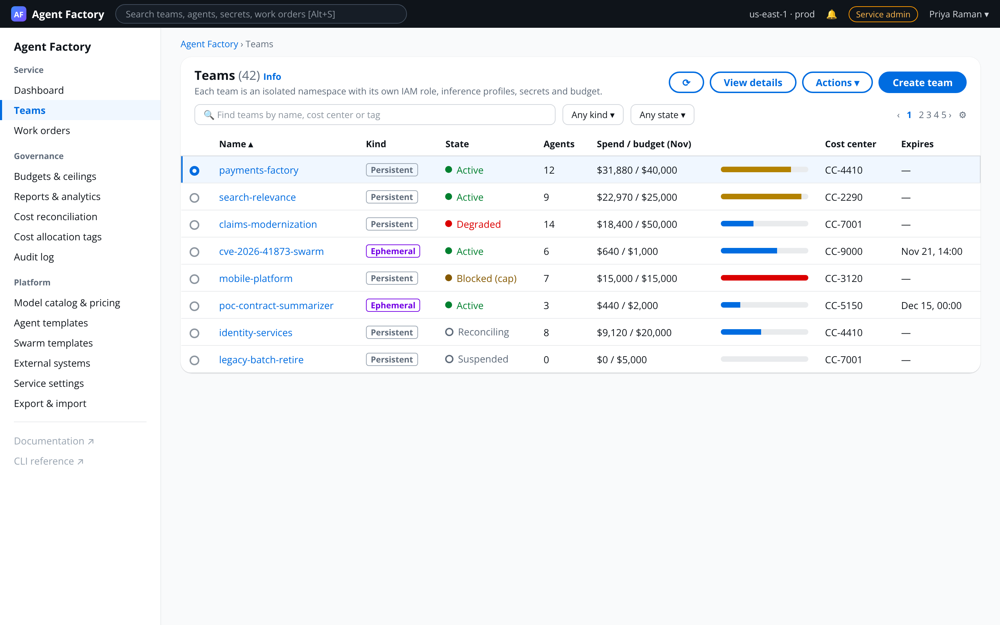

**S3 · Create team, step 1.** Wizard: details → models & network → budget → members → review. Step 1
chooses the lifecycle (persistent, or ephemeral for budgeted workloads and POCs), names the team (which
fixes its namespace), and sets the guardrails only service admins control: budget ceiling, compute quota
and isolation tier. It also picks the team's sign-in provider from the service's providers (ACC-1) and
asks for every required cost allocation tag (TAG-2); the team cannot be created without them.

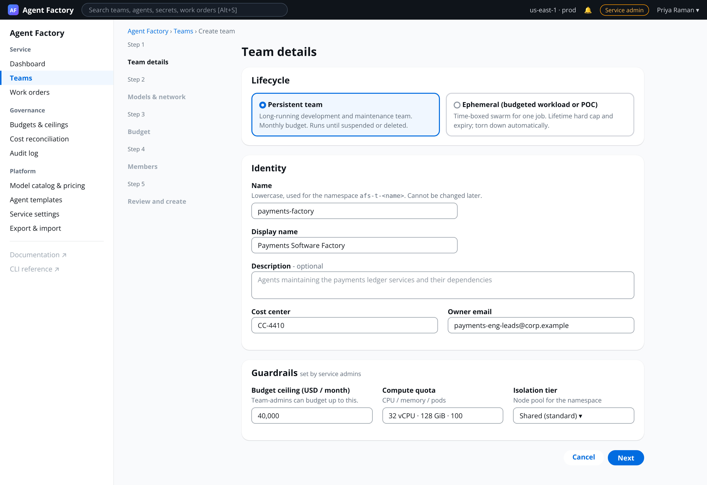

**S4 · Model catalog and pricing.** Bedrock models teams may enable, with effective-dated prices that the
gateway uses for real-time spend reservation. Price changes read daily from the AWS Price List wait in
*Price changes waiting for approval* until a service admin approves or rejects each; the price history
shows who approved what (BUD-9, decision D10).


**S5 · Audit log.** Append-only record of every state change, every denied request and every drift
correction, filterable by team, actor, action and outcome, downloadable as CSV.

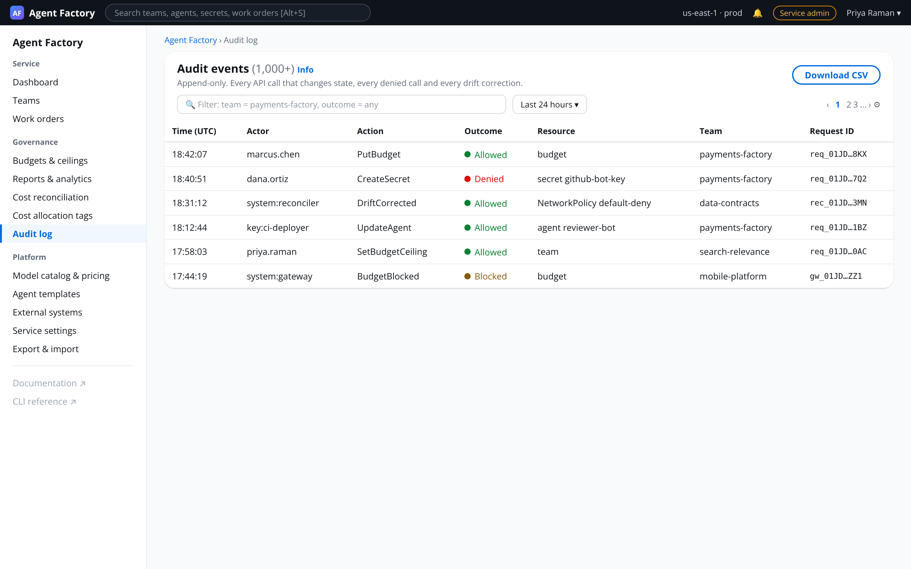

**S6 · Team AWS account access.** On a team's detail page, the *AWS account access* tab holds the team's
allowed-accounts filter: glob patterns over AWS Organizations account ids and names (`*` for every
account, `444455556666` for one, `payments-*` for a group by name). Below it, the organization accounts
that currently match, which pattern matched, and how many agent links point at each. Narrowing the filter
disables links that fall outside it. A *Team manages its own accounts* switch lets the team's admins edit
the filter themselves; while it is off, only service admins can, and team-admins see it read-only (TEAM-8).


**S7 · External systems catalog.** The outside services agents may reach. It ships with Atlassian (Jira
and Confluence), GitHub, Microsoft Outlook, Microsoft Teams, Microsoft Azure, Google, Slack, Okta, OpenAI
and OpenRouter, and service admins add custom systems (for example an internal artifact registry). Each
entry lists its endpoints and a service-level switch: off means off for every team. OpenAI and OpenRouter
carry an *Unmetered* badge and a notice: their calls bypass the gateway, so they are not counted in
budgets or stopped by hard caps, and they ship switched off. Below the catalog, service admins choose which
teams may declare their own systems (EXT-1 to EXT-6).


**S8 · Reports and analytics.** The service-level report across every team: spend against the sum of
budgets with forecast, calls and tokens, how many agents are working, idle, blocked or paused right now,
utilization, daily cost by Bedrock model (with EKS compute), a team table (spend and budget, tokens,
agents working, utilization, idle agents and denied egress) that opens each team's report, cost by
model, and traffic to external systems with denied attempts. A notice says that spend with model
providers other than Bedrock is not included (RPT-1 to RPT-8). A *Reconciliation* tab lists each team-day
with the gateway figure, the billed figure, the variance and whether it is over the threshold (BUD-6).

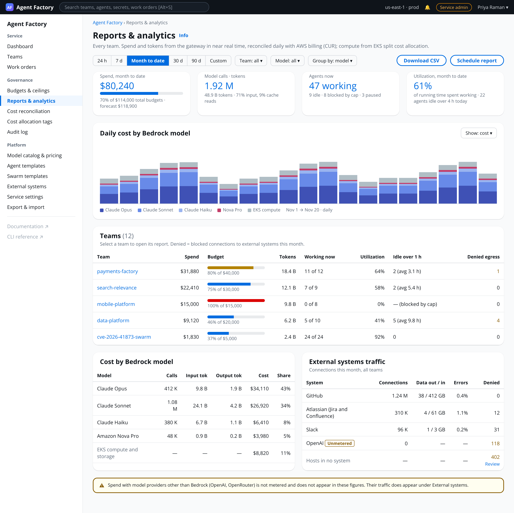

**S9 · Cost allocation tags.** The system tags (`afs-team-id`, `afs-agent-id`) that AFS always sets, the
service tags service admins define (fixed for every team, or required with an optional list of values
and a default), spend grouped by any tag, and the teams missing a required value (TAG-1 to TAG-7).

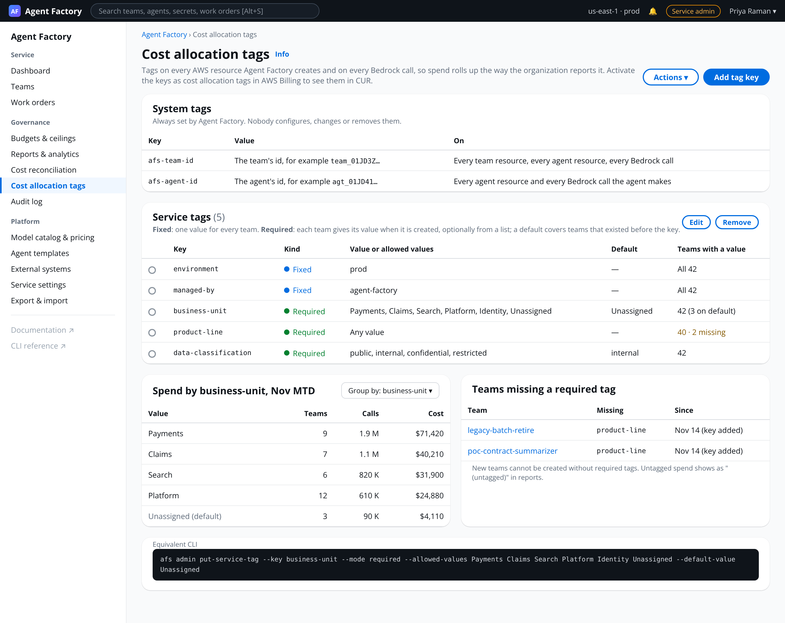

**S10 · Service settings.** No mockup; follows the S2 table pattern, with one tab per area:
- *Settings*: every key of §6.13 with its value, default, allowed range and last change. *Edit* validates
  the range before saving.
- *Identity providers*: Okta and Entra ID providers with issuer, client id, groups claim, default flag,
  enabled flag and the teams using each. A provider in use cannot be disabled (ACC-1).
- *Storage classes*: the classes teams may choose for agent volumes, with the default (AGT-9).
- *Agent templates*: the Agentic Teammates templates teams may use, each with its allowed image digests
  (AGT-11).
- *Service API keys*: keys with the security operator role, shown once at creation (ACC-4).
- *Security operators*: people and IdP groups bound to the security operator role (ACC-2).

Hidden from every role except service admins.

**S11 · Export and import.** No mockup; follows the S2 table pattern. *Create export* starts an
asynchronous export that the reconciler writes to S3; the list of past exports shows size, checksum and a
pre-signed download link. *Import* uploads a bundle (up to 100 MB) with an account map, runs a dry run first, shows the plan (create, update, skip per resource) and applies
it only on confirmation (CFG-5).

#### Team-admin

**T1 · Team overview.** Identity of the environment (namespace, cluster, IAM role, cost center), reconcile
status and conditions, budget burn, agent health and recent activity.

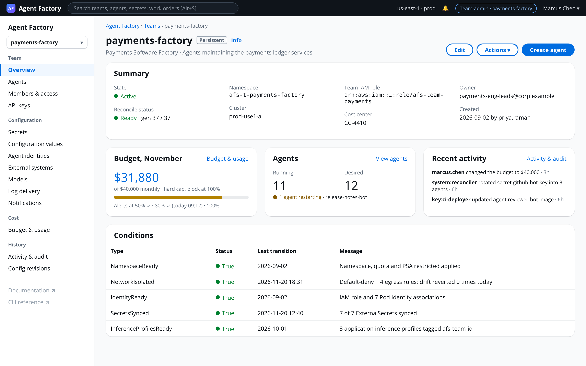

**T2 · Agents.** Agents with status, model, runtime template, bound secrets and cost. Selecting an agent
opens its detail panel with *Restart*, *Pause* and *Edit*, and tabs for secrets and identity, usage, logs
and revisions. An agent is one identity and runs as exactly one pod, so there is no replica count or
*Scale* action. A team adds capacity by adding agents (see AGT-7). The detail panel also shows the agent's
persistent volume (size, storage class, on-delete rule, snapshot schedule and last snapshot) with
*Take snapshot* and *Expand volume*. Team viewers see the same panel read-only.


**T3 · Create agent.** Template from the Agentic Teammates catalog, image pinned by digest, persona, model
(limited to models enabled for the team), resources, and secret bindings as environment variables or
files. There is no replicas field: each agent is a single pod with its own ServiceAccount and IAM identity.
The *Persistent storage* section sets the agent's volume for memory, configuration and work in progress:
size, storage class (from the classes a service admin offers), what happens to the volume when the agent
is deleted, and snapshot backups (AGT-9). The *Configuration values* section lists the agent's non-secret
settings. For each name the team-admin either types an agent value or picks *Use namespace value*, which
is offered only when the namespace has a value of that name; the effective value is shown beside it
(CFG-7). The *AWS identity* section chooses the team's shared role or a dedicated role for this agent;
cross-account roles need a dedicated role and are added after creation (AGT-6, AGT-10).
Binding lists only the team's shared secrets and this agent's own secrets. The side panel shows the
equivalent CLI command.


**T4 · Secrets, with create dialog.** Secrets are stored in AWS Secrets Manager. *Create secret* asks
only for a scope (*Team shared* or one agent), a name, a description and the value, and sends the value
once, straight to Secrets Manager. The user never types or edits the Secrets Manager path. AFS builds it
from the hierarchy `<service>/<namespace>/<agent>/<secret-name>`, or `<service>/<namespace>/_shared/<secret-name>`
for team-shared secrets (SEC-5), and shows it read-only. The table shows scope, the managed path, usage,
rotation and last change; the value column always reads "Write-only".

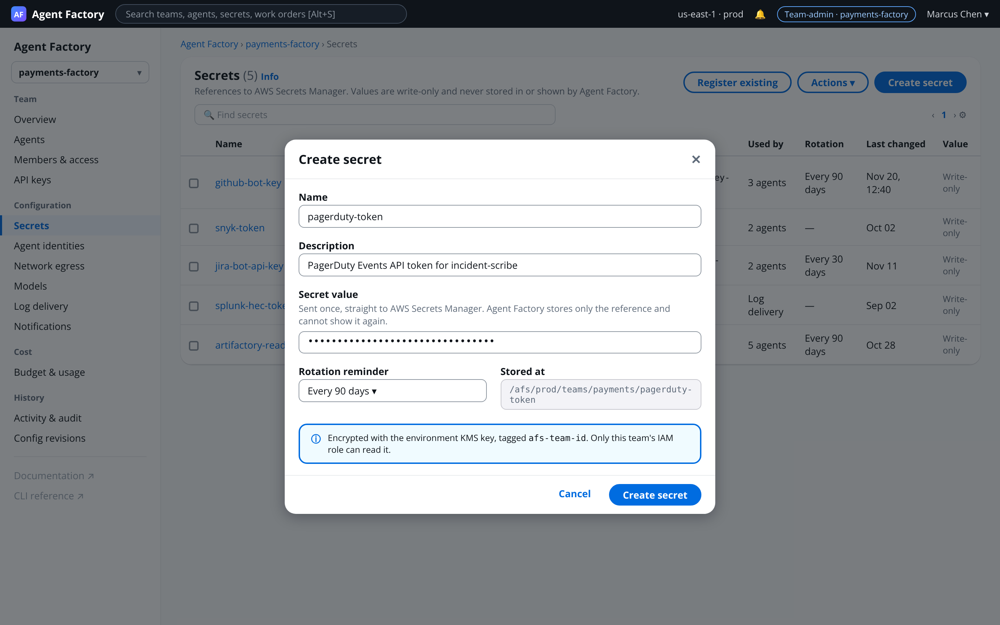

**T5 · Budget and usage.** Month-to-date spend, month-end forecast with projected cap date, the action at
exhaustion, the latest reconciliation result, daily spend split between Bedrock tokens (real time) and EKS
compute (daily from CUR), and spend by agent.

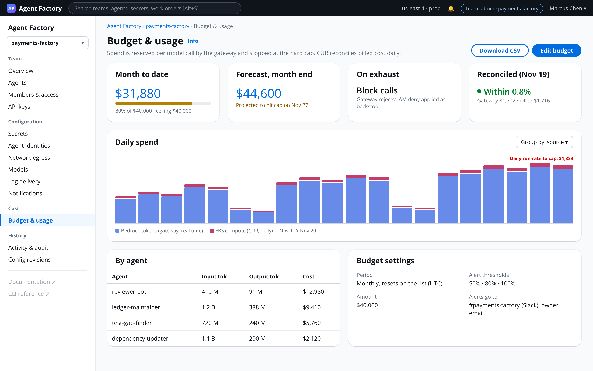

**T6 · Members and access.** Role bindings for people and IdP groups. Team-admins grant team-admin or
team viewer on their own team; API keys for pipelines are on the second tab, which only team-admins and
service admins see (D50). The page also shows the team's sign-in provider, which team-admins can change
among the service's enabled providers (ACC-1, D21).

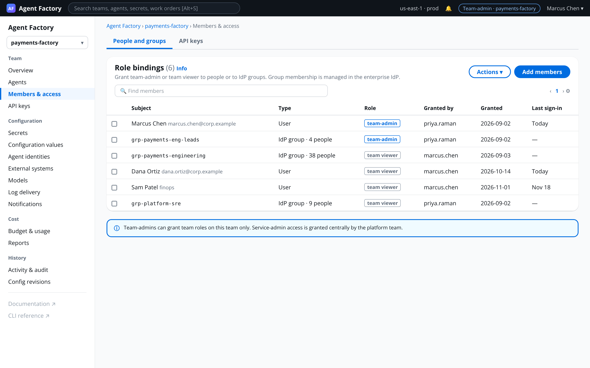

**T7 · Configuration values.** The namespace's non-secret values (name, value, description, how many agents
use each) and, below, every agent value with its source (*Namespace* or *Agent value*) and effective value.
Changing a namespace value restarts the agents that use it. Team viewers see the same page read-only.

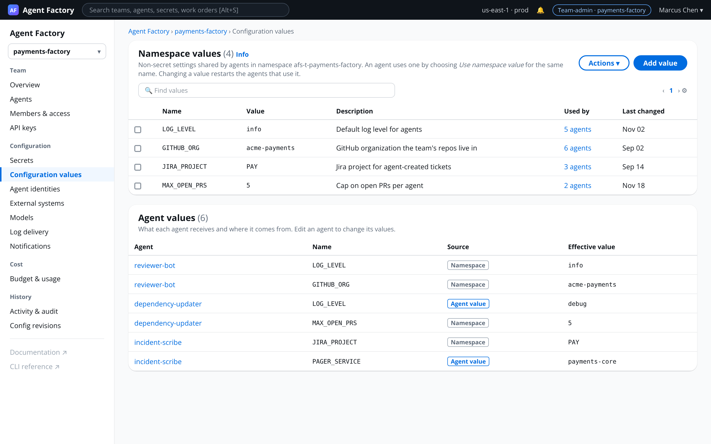

**T8 · Agent AWS access, with add-role dialog.** The agent's *Secrets & identity* tab shows its AWS
identity (shared team role or a dedicated role, the role ARN and the Pod Identity association) and the
accounts the team may use. Below it, *Cross-account roles* lists the roles in other organization accounts
the agent may assume: the profile name the agent uses, the account, the role ARN, the link status
(*Pending trust*, *Verified*, *Failed* or *Disabled*) and when it was last verified. *Add cross-account
role* offers only accounts inside the team's filter, takes the target role ARN, a profile name and a
maximum session length, and shows the trust policy (with the external ID AFS generated) for the target
account's owner to add to that role. *Verify now* assumes each role and updates the status. Team viewers
see the identity, links and trust policies read-only (AGT-6, AGT-10).

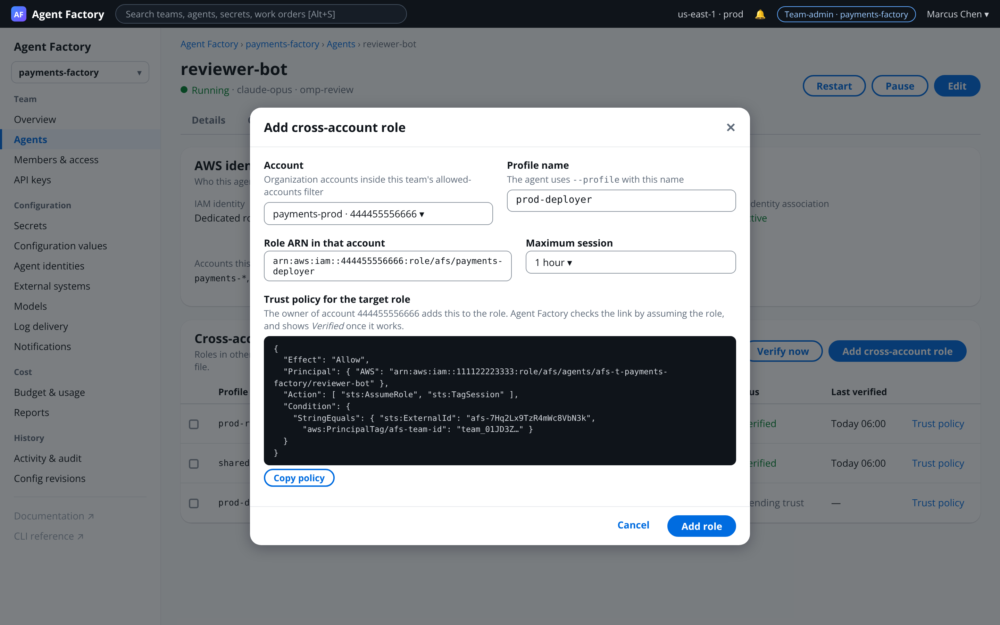

**T9 · External systems, with declare dialog.** Every system the team can use: catalog systems (on unless
the team turns them off) and the team's own declared systems, with endpoints, how many agents have access
and the secrets that are credentials for each. Systems switched off by service admins show as *Off for all
teams* and cannot be turned on. When service admins allow it, *Declare system* adds a team system with
name, category, endpoints, owner, documentation and purpose, so the team's dependencies are written down
and controlled. Team viewers see this page read-only (EXT-2, EXT-3).


**T10 · Agent external systems.** The agent's *External systems* tab shows its effective access: each
system the team has on, with a switch to turn it off for this agent and a note saying why. Systems turned
off at the team or service level show *Off above* and cannot be turned on. Team viewers see it read-only
(EXT-4).

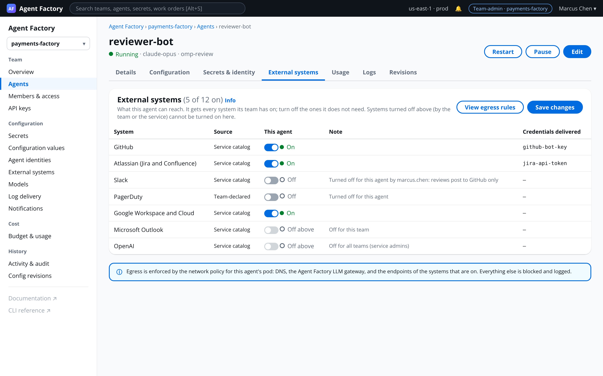

**T11 · Team reports.** Tabs for budget and usage, activity, models and external systems, with a time
range (24 hours to 90 days, or custom), filters by agent and model, *Download CSV* and *Schedule report*.
The first tab shows spend against budget with forecast, calls and tokens, utilization and idle time,
daily cost by Bedrock model, an hourly activity heatmap per agent, and each agent's current state (with
what it reports it is doing), utilization, how long it has been idle and its cost. Team viewers see the
same reports (RPT-2 to RPT-6).

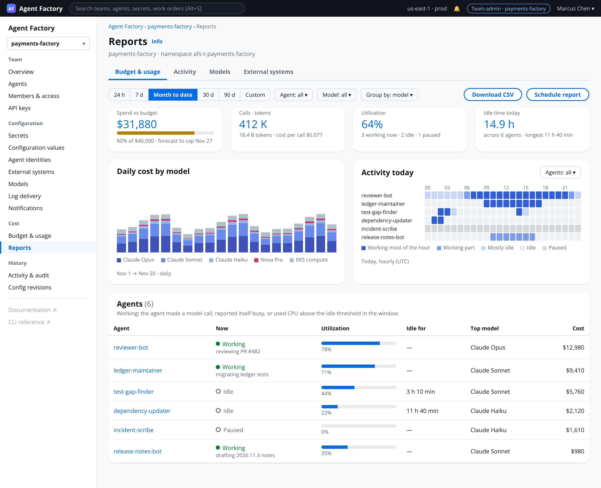

**T12 · Agent usage.** The agent's *Usage* tab: cost, calls and tokens, utilization and the longest idle
stretch, a timeline of the day in five-minute windows (working, partly working, idle), cost by model
and traffic to external systems, including denied attempts and why they were denied (RPT-3 to RPT-7).

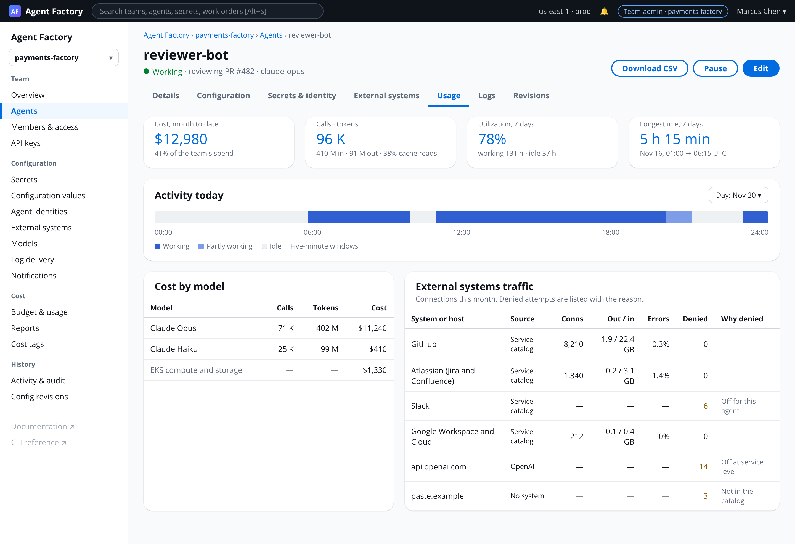

**T13 · Cost tags.** The tags the team carries and where each comes from (system, service fixed, service
required), the team's own optional tags, and where the tags are applied. Team-admins set required values
and their own tags; viewers see the page read-only (TAG-2 to TAG-5).

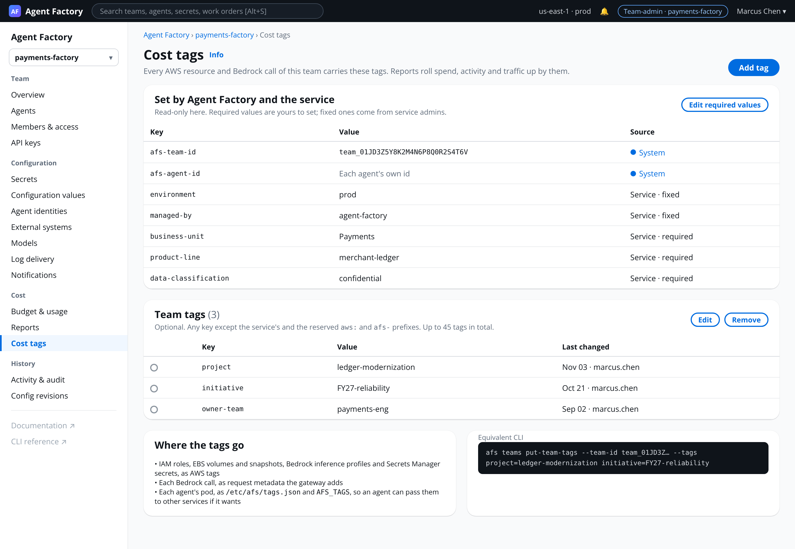

**T14 · Log delivery and notifications.** No mockup; follows the S2 table pattern. Two tabs. *Log
delivery* lists the team's destinations (CloudWatch, S3, OTLP, Splunk HEC, Datadog) with status and last
delivery; credentials are secret references. *Notifications* lists the team's channels (Slack, email,
webhook, Jira) with the events each receives and its delivery status, and a *Send test* action. Team
viewers see both read-only (OPS-1, OPS-3).

**T15 · History.** No mockup; follows the S2 table pattern. *Activity & audit* lists the team's audit
records (actor, action, resource, outcome, request id), filterable and downloadable as CSV. *Config
revisions* lists revisions per resource with a diff of any two; *Restore* runs a dry run, shows the plan
and restores on confirmation (CFG-3, CFG-6). Team viewers see both read-only; *Restore* is disabled for
them.

#### Team viewer

**V1 · Team overview, read-only.** The same page as T1 with an information banner. *Edit*, *Actions* and
*Create agent* are disabled with a "Requires team-admin" tooltip. The *API keys* tab of T6 is not
shown (D50).

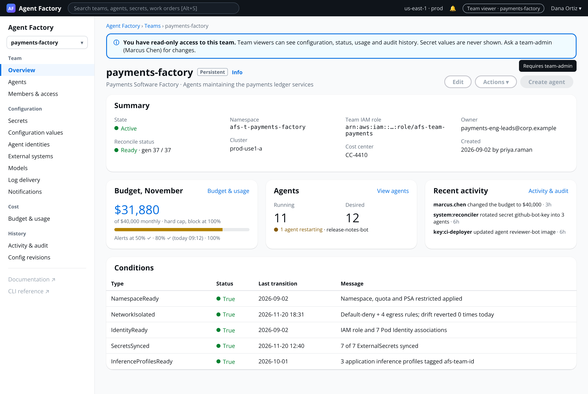

**V2 · Secrets, read-only.** Viewers see which secrets exist, their scope, managed path and where they
are used, so they can troubleshoot, but cannot create, rotate or bind them, and nobody sees values.


#### Budgeted workloads, swarms and CVE remediation

Screen ids P2 to P6 are kept as they are because the repository PRDs cite them; there is no P1.

**P2 · Ephemeral team budget.** For a POC or swarm rental the budget step asks for a lifetime hard cap, an
expiry (at most the service's maximum, default 90 days) and the teardown rule: *at expiry*, *at cap or
expiry* (the default for POCs) or *when its work order completes* (the default for remediation teams).
It shows an estimate of daily cost and when the cap would be reached.

**Swarms and pools.** A swarm is an ephemeral team, and it still runs several agents with
different identities that work together, for example a scanner, a PR writer and a reviewer. The
difference is that each of those agents can be a **pool**: one definition with its own identity (one
ServiceAccount, one IAM role, its own secrets and GitHub identity) and a worker count. Workers in a pool do
similar work across many repositories, so they share the pool's identity instead of having one each. The
model is swarm (ephemeral team, one lifetime budget and expiry) → pools (one identity each, N workers) →
workers (pods). Pools in a swarm can be grouped (for example "scan" and "fix" stages) and hand work to
each other. Audit and usage are attributed to the pool, with the worker's pod name recorded for
troubleshooting. Long-running team agents stay one identity, one pod (AGT-7). Storage for a pool is
chosen per pool: an ephemeral scratch volume per worker (the default, deleted with the worker), and
optionally one shared read-write volume for the pool (EFS) for shared memory or caches. Pool workers do
not get individual persistent volumes. For AWS access, a pool can optionally use a **shared named role**
in one or many organization accounts: one role name (for example `afs-cve-remediation`) deployed to
every target account, typically by a CloudFormation StackSet, that the pool's workers assume through
one profile per account. The accounts still have to be inside the team's allowed-accounts filter.


**P4 · Pools and stages.** In an ephemeral team, *Pools & stages* lists the swarm's stages in order and,
in each, its pools with template, model, desired and reporting workers (working, idle, impaired), the
pools it hands work to, storage (scratch per worker, shared EFS or none), its shared named role and the
accounts it is linked in, and spend to date. Team-admins create, scale (0 to 200 workers), pause and
delete pools; *Create pool* has the same template, image, model, secrets and configuration sections as
*Create agent*, plus worker count, stage, handoffs and storage. A pool's name shares the team's agent
names and cannot change. Viewers see everything read-only (AGT-8).

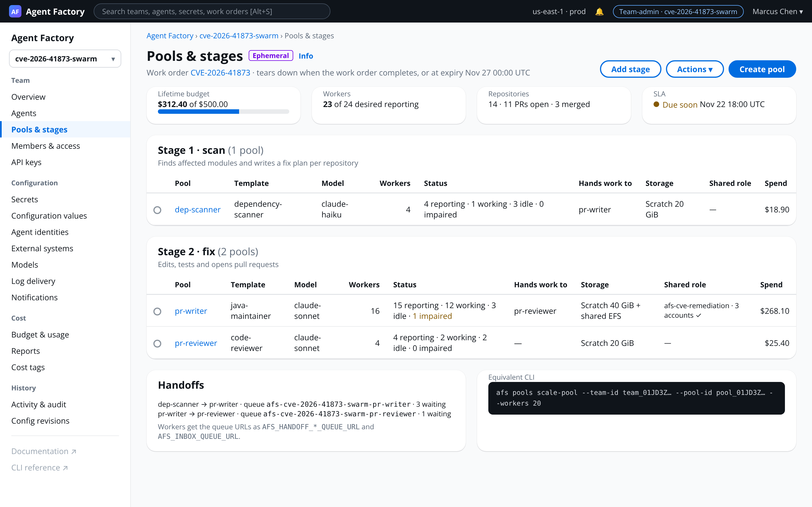

**P5 · Swarm templates.** Service admins keep the templates that work orders turn into remediation
teams: stages, pools (template, image, model, workers, storage, shared role name), handoffs, the secrets
each pool needs (created empty for the team to fill, or bound from a service-level source), configuration
values, the default cap, time to live and teardown rule. A template can be disabled; its revisions are
kept (WO-2).

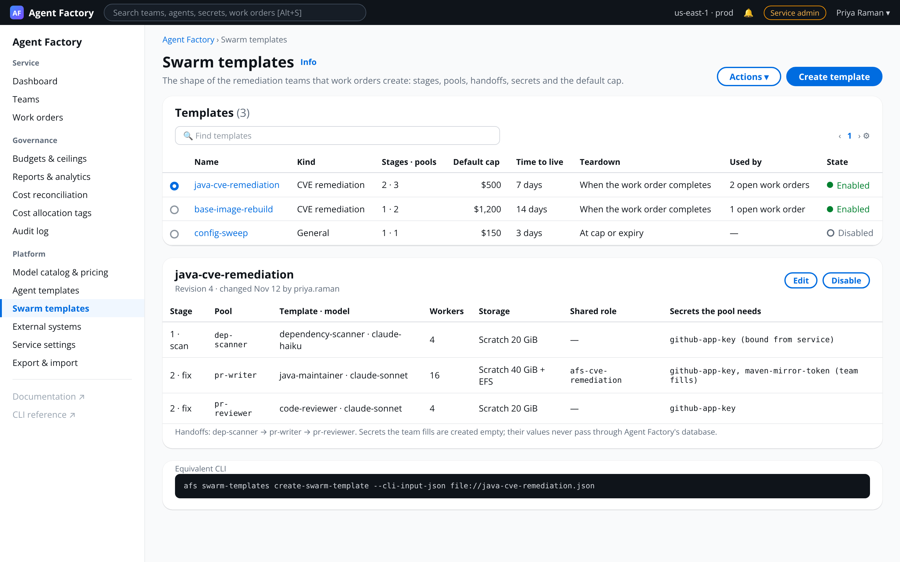

**P3 · Work orders.** CVE work orders from the security team with affected repos, PR progress, owning
teams to notify, SLA due date and state (*on track*, *due soon*, *breached*, *met*, *missed*) and the
remediation team assigned. Security operators and service admins see every work order; a team sees
those assigned to it and those that touch a repository it owns, read-only.

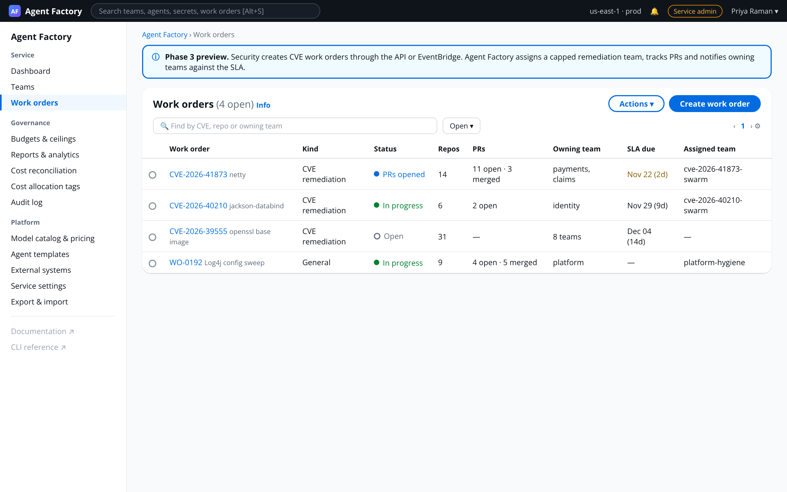

**P6 · Work order detail.** The CVE, severity, source (API or EventBridge), SLA and its state, the swarm
template and cap, the remediation team with its spend against the cap and its pools, and one row per
affected repository: owner (an AFS team or an outside contact), status (*pending*, *in progress*, *PR
opened*, *merged*, *not affected*, *failed*, *skipped*), the pull request link, and every notification
sent with its time. *Cancel* stops the remediation team (its teardown rule then applies) (WO-1 to WO-6).

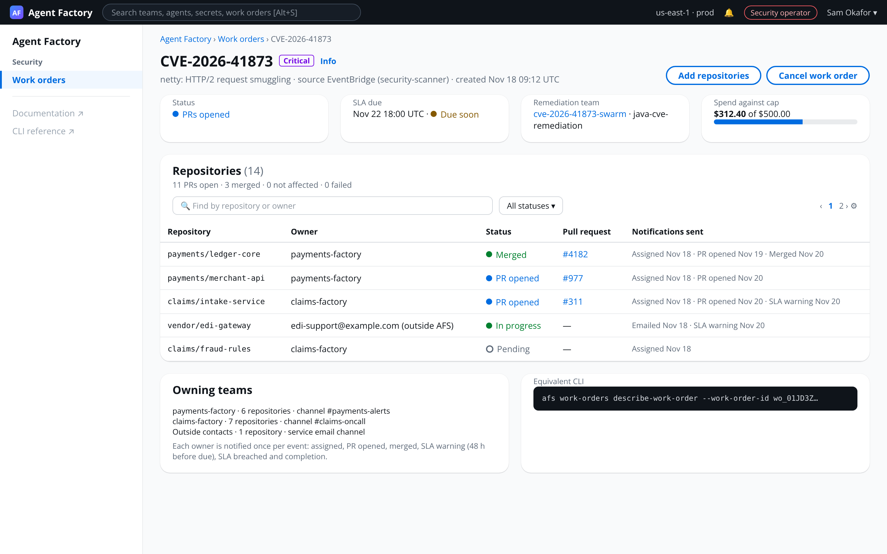

### 5.4 Key flows

| Flow | Role | Steps |
|---|---|---|
| Onboard a team | Service admin | Teams → Create team → details (guardrails, provider, required tags) → models & network → budget → members (first team-admin) → review → team appears `Reconciling`, then `Ready` |
| Stand up agents | Team-admin | Secrets → Create secret → Agents → Create agent → bind secrets → status `Ready` |
| Respond to budget alert | Team-admin | Alert (Slack/email) → Budget & usage → see top agents → pause an agent, or raise budget up to ceiling |
| Hard cap reached | System → team-admin | Gateway blocks calls → agents receive `402 BudgetExceeded` → team and its agents stay `Ready` with condition `BudgetExhausted=True`, shown as *Budget blocked* → team-admin raises the budget up to the ceiling, asks a service admin for a higher ceiling (or a temporary raise), or waits for the period reset |
| Investigate | Team viewer | Overview → conditions → History (T15): Activity & audit → Config revisions |
| Recover environment | Service admin | Restore DB (PITR) or import bundle → reconciler converges → dashboard shows the reconciler healthy and every team `Ready` |
| POC | Service admin / team-admin | Create team → Ephemeral → cap + expiry + teardown rule → run → automatic teardown; config and audit retained |
| Swarm | Team-admin | Ephemeral team → Pools & stages → create stages → create pools (identity, secrets, workers, handoffs) → scale → teardown at cap, expiry or work complete |
| CVE remediation | Security operator → system → owning teams | Create work order (console, CLI, API or EventBridge) → AFS creates the remediation team from the template within the cap → pools open PRs per repository → owners notified on PR, before the SLA and on completion → team torn down when the work order completes |

## 6. Functional requirements

Every requirement below is in scope for the feature-complete release (J, 2026-11-21). The priority only
orders the build: **P0** first, then **P1**, then **P2** (see the milestones in section 9).

### 6.1 Teams and environments

| ID | Requirement | Pri |
|---|---|---|
| TEAM-1 | Service admins create, update, suspend, resume and delete teams; team-admins update, suspend and resume their own. What each lifecycle action does to each resource is TEAM-9 | P0 |
| TEAM-2 | Each team gets one namespace `afs-t-<name>` with Pod Security `restricted`, ResourceQuota and LimitRange | P0 |
| TEAM-3 | Default-deny NetworkPolicy for ingress and egress; allow DNS, the LLM gateway and, per agent, the endpoints of the external systems that agent may use (EXT-5) only | P0 |
| TEAM-4 | Admission policy blocks teams from altering their own isolation (NetworkPolicies, LoadBalancer/NodePort Services, hostNetwork, privileged pods) | P0 |
| TEAM-5 | Team status shows reconcile `phase` (`Pending`, `Reconciling`, `Ready`, `Degraded`, `Failed`, `Deleting`), lifecycle `state`, observed generation and conditions (D24) | P0 |
| TEAM-6 | Isolation tier per team: *shared* (the default) or *dedicated*, a node pool for that team only (tainted and labelled so only its pods run there). Only service admins set it, when creating or managing the team. Dedicated nodes carry the team's tags, so their cost reaches the team through CUR split cost allocation (D16) | P1 |
| TEAM-7 | Ephemeral teams require an expiry (at most service setting `teams.ephemeral_max_days`, default 90), a lifetime budget that blocks at the cap, and a teardown rule: at expiry, at cap or expiry, or when the team's work order completes (or at expiry). The reconciler tears the team down when the rule fires, as TEAM-9 describes, and records when and why; the team record, configuration revisions, usage and audit are kept. A team's kind cannot change after creation. Teams expiring within 7 days show on S1 | P2 |
| TEAM-8 | Each team has an allowed-accounts filter: the organization accounts its agents may assume roles in, as glob patterns (`*` and `?`) over AWS account ids and names, with `*` for all accounts. Empty (the default) means none. AFS mirrors the AWS Organizations account list hourly so names resolve to ids; suspended or closing accounts never match. The filter is enforced in the API, in the database, and in the team's IAM permissions boundary (`sts:AssumeRole` only on `arn:aws:iam::<matching-account>:role/*`). Narrowing it disables links outside it. Service admins decide per team whether the team manages its own filter: when it does, its team-admins set it; when it does not, service admins set it (D6). Team-admins choose link targets within it either way | P1 |
| TEAM-9 | Lifecycle semantics. Suspend, resume, delete and teardown act on every resource a team owns exactly as the table below says. A suspended team is read-only for everyone (people and API keys) except *Resume* and *Delete*; mutations get `409 Conflict`. Delete of a persistent team and teardown of an ephemeral team do the same work; teardown also records the rule that fired (D53) | P0 |

#### 6.1.1 Team lifecycle (TEAM-9)

States: `active` ⇄ `suspended`; `active` or `suspended` → `deleting` → `deleted`. Delete and teardown
are not reversible; recovery is an import (CFG-5).

| Resource | Suspend | Resume | Delete or teardown |
|---|---|---|---|
| Agent pods, pool workers | Scaled to 0; each agent's and pool's own `paused` flag is kept | Restored to the state before suspend | Stopped, then their objects deleted with the namespace |
| Agent volumes (EBS) | Kept | Reattached | Each agent's on-delete rule: final snapshot then delete (default), delete, or retain (volume kept and tagged, no longer managed) |
| Volume snapshots | Kept; schedules paused | Schedules resume | Scheduled snapshots pruned; the final snapshot is kept for restore or import and is listed in the team's history |
| Secrets Manager secrets | Kept; External Secrets stop syncing | Sync resumes | Deleted with a 30-day recovery window |
| Pool EFS access points | Kept | Kept | Deleted with their data (shared pool storage is scratch) |
| SQS inbox queues | Kept; messages kept for the queue's retention | Kept | Deleted |
| Dedicated NodePool (Karpenter) | Kept; nodes scale to 0 with no pods | Nodes return on demand | Deleted |
| EKS access entries (viewer kubectl) | Removed | Recreated if `viewerKubectl` is on | Removed |
| IAM roles, boundary, Pod Identity associations | Kept; the team's Bedrock role gets the explicit deny | Deny removed unless the budget is exhausted | Deleted; target-account trust policies are listed for their owners to remove |
| Gateway | Rejects calls with `403 AccessDenied` (`reason = team_suspended`) | Accepts calls | Rejects the namespace's tokens with `401 Unauthenticated` |
| Bedrock inference profiles | Kept | Kept | Deleted |
| Namespace, NetworkPolicies, ConfigMaps | Kept | Kept | Deleted |
| Log destinations, notification channels | Kept; the `team.suspended` event is delivered | Kept | Final events delivered, then removed |
| Team API keys, role bindings | Keep authenticating; writes refused | Writes allowed | Revoked and removed (kept in the audit log) |
| Budget, spend counters | Kept; no spend | Kept | Kept read-only |
| Team row, revisions, usage, cost, activity, traffic, audit | Kept | Kept | Kept; `state = deleted`, `tornDownAt`, `teardownReason`; readable by service admins |
| Work order (remediation team) | Unchanged | Unchanged | `failed` when repositories remain, else already `done` |

### 6.2 Agents and identity

| ID | Requirement | Pri |
|---|---|---|
| AGT-1 | Team-admins create, update, pause, restart and delete agents | P0 |
| AGT-2 | Agents use templates from the service's agent template catalog (AGT-11); images are pinned by digest and must be one of the template's allowed digests | P0 |
| AGT-3 | Each agent gets its own ServiceAccount; AWS access via EKS Pod Identity. Pod Identity cannot add custom session tags, so the team is a tag on the role (`afs-team-id`, plus `afs-agent-id` or `afs-pool-id` on a dedicated role), read in IAM conditions as `aws:PrincipalTag/afs-team-id`, and the agent is identified by the session tags Pod Identity sets itself (`kubernetes-namespace`, `kubernetes-service-account`, `kubernetes-pod-name`). IAM conditions that scope a team use `aws:PrincipalTag/kubernetes-namespace` (D26, OQ-1) | P0 |
| AGT-4 | Agents have no direct Bedrock permission; model calls go through the gateway | P0 |
| AGT-5 | External identities (GitHub App installation, bot accounts) are modeled per agent with credentials as secret references | P1 |
| AGT-6 | Each agent runs either with its team's shared IAM role (the default) or with a dedicated IAM role of its own (path `/afs/<namespace>/`, name `afs-<agent id>` such as `afs-agt_01JD3ZQ5N7RW2X4Y6Z8A0B2C4D`, tagged `afs-team-id`, `afs-agent-id` and `afs-agent-name`, mapped by Pod Identity, carrying the team's permissions boundary). Roles and queues are named by immutable id, never by display name, so two teams can each have an agent called `reviewer` (D25). Team-admins choose this when creating or editing the agent. A dedicated role is required for cross-account roles (AGT-10); an agent with links cannot switch back to the shared role until they are removed | P1 |
| AGT-7 | One agent is one identity and one pod (a StatefulSet with one replica, so the name, ServiceAccount, IAM session and audit trail stay stable). There is no replica count. A team scales by adding agents. Swarm pools are the exception (AGT-8) | P0 |
| AGT-8 | Swarms (ephemeral teams) hold several pools that work together, alongside any agents. Each pool has its own identity (ServiceAccount, IAM role, GitHub identity), secrets, configuration values, external-system opt-outs and a worker count (0 to 200); its workers share that identity and run as a Deployment. Pools can be grouped into ordered stages and hand work to named pools. Each receiving pool has one SQS inbox queue (`afs-<team ulid>-<short hash>`); the receiver gets `AFS_INBOX_QUEUE_URL`, and each pool that hands work to it gets `AFS_HANDOFF_<TO_POOL_NAME_UPPER_SNAKE>_QUEUE_URL` pointing at that inbox. Only the roles of pools with a handoff to it may send (D32). Pools exist only in ephemeral teams, and pool and agent names share the team's namespace. Storage per pool: a scratch volume per worker (1 to 500 GiB, deleted with the worker), plus optionally one shared EFS volume for the pool; workers get no persistent volume. The swarm has one lifetime budget; usage, activity, traffic and audit are attributed to the pool, with the worker pod recorded. A pool can use one shared named role in one or many organization accounts (inside the team's allowed accounts): the same role name in every account, one profile per account in the workers' AWS config, verified like AGT-10 | P2 |
| AGT-9 | Every agent has one persistent volume (encrypted EBS gp3 by default, through a StatefulSet volume claim) mounted at `/var/lib/agent` for memory, configuration and work in progress. It survives restarts, pauses, image upgrades and reschedules. Team-admins set size (1 to 1000 GiB, default 20, grow only), storage class (from the service admin's list, fixed after creation), on-delete rule (snapshot then delete by default, delete, or retain) and snapshot schedule (off, daily or weekly, keeping 1 to 90). Viewers see the settings and snapshot history read-only. Volume usage counts toward the team's storage quota, and EBS cost is attributed to the team by tag | P0 |
| AGT-10 | An agent with a dedicated role can be linked to roles in other accounts of the organization, inside the team's allowed accounts (TEAM-8). Each link has the target role ARN, a profile name, a maximum session (15 minutes to 12 hours) and an external ID that AFS generates. AFS shows the trust policy for the target account's owner to add (principal: the agent's role; conditions: the external ID and `aws:PrincipalTag/afs-team-id`, which comes from the role's tag). The reconciler grants the agent's role `sts:AssumeRole` on the target, writes an AWS config file into the pod with one profile per link (`role_arn`, `external_id`, `credential_source`, and `role_session_name` set to the agent id), verifies each link by assuming it (on creation, daily and on demand) and records *Pending trust*, *Verified*, *Failed* or *Disabled*. A link's role ARN and external ID cannot change; replace the link instead. Team-admins add and remove links; viewers see them read-only. CloudTrail in the target account shows the agent through the role name, the role's `afs-team-id` and `afs-agent-id` tags and the session name (D51); whether Pod Identity session tags carry through the role chain is checked in the M0 spike (OQ-1) | P1 |
| AGT-11 | Agent template catalog. Service admins curate the Agentic Teammates templates teams may use: name, description, harness, default resources and the list of allowed image digests, with one marked current. Teams pick only enabled templates and allowed digests; disabling a template or removing a digest blocks new agents and pools with it and flags existing ones with condition `TemplateRetired=True`, without restarting them. Every change is audited and versioned (S10). Today `agents.template` is free text; the catalog needs a `-db` table `agent_templates` in a migration after 000013 (D54) | P0 |

### 6.3 Secrets

| ID | Requirement | Pri |
|---|---|---|
| SEC-1 | AFS stores Secrets Manager references and metadata only; no secret value is stored, logged or returned | P0 |
| SEC-2 | Create through AFS only: the user gives scope (team shared, one agent, or one pool), name and value; the value goes straight to Secrets Manager. Registering an arbitrary existing ARN is not offered, because it would bypass the managed hierarchy | P0 |
| SEC-3 | Bind secrets to agents as env vars or files; delivered by External Secrets Operator. A team-shared secret can be bound to any agent in the team; an agent secret only to its own agent | P0 |
| SEC-4 | Rotate: new value, rolling restart of bound agents and pool workers. Viewers cannot rotate; a rotate on a secret whose value cannot be written to Secrets Manager fails with `503 Unavailable` and leaves the old value in place | P1 |
| SEC-5 | AFS alone sets the Secrets Manager name: `<service>/<namespace>/<agent-name>/<secret-name>`, `<service>/<namespace>/<pool-name>/<secret-name>` for pool secrets, or `<service>/<namespace>/_shared/<secret-name>`. `<service>` is the installation's prefix (service setting `secrets.path_prefix`, default `afs`). Users cannot set or change the path; team slug, agent name and secret name are immutable once created. IAM policies are prefix rules on this path: `afs-api` writes under `<service>/*`, a team's secret store reads `<service>/<namespace>/*`, a per-agent role reads only `<service>/<namespace>/<agent-name>/*` plus `_shared/*`, and a pool's role reads only `<service>/<namespace>/<pool-name>/*` plus `_shared/*`. The `afs-team-id` tag stays as a second check | P0 |
| SEC-6 | **Zero impact on the agent's container.** Secrets and configuration values reach the agent without code, SDKs, sidecars the agent talks to, or calls from the agent: each secret binding becomes an environment variable or a file at the path the team-admin chose (delivered by External Secrets Operator into a namespace Secret the pod mounts), configuration values become environment variables and files under `/etc/afs/config` (CFG-7), cross-account profiles a file under `/etc/afs/aws` (AGT-10) and tags `/etc/afs/tags.json` plus `AFS_TAGS` (TAG-4). A rotated secret or changed value rolls the agents that use it, so environment variables are always current. The model-call path is delivered the same way: `AFS_GATEWAY_URL`, `AWS_ENDPOINT_URL_BEDROCK_RUNTIME`, `ANTHROPIC_BASE_URL` and a projected token file (IF-5). An on-demand endpoint for secrets is a non-goal (D12) | P0 |

### 6.4 Budgets, usage and cost

| ID | Requirement | Pri |
|---|---|---|
| BUD-1 | Service admins set a budget ceiling per team; team-admins set the budget up to it. A ceiling cannot be lowered below the current budget. A service admin may raise a ceiling temporarily with an amount, an expiry and a reason (`ceilingOverrideUsd`, `ceilingOverrideExpiresAt`); while it is unexpired it is the effective ceiling. At expiry the reconciler clears it and, if the budget is above the base ceiling, lowers the budget to the ceiling, notifies the team-admins and emits `budget.ceiling_override_expired`. Ceilings, overrides and quotas are guarded in the API and the database (D34, D35) | P0 |
| BUD-2 | Gateway reserves worst-case cost before each model call and settles to actual; rejects with `402 BudgetExceeded` when the cap would be exceeded (not retryable). Worst case is `maxTokens` from the request (else the model's `max_output_tokens`) times the output price, plus request bytes ÷ 3 input tokens times the input price. A reservation not settled within service setting `gateway.reservation_ttl_seconds` (default 900) is released by the reconciler. The gateway creates the period's spend counter if it is missing, so a new month never blocks calls (D28, D31) | P0 |
| BUD-3 | IAM explicit deny on the team's Bedrock role when the cap is reached (backstop), removed on reset or increase | P0 |
| BUD-4 | Alerts at configurable thresholds (default 50/80/100%), once per period per threshold, as `budget.threshold_crossed` events delivered to the team's channels (OPS-3). At the start of each period the reconciler opens the new counter and emits `budget.reset` | P0 |
| BUD-5 | Usage by agent, model and day in near real time | P0 |
| BUD-6 | Daily CUR reconciliation of Bedrock (by inference-profile tag), EKS compute (split cost allocation by namespace) and agent volumes and snapshots (by `afs-team-id` tag), reported alongside the gateway's figures. A team-day whose gateway figure differs from the billed figure by more than the variance threshold (service setting `billing.variance_alert_pct`, default 5%) is flagged and alerts service admins (D10) | P1 |
| BUD-7 | Showback export by cost center and by any cost allocation tag (TAG-6), as CSV through the reports API (`groupBy=tag:<key>`), for service admins across teams and for a team's members within it | P1 |
| BUD-8 | Lifetime budgets for ephemeral teams: one budget for the team's whole life, blocking at the cap, with the same thresholds and alerts as monthly budgets. Pools and agents in the team share it. The cap can be raised up to the ceiling; it cannot be removed while the team exists | P2 |
| BUD-9 | Model prices stay current because token and model costs drive budgets: when price sync is on (service setting `pricing.price_list_sync`, default on), the billing job reads the AWS Price List daily and proposes each changed price as a pending change with its effective date. A service admin approves or rejects it; an approved price takes effect from its effective date or from the approval, whichever is later, and is never backdated. Manual prices remain possible. Every proposal and decision is audited (D10) | P1 |
| BUD-10 | Exhaustion action. A budget blocks at the cap (`onExhaust: block`, the default). A service admin may choose `notify` for a persistent team only: spend continues past the cap and alerts still fire. Ephemeral teams always block. Team-admins cannot set or change it; the API and the database refuse it (D33) | P0 |

### 6.5 People and access

| ID | Requirement | Pri |
|---|---|---|
| ACC-1 | SSO via OIDC: auth code + PKCE (web), device code (CLI, using each provider's public CLI client id, which the sign-in provider list returns, D48). The console shows a provider picker when more than one provider exists (D42). Okta (the default) and Microsoft Entra ID are both supported. Service admins configure the providers at service level (one is the default). When there is more than one, each team's provider is chosen when the team is created (service admins) or managed (team-admins), from the enabled service-level providers; a provider in use by a team cannot be disabled. A team's group role bindings use the team's provider; service-level group bindings name the provider their group comes from. Client secrets are Secrets Manager references (D1) | P0 |
| ACC-2 | Roles service admin, team-admin, team viewer, bound to users or IdP groups, per team; plus security operator, a service-level role limited to work orders (D18) | P0 |
| ACC-3 | RBAC enforced in the REST API on every operation; `GET /v1/me` returns effective permissions for client UX | P0 |
| ACC-4 | API keys (max 90 days, hashed, shown once; seen only by team-admins and service admins, D50; a retried create never returns the key again, D52): team keys with the team-admin or viewer role, and service-level keys with the security operator role for security tooling (created by service admins) | P1 |
| ACC-5 | Read-only `kubectl` for a team's viewers and team-admins, switched on per team by service admins (default off). AFS creates an EKS access entry for the IAM role that the identity provider federates to (which role that is, per provider, is OQ-9) mapped to a namespace-scoped role that can get, list and watch workloads, events and logs, and nothing else: no secrets, exec, attach, port-forward or changes. `afs teams get-kubeconfig` writes the kubeconfig (D19) | P2 |

### 6.6 Configuration, recovery and audit

| ID | Requirement | Pri |
|---|---|---|
| CFG-1 | RDS PostgreSQL is the source of truth for desired state, with optimistic concurrency (`ETag`/`If-Match`) | P0 |
| CFG-2 | Reconciler applies desired state at startup and continuously; manual drift is reverted and audited | P0 |
| CFG-3 | Every change is versioned (config revisions) and every mutation is audited (append-only) | P0 |
| CFG-4 | PITR backups and cross-region/cross-account snapshot copies | P0 |
| CFG-5 | Export a versioned, checksummed bundle (no secret values); import with ARN/account mapping and dry-run plan. Agent volumes are carried as their settings plus the latest snapshot reference; import can restore an agent's volume from that snapshot once it is shared or copied to the target account. Teams' allowed-accounts filters and agents' identity settings and cross-account links (with their external IDs) are exported; import maps account ids and re-verifies every link. The external systems catalog, team-declared systems and team and agent opt-outs are exported too. Export is asynchronous: the reconciler writes the bundle to S3 and the export record holds a pre-signed download link. Import sends the bundle as the request body (JSON, up to 100 MB); `afs-api` applies it as desired-state writes, one transaction per team, and returns a report, so `afs-api` never reads S3 (D49) | P1 |
| CFG-6 | Restore a team to a previous revision | P1 |
| CFG-7 | Non-secret configuration values at two levels: the team's namespace (shared by its agents) and the agent. Each agent value is either its own literal value or a link to the namespace value with the same name (the link is offered only when that value exists). Team-admins manage both levels; viewers see names, values and sources read-only. Values are delivered to the agent's pod as environment variables and as files under `/etc/afs/config`, through a ConfigMap the reconciler owns (manual edits are reverted). Changing a value restarts the agents that use it. A linked namespace value cannot be deleted or renamed until no agent links to it. Names are `UPPER_SNAKE`; names that look like credentials (`*_PASSWORD`, `*_TOKEN`, `*_API_KEY` and similar) are refused with a pointer to Secrets, and a name cannot reuse an environment variable already used by the agent's secrets. Configuration values are included in export bundles | P0 |

### 6.7 Delivery and notifications

| ID | Requirement | Pri |
|---|---|---|
| OPS-1 | Per-team log delivery to CloudWatch, S3, OTLP, Splunk HEC or Datadog | P1 |
| OPS-2 | Events (team, agent, budget, drift, work order) published to EventBridge via a transactional outbox, at least once, in order per resource; consumers deduplicate on the event `id`. An event is published within 30 seconds of its commit (p95) | P0 |
| OPS-3 | Notification channels per team: Slack, email, webhook, Jira. The reconciler turns each channel into an EventBridge rule and target (an API destination for Slack, webhook and Jira; SES for email), and records delivery failures on the channel (D46) | P1 |
| OPS-4 | Credential hygiene in logs: agent logs and external-traffic records pass through a redaction step before storage or delivery. Values that look like passwords, tokens or keys (and the values of the agent's own bound secrets) are replaced by a stable token (`[redacted:<hash prefix>]`), so repeats can be correlated without exposing the value. Agent sign-ins to external systems (connections to a system's sign-in endpoints) are written to the team's log delivery as sign-in events with the agent or pool worker, system and time. They are not stored in the AFS database or shown in the console (D17) | P0 |

### 6.8 Work orders

| ID | Requirement | Pri |
|---|---|---|
| WO-1 | Security operators create CVE work orders (CVE id, severity, title, affected repositories with their owners, SLA due time, swarm template, optional cap) through the console, CLI, API, or an EventBridge event on the service bus. Events are deduplicated by event id; there is at most one open work order per CVE. Owners are AFS teams, outside contacts (email), or both | P2 |
| WO-2 | For each work order, AFS creates an ephemeral remediation team from the swarm template, with the work order's cap (or the template's) as its lifetime budget, the template's time to live as expiry, and *when its work order completes* as teardown rule. Service admins maintain the templates (P5) | P2 |
| WO-3 | Progress is tracked per repository: pending, in progress, PR opened (with link), merged, not affected, failed or skipped. The remediation team's agents and pools report progress through the API with the assigned team's identity; the reconciler also reads pull request state from GitHub through one GitHub App installation per organization, within a budget of 5,000 requests per hour per installation (OQ-5) | P2 |
| WO-4 | Owners are notified once per event: assigned, PR opened, merged, SLA warning (service setting `work_orders.sla_warning_hours` before due, default 48) and SLA breached, and on completion. AFS teams are notified on their channels; outside contacts by email through the service-level channel named in service setting `work_orders.notification_channel_id` (D22) | P2 |
| WO-5 | Work order `status` is `open` (created), `assigned` (team created), `in_progress` (a repository started), `pr_opened` (every remaining repository has a PR), `done`, `failed` or `cancelled`; `slaState` is separate (`on_track`, `due_soon`, `breached`, `met`, `missed`). A work order is done when every repository is merged, not affected or skipped; failed when the team is torn down with work remaining; cancelled by a security operator or service admin. Each change publishes a `work_order.*` event | P2 |
| WO-6 | Security operators and service admins see every work order; a team sees, read-only, those assigned to it and those touching a repository it owns | P2 |

### 6.9 Interfaces

| ID | Requirement | Pri |
|---|---|---|
| IF-1 | REST API `/v1`, OpenAPI 3.1 contract, AWS-style `maxResults`/`nextToken` pagination, error `{code, message, requestId}`. Creates accept an `Idempotency-Key`; a retry with the same key by the same caller within service setting `api.idempotency_key_ttl_seconds` (default 1 hour) returns the first response (D15). Every response carries `X-Afs-Contract-Version` so clients can warn when the server's contract is newer (D47). `afs-api` allows CORS only from the origins in service setting `api.cors_origins` (D43) | P0 |
| IF-2 | `afs` CLI: `afs <service> <operation>`, profiles, `--output json|table|text|yaml` (and `csv` on operations the contract marks *CSV*, D39), `--query`, pagination flags, `--cli-input-json`, `--generate-cli-skeleton`, AWS CLI exit codes | P0 |
| IF-3 | `@afs/sdk` TypeScript SDK generated from the contract with ergonomic resource clients and async pagination | P0 |
| IF-4 | Web console as specified in section 5, built on `@afs/sdk` with clean architecture, served as a static bundle from S3 and CloudFront per environment with runtime configuration from `/config.json` (D43) | P0 |
| IF-5 | Gateway interface for agents, as the [gateway contract](docs/contracts/gateway-contract.md) defines: Bedrock Runtime compatible paths (`converse`, `converse-stream`, `invoke`, `invoke-with-response-stream`) and an Anthropic Messages compatible path, streaming included, authenticated by the pod's projected token, with zero change to the agent's container (D28) | P0 |

### 6.10 External systems

| ID | Requirement | Pri |
|---|---|---|
| EXT-1 | A service-level catalog of external systems agents may reach. Each entry has a name, category, description, documentation link and endpoints (host or `*.domain`, optional port). AFS ships built-in entries for Atlassian (Jira and Confluence), GitHub, Microsoft Outlook, Microsoft Teams, Microsoft Azure, Google, Slack, Okta, OpenAI and OpenRouter. Service admins add custom entries for services not in the list, edit endpoints, and switch any entry off for every team. Built-in entries can be switched off but not deleted | P0 |
| EXT-2 | Teams inherit every system that is on at the service level, on by default. Team-admins switch systems off for the whole team. A team cannot switch on what the service level has off | P0 |
| EXT-3 | Service admins choose, per team, whether the team may declare its own systems (default: not allowed). A team-declared system needs an owner and a purpose, may have documentation, applies to that team only, and cannot reuse the name of a catalog entry. This is how teams declare, document and control the services their work depends on | P1 |
| EXT-4 | Agents inherit their team's systems, on by default. Team-admins switch systems off for one agent. Each level can only narrow the one above; the effective access of every agent, and which level turned a system off, is visible to team viewers read-only | P0 |
| EXT-5 | Enforced in the network: the reconciler renders the endpoints of the systems each agent may use into that agent's egress policy (FQDN rules, default deny). A change takes effect without restarting the agent. Hosts shared by two systems (for example `graph.microsoft.com` for Outlook and Teams) stay reachable while either is on; finer control comes from the credentials the agent holds | P0 |
| EXT-6 | Category *LLM* marks model providers other than Bedrock (OpenAI, OpenRouter). Their calls bypass the AFS gateway, so they are **not metered, not counted in budgets and not stopped by hard caps**. They ship switched off; the catalog, team and agent pages show an *Unmetered* badge, and turning one on at the service level asks for confirmation. Budgets for these providers are a non-goal of this release (section 3) | P0 |
| EXT-7 | A secret can name the external system it is a credential for. The reconciler does not deliver it to agents for which that system is off, and the secret's page shows the system. Every change to the catalog, a team's systems or an agent's systems is audited and versioned. The team's former egress allow-list becomes one team-declared system | P1 |

### 6.11 Reporting and analytics

| ID | Requirement | Pri |
|---|---|---|
| RPT-1 | Reports at three levels with the same measures: service (every team, service admins only), team (one namespace, its members) and agent. Every report has a time range (last 24 hours, 7, 30 or 90 days, month to date, or custom), filters (team, agent, model), grouping (by team, agent, model or day) and *Download CSV*. Team-admins and viewers see their own teams only | P0 |
| RPT-2 | **Budget and spend:** spend against budget for the period with month-end forecast and projected cap date, per team and summed across the service; spend per agent; reconciliation status against AWS billing. Spend and tokens are near real time from the gateway (within 5 minutes) and reconciled daily with CUR; EKS compute and storage come from CUR split cost allocation | P0 |
| RPT-3 | **Usage:** model calls, input, output and cache tokens, rejected calls (budget, model), cost per call and latency, per team, agent, model and day | P0 |
| RPT-4 | **Cost by Bedrock model** at service, team and agent level, with calls, tokens, cost and share, plus EKS compute as its own line | P0 |
| RPT-5 | **Agent activity:** every five minutes each running agent is recorded as *working* (it made a model call, reported itself busy, or used CPU above the idle threshold) or *idle*, or as paused, stopped, unhealthy or *Budget blocked* (condition `BudgetExhausted=True`, D24). Reports show each agent's current state and what it reports it is doing, utilization (working share of running time) over the range, an hourly heatmap, a day timeline, how long an idle agent has been idle, and the longest idle stretches. The idle threshold is service setting `reports.idle_cpu_millicores` (default 50) | P0 |
| RPT-6 | **External systems traffic:** connections and bytes each way (from Cilium Hubble), and requests and errors only where an egress proxy terminates HTTP (none is in this release's architecture, OQ-8), from each agent to each external system over time, at service, team and agent level. Denied attempts are reported with the reason (system off at the service, team or agent level, or a host in no system); they are a security signal: more than service setting `egress.denied_spike_threshold` (default 20) denials from one agent or pool in 5 minutes emits `egress.denied_spike`, which alerts team-admins and service admins. Traffic is reported as usage, never as cost: AFS does not know what external services bill (D14). Pool traffic is attributed to the pool and its worker pods | P1 |
| RPT-7 | Model providers other than Bedrock are marked unmetered: their spend is not in any report, and their traffic shows under external systems | P0 |
| RPT-8 | Scheduled reports: team-admins save a team report (usage, costs, activity or traffic, with its range, grouping and filters) to be sent daily, weekly or monthly as CSV to one of **the team's own** notification channels; service-level channels cannot be chosen. Viewers run reports on demand. Every report is also available through the API, CLI and SDK (D13) | P1 |
| RPT-9 | Every report can be grouped and filtered by cost allocation tag (TAG-6) | P1 |

### 6.12 Cost allocation tags

AFS has no access to the organization's hierarchy (business units, cost centers, products). Tags carry
it in, so spend can be rolled up the way the organization reports it, in AFS and in AWS billing.

| ID | Requirement | Pri |
|---|---|---|
| TAG-1 | **System tags.** `afs-team-id` and `afs-agent-id` are set by AFS on every resource and every Bedrock call it can attribute to a team or agent. Nobody configures, changes or removes them, and no other tag can use the `afs-` or `aws:` prefixes | P0 |
| TAG-2 | **Service tags.** Service admins define tag keys that are either *fixed* (one value applied to every team, for example `environment = prod`) or *required* (every team gives its own value, optionally from an allowed list, for example `business-unit`). A required key can have a default for teams that existed before it. A new team cannot be created without a value for every required key that has no default, and a team cannot remove one. Teams missing a value are listed for service admins and shown as untagged in reports | P1 |
| TAG-3 | **Team tags.** Team-admins add optional tags of their own (any key that is not a service key or reserved), and set the team's values for required keys. A team's effective tag set (system, service and team tags together) is at most 40 keys, which leaves room under AWS's limit of 50 per resource for the tags the EBS CSI driver and other AWS tooling add (D27, OQ-2). Viewers see all of a team's tags read-only | P1 |
| TAG-4 | **Where tags go.** The reconciler applies a team's tags to its AWS resources (IAM roles, EBS volumes and snapshots, Bedrock application inference profiles, Secrets Manager secrets), and the team's tags plus `afs-agent-id` to each agent's resources. The gateway adds the agent's tags as request metadata to every Bedrock call, at most 16 pairs (Bedrock's limit): system tags first, then service fixed and required tags, then team tags in key order; T13 lists the keys that do not fit (D27). Each agent's pod gets them as `/etc/afs/tags.json` and the `AFS_TAGS` environment variable, so an agent may pass them to other services; AFS does not alter the agent's calls to external systems, whose traffic is attributed to the agent (RPT-6) and so to its tags | P1 |
| TAG-5 | Tag keys and values follow AWS tag rules (keys up to 128 characters, values up to 256, letters, digits, spaces and `_ . : / = + @ -`). Keys that look like credentials are refused; tags are never secret. Every change is versioned and audited, and a tag change is applied to existing resources by the reconciler | P1 |
| TAG-6 | **Rollups.** Cost, usage, agent activity and external traffic roll up by any tag key and value at service level (service admins) and within a team's own scope. Rollups attribute every figure to the tags **in effect when it happened**: each usage, cost, activity and traffic record carries a snapshot of the team's tags at the time, and CUR lines carry the tags AWS billed with. Changing a tag changes later figures only. A record missing a currently required key shows under *(untagged)* for that key. Showback exports group by tag (BUD-7) (D20) | P1 |
| TAG-7 | Service admins are told, once, to activate the service and system keys as cost allocation tags in AWS Billing (a banner on S9 until acknowledged). The billing job records daily which keys CUR has seen and their activation status in AWS, shown per key on S9; a key not seen in 3 days of CUR after activation is flagged | P2 |

### 6.13 Service settings

Every service setting, set by service admins on S10 (`PutSetting`) and stored in `afs.service_settings`.
The database refuses a value outside its range. This table and the database contract are the only lists
(D45); ranges for the 000013 keys are D55.

| Key | Default | Allowed values | Used by | Migration |
|---|---|---|---|---|
| `secrets.path_prefix` | `"afs"` | `^[a-z][a-z0-9-]{0,30}$`; applies to new secrets only | SEC-5 | 000003 |
| `pricing.price_list_sync` | `true` | boolean | BUD-9 | 000010 |
| `billing.variance_alert_pct` | `5` | 0 to 100 | BUD-6 | 000010 |
| `api.idempotency_key_ttl_seconds` | `3600` | 60 to 604800 | IF-1 | 000011 |
| `teams.ephemeral_max_days` | `90` | 1 to 365 | TEAM-7 | 000012 |
| `work_orders.sla_warning_hours` | `48` | 1 to 720 | WO-4 | 000012 |
| `billing.tag_activation_acknowledged` | `false` | boolean; setting it to `true` is how S9's banner is acknowledged | TAG-7 | 000012 |
| `work_orders.notification_channel_id` | `null` | null, or the id (`nch_<ulid>`) of a service-level email channel | WO-4 | 000012 |
| `reports.idle_cpu_millicores` | `50` | 1 to 4000 | RPT-5 | 000013 |
| `egress.denied_spike_threshold` | `20` | 1 to 100000 denials per agent or pool in 5 minutes | RPT-6 | 000013 |
| `gateway.reservation_ttl_seconds` | `900` | 60 to 3600 | BUD-2 | 000013 |
| `api.cors_origins` | `[]` | array of `https://host[:port]` origins | IF-1, IF-4 | 000013 |

### 6.14 User stories and acceptance criteria

Product-level stories, US-1 to US-24. Each repository PRD breaks these into its own stories with acceptance criteria
for its layer, citing the story ids below (for example `-restapi` RA-US-4 refines US-4). Acceptance
criteria are written as Given / When / Then and are the basis of end-to-end tests in the dev
environment.

#### E1 Teams and access

**US-1 · Onboard a team.** As a service admin, I want to create a team with its guardrails, models,
required tags, sign-in provider and first team-admin in one wizard, so that a delivery team can start
without a platform ticket. *(TEAM-1, TEAM-2, TEAM-3, ACC-1, TAG-2, S3)*
- Given I am a service admin, when I complete the create-team wizard with valid input, then the team
  appears as `Reconciling` and becomes `Ready` within 60 seconds (p95), with namespace `afs-t-<name>`,
  Pod Security `restricted`, its ResourceQuota and LimitRange, and default-deny network policies.
- Given a required service tag has no default, when I leave it empty, then the review step blocks
  creation and names the tag, and the API refuses the same request with `ValidationError`.
- Given more than one sign-in provider exists, when I create the team, then I must pick one (the
  default is preselected), and the team's people sign in through it.
- Given I am a team-admin or viewer, when I call `CreateTeam`, then I get `403 AccessDenied` and an audit
  record of the denial.
- Given a team, when I read its status, then I see `phase`, `state`, `observedGeneration` and conditions,
  and `observedGeneration` equals `generation` once a change is applied (TEAM-5).

**US-2 · Manage who has access.** As a team-admin, I want to bind people and IdP groups to my team as
team-admin or viewer, and issue short-lived API keys, so that access follows our org chart and
pipelines can authenticate. *(ACC-2, ACC-3, ACC-4, T6)*
- Given I am a team-admin, when I add a group binding, then members of that group who sign in through the
  team's provider get the role on their next request, and the change is audited.
- Given I am a team-admin, when I try to grant `service_admin` or `security_operator`, then the request is
  refused with `403`, by the API and by the database.
- Given more than one sign-in provider, when I as team-admin change my team's provider to another enabled
  one, then group bindings use the new provider's groups from the next request; choosing a disabled
  provider is refused with `ValidationError` (ACC-1, D21).
- Given I am a viewer, then the *API keys* tab is not shown and `ListApiKeys` returns `403` (D50).
- When I create an API key, then its secret is shown once, it expires in at most 90 days, and only its
  prefix is shown afterwards.
- Given I am a viewer, then every control that changes membership is disabled with the tooltip
  "Requires team-admin", and calling the API directly returns `403`.

**US-3 · Isolation between teams.** As security, I want teams to be unable to see or reach each other,
so that one team's agents and people cannot touch another team's code, secrets or data. *(G2, TEAM-3,
TEAM-4, SEC-5)*
- Given two teams A and B, when a member of A requests any resource of B by id, then the API returns
  `404 NotFound` (never revealing it exists), and the database returns no rows even if the API's filter
  were missing (RLS test).
- Given an agent in A, when it opens a connection to a pod in B or to any host outside its allowed
  systems, then the connection is denied and recorded as a denied flow.
- Given a team-admin of A, when they try to create a NetworkPolicy, LoadBalancer Service or privileged
  pod in A's namespace, then admission refuses it.
- Given teams A and B each create an agent named `reviewer`, then both succeed, with IAM roles and queues
  named by id (`afs-<id>`) that do not collide (D25).

#### E2 Agents, secrets and configuration

**US-4 · Stand up an agent.** As a team-admin, I want to create an agent from a template with a model,
storage, secrets and configuration, so that it starts working on our backlog. *(AGT-1, AGT-2, AGT-7,
AGT-9, SEC-3, CFG-7, T3)*
- When I create an agent with a digest-pinned image, then one pod runs under its own ServiceAccount with
  a persistent volume at `/var/lib/agent`, and its status reaches `Ready`.
- Given an image referenced by tag rather than digest, then creation is refused with `ValidationError`.
- Given the agent is restarted, paused and resumed, or its image upgraded, then the files on its volume
  are unchanged.
- The agent has no replica count anywhere in the UI, CLI, SDK or API.
- Given an image digest that is not on the template's allowed list, or a disabled template, then creation
  is refused with `ValidationError` (AGT-11).
- When I take a snapshot, then it appears in the snapshot history within 10 minutes; when I expand the
  volume from 20 to 50 GiB, then the agent sees 50 GiB without losing data; shrinking or changing the
  storage class is refused with `ValidationError` (AGT-9).
- Given on-delete rule *snapshot then delete*, when I delete the agent, then a final snapshot is taken
  before the volume is deleted; with *retain*, the volume is kept and tagged (AGT-9).
- When I add a GitHub App identity with its credential as a secret reference, then the agent's detail
  shows it and no credential value appears anywhere (AGT-5).

**US-5 · Secrets and configuration with zero impact on the container.** As an agent author, I want my
agent to find its secrets and configuration already in its environment, so that it needs no code, SDK
or call to fetch them. *(SEC-3, SEC-4, SEC-6, CFG-7)*
- Given a secret bound as env var `GITHUB_TOKEN`, when the pod starts, then `GITHUB_TOKEN` holds the
  current value; given a binding as file `/etc/afs/secrets/jira`, then that file holds it.
- Given a configuration value `LOG_LEVEL`, then it is an environment variable and the file
  `/etc/afs/config/LOG_LEVEL`.
- When a team-admin rotates a bound secret or changes a configuration value, then every agent using it
  restarts and sees the new value within 5 minutes, without any change to the agent's code or image.
- No API response, CLI output, console page, log line or audit record shows a secret value.
- Given a configuration value name `DB_PASSWORD` or `GITHUB_TOKEN`, then it is refused with
  `ValidationError` pointing to Secrets; given a name already used as an env var by one of the agent's
  secret bindings, then it is refused (CFG-7).
- Given a namespace value that an agent links to, when I delete or rename it, then it is refused with
  `409 Conflict` naming the agents (CFG-7).
- Given a viewer, when they call `RotateSecret`, then they get `403` (SEC-4).

**US-6 · Write-only secrets.** As a team-admin, I want to create and rotate secrets by name and value
without choosing where they live, so that they always land in the managed hierarchy with the right
access. *(SEC-1, SEC-2, SEC-5, T4)*
- When I create a team-shared secret `artifactory-reader`, then it is stored at
  `<service>/afs-t-<team>/_shared/artifactory-reader` and I see the path, never the value.
- Given a viewer, then they see names, paths, usage and rotation but no value and no way to read one.
- When I create a pool secret `gh-app-key` for pool `fixer`, then it is stored at
  `<service>/afs-t-<team>/fixer/gh-app-key`, the pool's role can read it, and other pools' roles cannot
  (SEC-5).

#### E3 AWS access

**US-7 · Cross-account roles for an agent.** As a team-admin, I want to link an agent to a role in
another organization account within my team's allowed accounts, and hand the account owner a trust
policy, so that the agent can work there without long-lived keys. *(AGT-6, AGT-10, TEAM-8, T8, S6)*
- Given the target account does not match the team's allowed-accounts filter, then the link is refused
  by the API, the database and the IAM permissions boundary.
- When I add a link, then AFS generates the external ID, shows the trust policy, writes a profile into
  the pod's AWS config, and shows *Pending trust* until a verification assumes the role, then *Verified*.
- Given the team does not manage its own accounts, then a team-admin cannot change the filter (disabled
  with a tooltip; `403` from the API).
- Given a verified link, when the agent assumes the role, then the target account's CloudTrail shows the
  agent's role `afs-<agent id>` and session name set to the agent id (D51).

#### E4 External systems

**US-8 · Control which outside services agents reach.** As a service admin, I want a catalog of
external systems that I can extend and switch off, and as a team-admin I want to narrow it for my team
and each agent, so that egress is explicit and least-privilege. *(EXT-1 to EXT-7, S7, T9, T10)*
- Given Slack is off at service level, then no team or agent can switch it on, and agents' connections
  to Slack endpoints are denied with reason *system off at service level*.
- When a team-admin switches GitHub off for one agent, then within 60 seconds that agent's egress policy
  no longer allows GitHub hosts, without a restart, and the agent's page shows *off at agent level*.
- Given OpenAI is switched on, then every page that shows it carries the *Unmetered* badge and reports
  say its spend is not included.
- Given a team that service admins have not allowed to declare systems, when a team-admin calls
  `DeclareTeamExternalSystem`, then it gets `403`; when allowed, a declaration without owner or purpose,
  or reusing a catalog name, is refused with `ValidationError` (EXT-3).
- Given a secret linked to Jira, when Jira is switched off for an agent, then that secret is no longer
  delivered to the agent, and the secret's page names Jira (EXT-7).

#### E5 Budget, cost and pricing

**US-9 · Hard budget cap.** As a team-admin, I want my team's model spend to stop at the budget, so that
a runaway agent cannot overspend. *(G3, BUD-1 to BUD-5, T5)*
- Given a budget of $100 with $99.50 spent, when agents make concurrent calls whose worst-case cost
  exceeds $0.50, then the gateway rejects the excess with `402 BudgetExceeded`, total spend exceeds the
  budget only where a call's actual cost is above its reserved worst case (at most one in-flight request
  per agent or pool worker), and the IAM deny is applied as backstop.
- When spend crosses 50%, 80% and 100%, then exactly one `budget.threshold_crossed` event per threshold
  per period is emitted, and it reaches the team's channels within 2 minutes.
- Given I am a team-admin, when I set a budget above the ceiling, then it is refused.

**US-10 · Current model prices.** As a service admin, I want price changes from the AWS Price List
proposed to me daily, and billed cost compared with our estimates, so that budgets reflect what models
actually cost. *(BUD-6, BUD-9, S1, S4)*
- Given a price change on the AWS Price List, when the daily sync runs, then one pending proposal per
  model appears on S4 and the dashboard banner counts it.
- When I approve it, then the gateway uses the new price from its effective date or from approval,
  whichever is later; nothing is backdated. When I reject it, nothing changes. Both are audited.
- Given a team-day where the gateway figure and the billed figure differ by more than 5%, then the team
  is flagged on S1 and a `cost.variance_detected` event is published.

#### E6 Reporting and tags

**US-11 · See spend, usage and activity.** As a service admin, team-admin or viewer, I want reports at
service, team and agent level for budget, usage, cost by Bedrock model, idle versus working, and
external traffic, so that I can manage cost and capacity. *(G7, RPT-1 to RPT-9, S8, T11, T12)*
- Given any report, then figures are no more than 5 minutes behind the gateway, and every table can be
  downloaded as CSV with the same numbers.
- Given an agent that made no model call, reported idle and used CPU below the threshold for an hour,
  then it shows as idle with *idle since* set to the end of its last working window.
- Given a viewer of team A, then service-level reports and other teams' reports are not available
  (hidden in the console, `403` from the API).
- When a team-admin schedules the weekly cost report to the team's Slack channel, then it arrives as CSV
  every week; choosing another team's or a service-level channel is refused; a viewer calling
  `CreateReportSchedule` gets `403` (D23).
- Given external system traffic, then reports show connections and bytes, plus requests and errors where
  an egress proxy exists, and no cost (OQ-8).
- Given a 90-day team report, then it returns within 3 seconds (p95).

**US-12 · Cost allocation tags.** As a service admin, I want every team to carry the tags our finance
reporting needs, and every resource and Bedrock call tagged with team and agent ids automatically, so
that spend rolls up by business unit, product or any other dimension. *(TAG-1 to TAG-7, S9, T13)*
- Given any agent, then its IAM role, volume, snapshots and Bedrock calls carry `afs-team-id` and
  `afs-agent-id` with no configuration by anyone, and no one can change or remove them.
- Given a fixed service tag `environment = prod`, then every team's resources carry it, and a team cannot
  override it.
- When a team-admin adds `project = ledger-modernization`, then within 10 minutes the team's AWS
  resources carry it, and reports can group spend by `project`.
- Given a required key added after some teams exist, then those teams appear in *Teams missing a
  required tag* and their spend shows as *(untagged)* until they set a value.
- Given a team tagged `business-unit = payments` until Tuesday noon and `platform` after, then Monday's
  spend stays under *payments*, Wednesday's is under *platform*, and Tuesday's is split at the change.
- Given CUR has not seen `business-unit` for 3 days after activation, then S9 flags the key.
- Given a team with 40 effective tags, when a team-admin adds another, then it is refused with
  `ValidationError`; a key with the `afs-` or `aws:` prefix, over 128 characters, or that looks like a
  credential is refused (TAG-3, TAG-5).
- Given a team with 25 tags, then each Bedrock call carries 16 metadata pairs, system tags first, and T13
  names the 9 keys not sent (D27).

#### E7 Recovery and audit

**US-13 · Recover from configuration.** As a service admin, I want a fresh cluster with a restored
database to converge to the full environment, so that we can recover from loss or move accounts.
*(G5, CFG-1 to CFG-6, S5)*
- Given a fresh EKS cluster and a database restored to a point in time, when the reconciler starts, then
  every team, agent, policy, identity and secret binding is recreated with no manual step, within 1 hour
  for the initial scale.
- Given someone edits a managed Kubernetes object by hand, then the reconciler reverts it and records
  `drift.corrected` in the audit log.
- When I export a bundle and import it into another account with an account map in dry-run, then I see
  the plan, and no secret value is in the bundle.
- Given the production database, then PITR is on with 35 days of backups and a daily snapshot is copied to
  the backup region and account; a quarterly restore drill meets RPO 5 minutes and RTO 1 hour (CFG-4).

**US-14 · Attribute everything.** As an auditor (viewer), I want every change and every agent's AWS call
to be attributable to a person or agent and team, so that investigations are fast. *(G4, CFG-3, OPS-4)*
- Every mutation has exactly one audit record with actor, team, request id and outcome; denied requests
  are recorded too.
- Every agent's AWS call in CloudTrail resolves to its team and agent: the role carries `afs-team-id`
  (and `afs-agent-id` for a dedicated role), and the session carries Pod Identity's
  `kubernetes-namespace`, `kubernetes-service-account` and `kubernetes-pod-name` tags; in linked accounts
  the role and session name identify the agent (D26, D51).
- Given a mutation commits, then its event is on EventBridge within 30 seconds (p95), and a consumer that
  receives it twice sees the same `id` (OPS-2).
- Given an agent logs a string that looks like a password or the value of one of its bound secrets, then
  the delivered log shows `[redacted:<hash prefix>]` instead.
- When an agent connects to a system's sign-in endpoint, then a sign-in event with agent, system and time
  appears in the team's log delivery (not in the console).

#### E8 Budgeted workloads, swarms and CVE remediation

**US-15 · Budgeted POC.** As a service admin, I want an ephemeral team with a lifetime cap and expiry
that tears itself down, so that experiments cannot outlive their budget. *(TEAM-7, BUD-8, P2)*
- Given the create-team wizard with *Ephemeral* chosen, then I must give an expiry no more than 90 days
  ahead (the service setting), a lifetime budget that blocks at the cap and a teardown rule; the wizard
  cannot finish without them.
- When the cap or the expiry is reached (per the team's teardown rule), then within 5 minutes agents and
  pools stop, IAM is revoked and the namespace is deleted, as TEAM-9 says; the team shows `state =
  deleted` with `tornDownAt` and `teardownReason`, and its configuration revisions, usage and audit remain
  readable.
- Given an ephemeral team, when anyone tries to make it persistent or remove its lifetime budget, then
  the API refuses with `ValidationError` (the database raises `23514`, D35).
- When a team-admin raises the lifetime cap up to the ceiling, then it applies at once; above the ceiling
  it is refused (BUD-8).
- Given a team expiring within 7 days, then S1 lists it under *Teams needing attention*.

**US-16 · CVE remediation.** As a security operator, I want to create a CVE work order and have a capped
remediation team open PRs in affected repositories and notify owning teams against the SLA.
*(WO-1 to WO-6, P3, P5, P6)*
- When I create a work order through the console, CLI, API or an EventBridge event, then within 5
  minutes a remediation team is created from the template with the cap as its lifetime budget and its
  pools start.
- Given an EventBridge event delivered twice, then one work order exists; given an open work order for
  CVE-2026-1234, then a second one for the same CVE is refused with `Conflict`.
- When a pool opens a PR in an affected repository, then the repository shows *PR opened* with its link,
  and its owner is notified once.
- Given a PR merged on GitHub that no pool reported, then within 15 minutes the reconciler marks the
  repository *merged* (WO-3).
- Given a pool's projected `afs-api` token, when it reports progress on its own team's work order, then
  it succeeds; on another work order, or any other operation except `GetMe`, it gets `403` (D29).
- Given a security operator, when they list swarm templates, then it works; creating one gets `403`
  (D37).
- Given an SLA due in less than 48 hours with repositories remaining, then each owner gets one SLA
  warning; after the due time, one *breached* notice; the work order shows *due soon* then *breached*.
- When every repository is merged, not affected or skipped, then the work order is done, owners get a
  completion notice and the remediation team is torn down.
- Given a viewer of a team that owns one affected repository, then they see the work order and their
  repository's row only, read-only; a team with no link to it sees nothing (`404`).

**US-17 · Swarm pools.** As a team-admin of an ephemeral team, I want pools of workers that share one
identity and hand work to each other, so that a job spread over many repositories runs in parallel
under one budget. *(AGT-8, P4)*
- When I create a pool with 5 workers, then 5 pods run under one ServiceAccount and one IAM role, each
  with its own scratch volume, and the pool shows 5 workers reporting.
- When I scale it to 0, then no worker runs and the pool stays defined; when I scale above 200, then it
  is refused.
- Given a pool secret bound as `GH_TOKEN`, then every worker receives it as an environment variable with
  no change to its code (SEC-6); another pool or an agent cannot be bound to it.
- Given a pool with the shared named role `afs-cve-remediation` linked in two allowed accounts, then the
  workers' AWS config has one profile per account; a link in an account outside the filter, or with a
  different role name, is refused.
- Given usage by a worker, then reports show it under the pool with the worker pod name, and the audit
  log records the pool and pod for its actions.
- Given a persistent team, then *Pools & stages* is not shown and creating a pool is refused.
- Given pools `scan` and `review` both hand work to `fixer`, then `fixer` gets `AFS_INBOX_QUEUE_URL`, both
  senders get `AFS_HANDOFF_FIXER_QUEUE_URL` for the same queue, and a pool without a handoff to `fixer`
  is denied `sqs:SendMessage` on it (AGT-8, D32).

**US-18 · Dedicated nodes and viewer kubectl.** As a service admin, I want to give a regulated team
dedicated nodes and let its people inspect their workloads with `kubectl`, so that they get isolation
and visibility without extra access. *(TEAM-6, ACC-5)*
- When I set a team's isolation tier to *dedicated*, then its pods run only on its own node pool, other
  teams' pods never do, and the node cost appears in the team's CUR figures.
- When a team-admin tries to change the tier or the kubectl switch, then it is refused with
  `AccessDenied`.
- Given kubectl is on for a team, when a viewer runs `kubectl get pods` in the namespace, then it works;
  `kubectl get secret`, `exec`, `port-forward` or any change are denied, and other namespaces are denied.

#### E9 Operations, history and administration

**US-19 · Log delivery and notifications.** As a team-admin, I want my agents' logs delivered to our
tools and AFS events sent to our channels, so that we see what our agents do where we already work.
*(OPS-1, OPS-2, OPS-3, OPS-4, T14)*
- When I add a CloudWatch, S3, OTLP, Splunk HEC or Datadog destination, then the agents' logs arrive
  there within 2 minutes, redacted (OPS-4); the destination's credentials are secret references only.
- When I add a Slack channel subscribed to budget events, then *Send test* delivers a message, and the next
  `budget.threshold_crossed` arrives once; a failed delivery shows on the channel with the error.
- Given a viewer, then T14 is read-only and `PutLogDestination` or `CreateNotificationChannel` returns
  `403`.

**US-20 · History and restore.** As a team-admin, I want to see every change to my team and put it back
to an earlier revision, so that a bad change is quick to undo. *(CFG-3, CFG-6, T15)*
- Given any change to a team, agent, secret binding, configuration value, tag or external system, then a
  revision exists with the actor, the time and the full snapshot, and two revisions can be compared.
- When I restore revision N with dry run, then I see the plan and nothing changes; when I confirm, then
  the team's desired state matches revision N, a new revision records the restore, and no secret value is
  touched (bindings point to the same references).
- Given a viewer, then *Restore* is disabled and `RestoreRevision` returns `403`.

**US-21 · Service settings and identity providers.** As a service admin, I want to manage settings,
sign-in providers, storage classes, agent templates and security tooling access in one place, so that the
service is configured without database access. *(S10, §6.13, ACC-1, ACC-2, ACC-4, AGT-9, AGT-11)*
- When I set `billing.variance_alert_pct` to 150, then it is refused with `ValidationError` naming the
  range; any change to a setting is audited.
- When I add an Entra ID provider and mark it the default, then the sign-in page offers both providers
  with Entra ID preselected; disabling a provider that a team uses is refused with `409 Conflict`.
- When I create a service-level API key, then it holds only the security operator role, its secret is
  shown once, and it can call work order operations, `ListSwarmTemplates`, `ListTeamDirectory` and
  `GetMe` only.
- Given a team-admin or viewer, then S10 is hidden and every settings, provider, storage class, template
  and service key operation returns `403`, from the API and from the database (D35).

**US-22 · Swarm templates.** As a service admin, I want to keep the templates that work orders turn into
remediation teams, so that a CVE becomes a capped, correctly shaped team without manual setup. *(WO-2,
P5)*
- When I create a template with stages, pools, handoffs, secrets, configuration values, cap, time to live
  and teardown rule, then a work order that names it creates a team with exactly that shape.
- When I disable a template, then new work orders naming it are refused with `ValidationError`, and its
  revisions stay readable; existing remediation teams are not changed.
- Given a security operator, then they can list and describe templates but not change them (`403`).

**US-23 · Suspend and delete a team.** As a service admin, I want suspend and delete to have predictable
effects on every resource, so that nothing keeps running or costing money unseen. *(TEAM-1, TEAM-9)*
- When a team-admin suspends their team, then within 5 minutes no agent or worker pod runs, the gateway
  rejects the team's calls with `403 AccessDenied`, writes by people and API keys get `409 Conflict`, and
  every volume and secret is kept; resume restores the earlier state.
- When I delete a persistent team, then every resource in the TEAM-9 table is handled as it says,
  secrets are scheduled for deletion with a 30-day recovery window, and the team shows `state = deleted`;
  its usage, cost, revisions and audit stay readable to service admins.
- Given a team-admin, when they call `DeleteTeam`, then they get `403`.

**US-24 · Ceilings, temporary raises and exhaustion modes.** As a service admin, I want to raise a
ceiling for an incident with an expiry and, for a persistent team, choose notify-only at exhaustion, so
that I can unblock work without losing control. *(BUD-1, BUD-7, BUD-8, BUD-10, D33, D34)*
- When I raise a team's ceiling to $8,000 until Friday, then the team-admin can set a budget up to $8,000;
  at expiry the override is cleared, a budget above the base ceiling is lowered to it, the team-admins are
  notified and `budget.ceiling_override_expired` is emitted.
- Given a team-admin, when they set `ceilingOverrideUsd`, `maxBudgetUsd`, `quotas` or `onExhaust`, then
  they get `403`, and the database refuses the same write (`42501`).
- Given an ephemeral team, when anyone sets `onExhaust: notify`, then it is refused with
  `ValidationError`.
- When I export showback for October grouped by `business-unit`, then the CSV totals equal the report's
  totals (BUD-7).

## 7. Non-functional requirements

| Area | Requirement |
|---|---|
| Availability | API and gateway 99.9% monthly, multi-AZ. Gateway fails closed on spend |
| Performance | API p99 < 300 ms for reads; gateway adds < 25 ms p99 (time to first byte for streams); reconcile lag p95 < 60 s |
| Report latency | Report queries over ranges up to 90 days answer in under 3 s (p95); CSV of the same query in under 10 s |
| Alert latency | Budget threshold crossing to delivery on the team's channels under 2 minutes (p95); outbox commit to EventBridge under 30 s (p95) |
| Event delivery | At least once, ordered per resource, deduplicated by consumers on event `id`; undeliverable events retried for 24 h, then kept in a dead-letter queue and alerted |
| Scale (initial) | 200 teams; 5,000 concurrent agents and pool workers (2,000 agents plus pools up to 200 workers each); 1,000 gateway requests/s sustained, 2,000 peak |
| Rate limits | 20 requests/s per principal, burst 40, `429 Throttled` with `Retry-After`; the gateway is limited only by budget |
| Security | No long-lived AWS keys; least privilege; secrets never in DB or logs; OWASP ASVS L2 for the API and console |
| Encryption | In transit: TLS 1.2 or later on every hop (ALB, API, gateway, RDS, Bedrock VPC endpoint). At rest: KMS customer-managed key per environment for RDS, EBS volumes and snapshots, EFS, SQS, S3 exports and Secrets Manager (encryption context with the team id where the service supports it) |
| Recovery | RPO 5 min (PITR, 35 days); RTO 1 h for full environment rebuild |
| Retention | Audit: 400 days online, never deleted in this release, then archived to S3 with Object Lock (compliance mode) for 7 years; partitioning is OQ-4. Usage events, agent activity and external traffic: five-minute and per-call rows 13 months online, then dropped by `afs.drop_partitions_older_than(13)`; daily rollups and `cost_daily` kept indefinitely (D36). Config revisions: kept with the team |
| SLO alerting | Multi-window burn-rate alerts on API availability, gateway availability and added latency, reconcile lag and outbox delay, paging the platform on-call |
| Accessibility | WCAG 2.2 AA |
| Supportability | OpenTelemetry traces and metrics from every service; runbooks for restore, rebuild, revoke |

## 8. Architecture and repositories

The architecture is in [docs/solution-design.md](docs/solution-design.md). Responsibilities map to
repositories:

| Repository | Language | Owns |
|---|---|---|
| [enterprise-agent-factory-service](https://github.com/stainedhead/enterprise-agent-factory-service) | Docs | This PRD, solution design, cross-repo specs, ADRs, UI mockups |
| [enterprise-agent-factory-service-db](https://github.com/stainedhead/enterprise-agent-factory-service-db) | SQL, Go | PostgreSQL schema and migrations, roles and row-level security, `afs-migrate`, embedded migrations Go module |
| [enterprise-agent-factory-service-restapi](https://github.com/stainedhead/enterprise-agent-factory-service-restapi) | Go 1.27 | `afs-api` (REST, RBAC, audit), `afs-reconciler`, `afs-gateway`, `afs-billing`, OpenAPI contract |
| [enterprise-agent-factory-service-cli](https://github.com/stainedhead/enterprise-agent-factory-service-cli) | Go 1.27 | `afs` CLI |
| [enterprise-agent-factory-service-website](https://github.com/stainedhead/enterprise-agent-factory-service-website) | TypeScript 7 | `@afs/sdk` (packages/sdk) and the web console (apps/console) |

Dependencies: `-restapi` imports `-db` (migrations) as a Go module; `-cli` and `-website` depend only on
the REST API contract in `-restapi/api/openapi.yaml`.

### 8.1 Repository PRDs and shared contracts

This PRD is the product level. Each repository has its own PRD that takes the requirements it owns,
refines the stories above into stories and acceptance criteria for its layer, and names the contracts it
provides or consumes. The three contracts are shared design, reviewed here and owned by their provider.

| Document | Covers |
|---|---|
| [Database contract](docs/contracts/database-contract.md) | `-db` ↔ `-restapi`: releases, roles and connections, session settings, what each service may touch, transaction rules, error mapping, known gaps |
| [API contract](docs/contracts/api-contract.md) | `-restapi` ↔ `-cli`, `@afs/sdk`, console: conventions, authentication, permission catalog, every operation with its CLI command, SDK method and screen, resource shapes, errors, events |
| [Gateway contract](docs/contracts/gateway-contract.md) | `-restapi` `afs-gateway` ↔ agents and the Agentic Teammates runtime: endpoints, authentication, environment delivered to pods, reservation, streaming, errors, usage records |
| [`-db` PRD](https://github.com/stainedhead/enterprise-agent-factory-service-db/blob/main/enterprise-agent-factory-service-db-PRD.md) | Schema, roles, RLS, migrations runner and CLI |
| [`-restapi` PRD](https://github.com/stainedhead/enterprise-agent-factory-service-restapi/blob/main/enterprise-agent-factory-service-restapi-PRD.md) | `afs-api`, `afs-reconciler`, `afs-gateway`, `afs-billing` |
| [`-cli` PRD](https://github.com/stainedhead/enterprise-agent-factory-service-cli/blob/main/enterprise-agent-factory-service-cli-PRD.md) | `afs` |
| [`-website` PRD](https://github.com/stainedhead/enterprise-agent-factory-service-website/blob/main/enterprise-agent-factory-service-website-PRD.md) | `@afs/sdk` and the console |

Story ids are traced across levels: product US-1 to US-24 → repository stories (`DB-US-n`, `RA-US-n`,
`CLI-US-n`, `WEB-US-n`) → specs and tests. Where a repository document and a contract disagree, the
contract wins; where the solution design and a contract disagree, the contract wins.

### 8.2 Dependencies

| Dependency | What AFS consumes | Owner |
|---|---|---|
| AWS: EKS, IAM, STS, EKS Pod Identity, EKS access entries | Cluster, roles, permissions boundaries, Pod Identity associations, namespace-scoped viewer access | Platform (AFS account) |
| AWS: Bedrock (application inference profiles, VPC endpoint) | Model calls through the gateway, per-team inference profiles | Platform |
| AWS: RDS PostgreSQL 17, KMS, AWS Backup | Desired state, PITR, cross-region and cross-account copies, encryption | Platform |
| AWS: Secrets Manager, SQS, EventBridge, SES, S3, CloudFront | Secret values, handoff inboxes, events and notifications, email, exports, console hosting | Platform |
| AWS: Organizations | Account list (read hourly) for allowed-accounts filters | Cloud governance team (read-only delegated access) |
| AWS: CUR 2.0 with split cost allocation, Athena, Price List API, cost allocation tag activation | Billed cost, EKS and storage attribution, model prices, tag status | FinOps (CUR export), platform (Athena) |
| EKS add-ons: Karpenter | Dedicated NodePools (TEAM-6) | Platform |
| EKS add-ons: EBS CSI driver, EFS CSI driver, VolumeSnapshot CRDs and snapshot controller | Agent volumes, snapshots, pool shared volumes | Platform |
| EKS add-ons: metrics-server | Pod CPU for agent activity (RPT-5) | Platform |
| EKS add-ons: Cilium with Hubble | FQDN egress policy, denied-flow and traffic records (TEAM-3, EXT-5, RPT-6) | Platform |
| EKS add-ons: External Secrets Operator | Secret delivery into namespaces (SEC-3) | Platform |
| EKS add-ons: Fluent Bit | Log delivery and redaction (OPS-1, OPS-4) | Platform |
| Admission policy engine | Isolation guard (TEAM-4); ValidatingAdmissionPolicy by default (OQ-6) | Platform |
| GitHub (github.com and any GitHub Enterprise Server hosts) | Pull request state for work orders (WO-3); one GitHub App per organization (OQ-5) | Enterprise GitHub admins |
| Identity providers: Okta, Microsoft Entra ID | OIDC sign-in (web and device grant), groups claim, CLI public client, IdP-to-IAM federation for viewer kubectl (OQ-9) | Enterprise identity team |
| Agentic Teammates | Agent images and templates, CRDs (version pin OQ-7), status endpoint for busy/idle (RPT-5, R6), gateway client behaviour per the gateway contract | Agentic Teammates project |
| Slack, Jira, webhooks | Notification targets reached through EventBridge API destinations | Each team |

## 9. Release plan

| Milestone | Scope | Exit criteria |
|---|---|---|
| M0 Foundations | Repos, CI, schema v1 (to 000013), OpenAPI skeleton, IF-1, auth middleware, `/v1/me`; spikes for OQ-1, OQ-2, OQ-6 | All gates green; isolation and RLS tests pass; spike results recorded |
| M1 Teams & access | TEAM-1..5, TEAM-9 (suspend, resume, delete), ACC-1..3, CFG-1..3, IF-2..4 (CLI, SDK and console foundations, CORS and console hosting), reconciler for namespace/network/IAM; console S1–S3, S10 (settings, identity providers), T1, T6, T15 (history, without restore), V1; CLI `teams`, `members` | A service admin onboards a team end to end in dev; S1 spend tiles show *No spend data yet* |
| M2 Agents & secrets | AGT-1..4, AGT-7, AGT-9, AGT-11, SEC-1..6, CFG-7, EXT-1, EXT-2, EXT-4..6, OPS-4 (redaction on every agent log stream); console T2–T4, T7, T9, T10, S7, S10 (storage classes, agent templates), V2; CLI `agents`, `secrets` | Agents run with bound secrets; a rotated secret rolls its agents; viewers cannot change anything (tested) |
| M3 Spend control | BUD-1..5, BUD-10, OPS-2, RPT-1..5, RPT-7, TAG-1, IF-5; gateway and gateway contract; activity collector; console T5, S4, S8, T11, T12 | Load test proves the hard cap; `budget.threshold_crossed` emitted exactly once per threshold per period (delivery to channels arrives with OPS-3 in M4) |
| M4 Production readiness | CFG-4, BUD-6/7/9, TAG-2..6, RPT-9, OPS-1/3, S9, T13, T14, ACC-4, AGT-5/6/10, TEAM-8, EXT-3, EXT-7, RPT-6, RPT-8, CFG-5/6, S5, S6, S11, T8, T15 restore | DR rebuild drill passes (RPO 5 min, RTO 1 h); alerts reach team channels within 2 minutes; security review signed off |
| M5 Budgeted workloads and swarms | TEAM-6, TEAM-7, TEAM-9 (teardown), BUD-8, AGT-8 (with the pool shared named role), ACC-5, TAG-7; P2, P4 screens | First POC team runs and tears itself down; a 20-worker pool runs under one identity |
| M6 CVE remediation | WO-1..6, security operator role and keys, workload principal (D29), team directory (D38); P3, P5, P6 screens | One CVE remediated across repos within SLA, from an EventBridge event |

Feature complete is M0 to M6. The milestones order the build; nothing in them is deferred.

## 10. Decisions and risks

### 10.1 Decisions log

Open questions answered by J on 2026-11-21 (D1 to D22), and decisions Claude made after the `review-prd`
pass the same day under J's standing instruction to work out answers (D23 to D56, each for J's review).
Each is reflected in the requirements above and in the contracts.

| # | Question | Decision | Where |
|---|---|---|---|
| D1 (Q1) | Which IdP? | Both Okta and Microsoft Entra ID. Service admins configure providers at service level; Okta is the default. When more than one is configured, each team's provider is chosen when the team is created or managed (revised by J, 2026-11-21) | ACC-1, S3; schema `identity_providers` (000009), `teams.identity_provider_id` (000010) |
| D2 (Q2) | Network policy engine? | Cilium, for FQDN egress rules | TEAM-3, EXT-5 |
| D3 (Q3) | Agentic Teammates interface? | Kubernetes CRD. The reconciler renders the Agentic Teammates custom resources | Solution design §3.1 |
| D4 (Q4) | Cluster topology? | One shared EKS cluster per environment (dev, stage, prod); `cluster_id` on teams keeps a split possible, which is a non-goal of this release | Solution design §2.3 |
| D5 (Q5) | Who may raise a ceiling during an incident? | Service admins only, audited, with an expiry (implemented by D34) | BUD-1, S2, US-24 |
| D6 (Q6) | Who sets a team's allowed AWS accounts? | Team management of the filter is optional per team. When service admins allow it, the team's admins set it; otherwise service admins must | TEAM-8, S6; schema `teams.may_manage_aws_accounts` (000009) |
| D7 (Q7) | Ship OpenAI and OpenRouter switched off? | Yes | EXT-6 |
| D8 | TypeScript runtime | Use Bun as the runtime (install, scripts, tests, dev server) where it is available, with Node.js 22 as the fallback | Solution design §12 |
| D9 (R5) | Credentials for external systems | Credentials are per agent through Secrets, not a separate per-system enablement. Log agents' sign-ins to external systems, and redact (tokenize) passwords and other credentials wherever they appear in logs | OPS-4, SEC-3 |
| D10 (R3) | Token and model costs affecting budgets | Prices drive budgets, so AFS keeps them current: daily AWS Price List sync proposes changes for service admins to approve, and daily CUR reconciliation alerts on variance above a threshold. AFS has no access to the organization's hierarchy; it comes in through cost allocation tags (D11). (Clarified by J, 2026-11-21; replaces the earlier reading that dropped price sync) | S1, S4, BUD-6, BUD-9 |
| D11 | Cost allocation tags | System tags `afs-team-id` and `afs-agent-id` always, set by AFS with no configuration; required and fixed service tags; optional team tags; all passed on Bedrock calls and AWS resources and rolled up in reporting | §6.12, S9, T13; schema 000010 |
| D12 | How agents receive secrets and configuration | Zero impact on the container: everything is injected as environment variables and files; the agent makes no calls. External Secrets Operator stays (J: either it or the CSI driver is fine if the container needs nothing). An on-demand endpoint is a non-goal | SEC-6, §3 |
| D13 | Who schedules reports, and where they go | Team-admins schedule their team's reports, delivered only to the team's own channels (J) | RPT-8; schema `report_schedules` (000011) |
| D14 | What spend is tracked for external services | Traffic and usage only, attributed by agent or pool; no cost, since AFS cannot know what those services bill (J) | RPT-6, non-goals |
| D15 | How long a create can be retried safely | 1 hour, stored in the database, as service setting `api.idempotency_key_ttl_seconds` (J chose 1 hour; the setting is Claude's addition so it can change without a migration) | IF-1; schema `idempotency_keys` (000011) |
| D16 | How a team gets dedicated nodes | Service admins set the isolation tier per team; dedicated node cost goes to the team (J) | TEAM-6; schema `teams.isolation_tier` (000011) |
| D17 | Where agent sign-ins are recorded | The team's log delivery only; no database table, not in the console (J; replaces the login events of D9) | OPS-4 |
| D18 | Scope | Feature complete: swarms and pools, ephemeral teams, viewer kubectl, CUR tag status and CVE work orders are all built, with the pool tables in the schema now (J). Security operators are a new service-level role, and security tooling may use a service-level key with that role (Claude, for J's review) | §4, ACC-2, ACC-4, WO-1..6; schema 000012 |
| D19 | Who switches on viewer kubectl | Service admins, per team, because it grants cluster access (Claude, for J's review) | ACC-5 |
| D20 | Tag rollups over time | By the tags in effect when the spend happened, not current tags (J). Implemented as immutable per-team tag snapshots on each record | TAG-6; schema `tag_sets` (000011) |
| D21 | Team-admins changing the team's sign-in provider | Yes, when managing the team (J confirmed) | ACC-1 |
| D22 | Plumbing for swarms and work orders | Pool handoffs are SQS queues the reconciler creates and delivers to both pools as environment variables; EventBridge work order events are queued to SQS and drained by the reconciler; outside contacts are emailed through one service-level channel named in setting `work_orders.notification_channel_id` (Claude, for J's review) | AGT-8, WO-1, WO-4; schema 000012 |
| D23 | Who schedules reports | Team-admins and service admins only (`reports:schedule`); viewers run reports on demand (Claude, for J's review) | §4, RPT-8, US-11; API contract §3 |
| D24 | Status vocabulary | Only the contract's terms: `phase` (Pending, Reconciling, Ready, Degraded, Failed, Deleting), team `state` (active, suspended, deleting, deleted), agent and pool `paused` / `state`; budget exhaustion is condition `BudgetExhausted=True`, shown as *Budget blocked* (Claude, for J's review) | §5.1, §5.4, TEAM-5, RPT-5, US-4, US-15 |
| D25 | AWS resource names | IAM roles `afs-<id>` under path `/afs/<namespace>/`, SQS queues `afs-<team ulid>-<short hash>`; human names only in tags; Secrets Manager keeps the readable path (Claude, for J's review) | AGT-6, AGT-8, US-3 |
| D26 | Agent identity under Pod Identity | The team (and dedicated agent or pool) is a tag on the role; the agent is identified by Pod Identity's own session tags; IAM conditions use `aws:PrincipalTag/kubernetes-namespace` (Claude, for J's review; spike OQ-1) | G4, AGT-3, AGT-10, US-14 |
| D27 | Tag limits | Effective tag set at most 40 keys; at most 16 Bedrock `requestMetadata` pairs, in a fixed order, the rest listed on T13 (Claude, for J's review; spike OQ-2) | TAG-3, TAG-4, US-12 |
| D28 | Gateway wire contract | New gateway contract: Bedrock Runtime and Anthropic Messages compatible paths, projected token, env vars in the pod, worst-case reservation, `402 BudgetExceeded` (Claude, for J's review) | BUD-2, IF-5; gateway contract; `-db` 000013 `models.max_output_tokens` |
| D29 | Agents and pools calling `afs-api` | A projected token with audience `afs-api` makes a *workload* principal that may only report progress on its team's work orders and call `GetMe` (Claude, for J's review) | §4, WO-3, US-16; API contract §2, §3 |
| D30 | Reconciler change detection | `pg_notify('afs_desired_state', '<table>:<team_id>:<id>')` triggers on every desired-state table, a 30 s generation poll as backstop, full resync every 10 min (Claude, for J's review) | CFG-2; `-db` 000013 |
| D31 | Spend periods and stuck reservations | `afs.ensure_spend_counter` opens a period on demand; held reservations expire after 15 minutes and are released by the reconciler; `settle_reservation(id, budget, period, actual)` still adds the actual cost of a call that ran past the expiry (Claude, for J's review) | BUD-2, BUD-4; `-db` 000013 |
| D32 | Handoff queues | One SQS inbox per receiving pool; `AFS_INBOX_QUEUE_URL` in the receiver, `AFS_HANDOFF_<TO_POOL>_QUEUE_URL` in each sender (Claude, for J's review) | AGT-8, US-17 |
| D33 | Budget exhaustion modes | `notify` only for persistent teams and only set by service admins; ephemeral teams always block (Claude, for J's review) | G3, BUD-10, US-24; `-db` 000013 guard |
| D34 | Temporary ceiling raise (D5) | `ceilingOverrideUsd` and `ceilingOverrideExpiresAt` on teams, service admins only; at expiry the budget is lowered to the base ceiling and `budget.ceiling_override_expired` is emitted (Claude, for J's review) | BUD-1, S2, US-24; `-db` 000013 |
| D35 | Database hardening | Guards on ceilings, quotas, overrides and `team_models`; service-admin-only writes on settings and catalogs; `users` and `role_bindings` write rules; work orders read-only for teams, deleted only by security operators and service admins, the assigned team updating only progress columns; no `secretKey` in stored idempotent responses; `kind` change raises `23514` (Claude, for J's review) | BUD-1, US-2, US-15, US-21; `-db` 000013 |
| D36 | Retention | Usage, activity and traffic partitions older than 13 months are dropped; audit kept online with no deletion (Claude, for J's review; OQ-4) | §7 Retention; `-db` 000013 |
| D37 | Security operators and templates | Security operators hold `swarm-templates:read` to choose a template (Claude, for J's review) | §4, US-16, US-22 |
| D38 | Work order owners | The CLI takes team ids or emails; the console resolves slugs through read-only `ListTeamDirectory` for security operators and service admins (Claude, for J's review) | §4, WO-1; API contract §4.10a |
| D39 | CSV in the CLI | `--output csv` only on operations marked *CSV*; no `--query` with csv; pages concatenated under one header (Claude, for J's review) | IF-2 |
| D40 | Safe updates in the CLI and SDK | `--if-match` (or a resource with `version`) is the safe mode; otherwise read then write with a notice; `428` maps to exit 254 (Claude, for J's review) | IF-2, IF-3 |
| D41 | Expired SSO token in the CLI | Locally expired → exit 255 with a hint, no call; server `401` → exit 254; silent refresh when a refresh token exists (Claude, for J's review) | IF-2 |
| D42 | Console sign-in and `can()` | Provider picker when several exist, deep links skip it; `can()` reads the per-team permissions from `GetMe` (Claude, for J's review) | ACC-1, ACC-3 |
| D43 | Console hosting and CORS | Static bundle on S3 and CloudFront per environment, `/config.json` at runtime; CORS only from `api.cors_origins` (Claude, for J's review) | IF-1, IF-4, §6.13 |
| D44 | Global search | Client-side filter over what the caller can list; no search API (Claude, for J's review) | §3 non-goals |
| D45 | Settings | One settings table (§6.13 and the database contract); `-db` 000013 seeds the four new keys; variance default stays 5% (Claude, for J's review) | §6.13 |
| D46 | Notification delivery | The reconciler renders each channel as an EventBridge rule and target (Claude, for J's review) | OPS-3 |
| D47 | Contract version discovery | Every API response carries `X-Afs-Contract-Version: <semver>`; clients warn when the server's minor is newer than theirs (Claude, for J's review) | IF-1; API contract §1 |
| D48 | CLI client for the device grant | `ListSignInProviders` returns each provider's public `cliClientId` beside the console client id (Claude, for J's review) | ACC-1; API contract §4.1 |
| D49 | Export and import transport | Export is asynchronous (the reconciler writes S3 and stores a pre-signed link); import takes the bundle as the request body (up to 100 MB) and applies it one transaction per team, so `afs-api` never reads S3 (Claude, for J's review) | CFG-5, S11; API contract §4.11 |
| D50 | Viewers and API keys | Viewers do not see team API keys; `api-keys:read` is team-admin and service admin only; API keys are a tab of T6 (Claude, for J's review) | §4, T6, V1, ACC-4, US-2 |
| D51 | Cross-account session names | Each AWS profile sets `role_session_name` to the agent or pool id, so target-account CloudTrail names the agent without relying on transitive session tags (Claude, for J's review) | AGT-10, US-7, US-14 |
| D52 | Idempotent replay of one-time secrets | For creates that return `secretKey`, the stored response omits it; a replay returns the key's metadata without `secretKey` and `Idempotent-Replayed: true` (Claude, for J's review) | ACC-4, IF-1; database contract §7.1 |
| D53 | Team lifecycle semantics | The TEAM-9 table: suspend scales to zero and denies at the gateway, delete and teardown remove cluster and AWS resources, secrets get a 30-day recovery window, history is kept (Claude, for J's review) | TEAM-1, TEAM-9, US-23 |
| D54 | Agent template catalog | Service admins curate templates and allowed digests (AGT-11); needs a `-db` table `agent_templates` after 000013 (Claude, for J's review) | AGT-2, AGT-11, S10 |
| D55 | Ranges for the 000013 settings | `reports.idle_cpu_millicores` 1 to 4000, `egress.denied_spike_threshold` 1 to 100000, `gateway.reservation_ttl_seconds` 60 to 3600, `api.cors_origins` an array of `https://host[:port]` origins, as `-db` 000013 enforces (Claude, for J's review) | §6.13 |
| D56 | Team directory permission | `ListTeamDirectory` needs `teams:read-directory`, held by service admins and security operators only (Claude, for J's review) | API contract §3 |

### 10.2 Risks

| # | Risk | Owner | Response |
|---|---|---|---|
| R1 | Namespace isolation shares the kernel | Security | **Accepted** (J). Isolation tier with dedicated nodes for regulated work; gVisor/Kata are a non-goal of this release |
| R2 | Gateway is on the critical path for every model call | Platform | **Accepted** (J). Multi-AZ, fail closed, latency SLO, load tested in M3 |
| R3 | Token and model price changes make budgets and estimates drift | FinOps | **Mitigated** by D10: daily price sync with approval (BUD-9) and variance alerts against CUR (BUD-6) |
| R4 | TypeScript 7 tooling maturity (no ESLint type-aware rules yet) | Web | **Accepted** (J). Biome for lint, `tsc` 7 for types; revisit when typescript-eslint supports TS 7 |
| R5 | Every allowed external system is a path for data to leave (for example posting to Slack) | Security | Narrow per agent (EXT-4); credentials per agent through Secrets (D9); log sign-ins and egress per pod; redact credentials in logs (OPS-4); review team-declared systems in the audit log |
| R6 | "Working" is inferred, so a busy agent that makes no model calls and uses little CPU can look idle | Platform | Open (OQ-7). Agents report busy or idle on their status endpoint (Agentic Teammates contract); the CPU threshold is tunable; the definition is shown on every report |

### 10.3 Open questions

Each has an owner, the milestone that needs the answer, and the default AFS builds to if no answer comes.

| # | Question | Owner | Needed by | Default if unanswered |
|---|---|---|---|---|
| OQ-1 | Which session tags does EKS Pod Identity set in the target EKS version, and do they carry through role chaining into linked accounts? | `-restapi` | M0 spike | Conditions on `aws:PrincipalTag/kubernetes-namespace`; agent attribution in linked accounts by role name and session name only (D51) |
| OQ-2 | AWS tag limit per resource after the EBS CSI driver's own tags, and Bedrock's `requestMetadata` pair limit | `-restapi` | M0 spike | 40 effective tags, 16 metadata pairs (D27) |
| OQ-3 | Do third-party agent images need an environment-only gateway credential instead of a token file? | J, platform | M3 | Token file only; images that cannot read a file use the Agentic Teammates runtime helper |
| OQ-4 | When to partition `audit_log` | `-db` | Review at 12 months or 50 GB | One table, kept online, no deletion |
| OQ-5 | GitHub access for work order PR tracking: one GitHub App per organization or GitHub Enterprise Server tokens; rate-limit budget | J (enterprise GitHub setup) | M6 | One GitHub App per organization, 5,000 requests per hour per installation |
| OQ-6 | Admission engine: ValidatingAdmissionPolicy or Kyverno | Platform | M0 | ValidatingAdmissionPolicy (built in) |
| OQ-7 | Agentic Teammates CRD version pin and the shape of its status endpoint (R6) | J | M2 (CRD), M3 (status) | Pin the CRD version current at M2; activity falls back to model calls and CPU when no status endpoint answers |
| OQ-8 | Is an egress proxy available to count HTTP requests and errors? | Platform | M4 | No proxy: traffic reports carry connections and bytes from Hubble only |
| OQ-9 | Which IAM role does each identity provider federate to for viewer `kubectl` (SAML or IAM Identity Center)? | J | M5 | ACC-5 waits for the federation; no access entry is created without a federated role |

## 11. Glossary

| Term | Meaning |
|---|---|
| Software factory / team | An isolated namespace environment with its agents, people, secrets and budget |
| Persistent team | Long-running team with a monthly budget |
| Ephemeral team | Time-boxed team (POC, swarm rental, CVE remediation) with a lifetime cap, expiry and teardown rule |
| Swarm | An ephemeral team whose work is done by pools (and optionally agents) under one lifetime budget |
| Pool | One definition with one identity and N worker pods that share it; grouped into stages, handing work to other pools |
| Worker | One pod of a pool; recorded on its usage, activity, traffic and audit |
| Swarm template | A service admin's recipe for a remediation team: stages, pools, secrets, cap, time to live |
| Work order | A job for a remediation team, such as a CVE fix across repositories, with an SLA |
| Security operator | Service-level role that creates and tracks work orders only |
| Tag set | Immutable snapshot of a team's tags, stamped on each usage and cost record |
| Gateway | `afs-gateway`, the metering proxy between agents and Bedrock |
| Reconciler | `afs-reconciler`, which applies desired state from the database to EKS and AWS |
| Ceiling | Maximum budget a service admin allows a team-admin to set |
| Ceiling override | A temporary, expiring raise of a ceiling by a service admin (D34) |
| Inbox queue | A receiving pool's SQS queue; every pool that hands work to it sends there (D32) |
| Workload principal | An agent or pool calling `afs-api` with its projected token; may only report work order progress (D29) |
| Agent template | A curated Agentic Teammates template with its allowed image digests (AGT-11) |
| CUR | AWS Cost and Usage Report, the billed source of truth used for daily reconciliation |
