# PRD: Team orchestration agent

| | |
|---|---|
| **Status** | Draft for review (2026-11-23). UI design first: J reviews the mockups and requirements here before any repository starts. No contract, schema or code has changed |
| **Kind** | Change PRD to the [Paperclip team collaboration PRD](paperclip-team-collaboration-PRD.md) (built and merged as release 1.0.1) and to the [initial PRD](enterprise-agent-factory-service-initial-PRD.md). Requirements here replace the named requirements of those PRDs (section 6.10); everything not named stays as built |
| **Author** | J (Enterprise Architecture), drafted with Claude |
| **Jira** | N/A |
| **Repositories** | `enterprise-agent-factory-service` (this root: PRD, contracts, design, mockups), `-db`, `-restapi`, `-cli`, `-website` (`@afs/sdk` and the console) |
| **Upstream** | [agentic-teams](https://github.com/stainedhead/agentic-teams) and [agentic-team-w-paperclip](https://github.com/stainedhead/agentic-team-w-paperclip) (Paperclip + Hermes image); [Paperclip](https://github.com/paperclipai/paperclip); [Buzz](https://github.com/block/buzz) (Block, Apache-2.0, developer preview) |

---

## 1. Summary

Release 1.0.1 lets a team-admin *optionally* create one "collaboration agent" from a *Role* card on the
*Create agent* page, then connect workers to it with a switch. J finds the flow hard to follow: the most
important agent in a team is hidden among the workers, it is easy to have a team without one, and its
public endpoints are configured on a page that looks like any other agent's.

This change makes orchestration a fixed part of every team:

- **Every team gets an orchestration agent when the team is created.** It is created in the same request as
  the team (namespace), named `orchestrator`, and deleted only with the team. Team-admins can pause, restart
  and configure it, but not delete it or create a second one.
- **Behind the scenes it is a harness plus a collaboration tool.** The harness defaults to Hermes and the
  collaboration tool defaults to **Paperclip AI**, with **Buzz** as a second choice. Team screens show the
  tool but never name the harness: the service maps each tool to an orchestration runtime template that only
  service admins see.
- **It is shown apart from the team's other agents.** The console gives it its own *Orchestration* page
  and its own card at the top of *Agents* and *Overview*, so its role and its extra attributes are obvious
  to people and to the service.
- **It is the only thing in a team reachable from outside the EKS cluster and the AWS account.** Its
  collaboration tool's **Web UI** and **Web API** are each set to **Off**, **Private** (corporate network,
  internal load balancer) or **Public** (internet, WAF), within a limit service admins set per team.
- **Agent configuration screens are shared; collaboration screens are not.** The orchestration agent's
  model, resources, storage, secrets and configuration values use the same screen as every agent. The tool,
  endpoints, connected agents, tool-managed secrets and access records live only on the *Collaboration*
  tab of the *Orchestration* page, and in a separate *Collaboration* section on worker screens.

Buzz has no REST API and no confirmed browser client (section 2.2), so when Buzz is the tool both the Web UI
and the Web API are **Off and disabled**, with "N/A" text explaining why (J, 2026-11-23).

**Model access, for every agent (J, 2026-11-23).** An agent may use **all, one or several** Bedrock models,
not one fixed model. Service admins set the models enabled for the service, and the models each team may use;
both default to **all**. Team-admins then pick all of the team's models or a selection per agent, with one
default model for the runtime (section 6.9). This applies to workers and to the orchestration agent alike,
on the shared agent configuration screen.

## 2. Problem and context

### 2.1 What is wrong with the 1.0.1 flow

- **Optional and buried.** The collaboration agent is one radio button on *Create agent* (T3). A team can
  run for months without one, and every connected-agent feature depends on it.
- **Not visibly special.** On *Agents* (T2) it is one row with a badge. Its endpoints, which are the only
  openings in the team's isolation, are reached through a separate *Collaboration* page that does not say
  which agent owns them.
- **Collaboration mixed into agent configuration.** The role choice, the Paperclip template restriction and
  the *Connect to Paperclip* switch sit inside the generic agent form, so the generic form has tool-specific
  rules and the tool's settings are spread over three pages.
- **Public or nothing.** A surface is on (internet-facing) or off. Most enterprise teams want their people to
  reach the board from the corporate network only, which 1.0.1 can approximate only with a CIDR allow list on
  the public WAF.
- **One tool.** Paperclip is hard-wired into names (`role = collaboration`, `paperclip` capability,
  `PAPERCLIP_*` env) with no way to offer a second tool.

### 2.2 Buzz: what we know and what we assume

Researched 2026-11-23 from Block's launch post, SD Times, and a technical walkthrough of the repository.
The repository itself has not been read in depth; facts below should be rechecked before C4 (section 10).

| Topic | Known | Assumed here (to confirm, OR-OQ-3 to OR-OQ-6) |
|---|---|---|
| Licence, status | Apache-2.0, `github.com/block/buzz`, developer preview (some tools return NotImplemented) | Pinned by digest like any template |
| What it is | Slack-like workspace for people and agents: channels, threads, DMs, canvases, search, YAML workflows, Git hosting | Used by agents for coordination only, until people can reach it |
| Server | Rust relay (`buzz-relay`), port 3000, needs PostgreSQL, Redis and S3-compatible storage; tenant from the request host, unknown host fails closed | PostgreSQL and Redis run inside the orchestration pod on its volume; object storage is a per-team S3 prefix reached with the orchestration agent's own role |
| Agents | Each agent is a member with its own Nostr keypair (`BUZZ_PRIVATE_KEY`); `buzz-acp` connects to the relay over WebSocket and drives an ACP coding agent; MCP tools | Each connected worker gets its own keypair as an AFS-managed secret; registration in the community is by relay admin call (OR-OQ-4) |
| People | Desktop app (Tauri); NIP-42 challenge signing; no OIDC or SSO described | No outside access in this change: Web UI and Web API N/A (J) |
| API | WebSocket relay protocol, `buzz-cli`; **no REST API** | Web API N/A (J) |
| Image | None that bundles Buzz with the AFS harness | Agentic Teammates publishes an orchestration image with Buzz (dependency, section 11) |

### 2.3 Where this sits

The orchestration agent is the 1.0.1 collaboration agent made mandatory, renamed and generalised. The public
edge (`afs-edge`, ADR-016), its SSO, authorization, scanning and records, the `team_collaborator` role, the
in-namespace pull model, the reserved secret prefixes and the one-identity-per-pod rule all stay. This PRD
names each place they change.

## 3. Goals and non-goals

### Goals

| ID | Goal | Measure |
|---|---|---|
| OG1 | Every team has exactly one orchestration agent from the moment it exists | 100% of active teams have one `Ready` within 10 minutes (p95) of `CreateTeam`; zero teams without one after the migration of section 8 completes |
| OG2 | People understand at a glance which agent orchestrates and what it exposes | In the usability check of section 10 (C2 exit), 5 of 5 people find the team's Web UI address and its exposure level from *Agents* or *Overview* in under 30 seconds |
| OG3 | Outside reachability is explicit and graded | Each surface is Off, Private or Public; nothing else in any team namespace is reachable from outside the cluster (isolation tests); a level above the team's limit is refused by the API |
| OG4 | Collaboration settings live in one place | No tool or endpoint field appears on the shared agent configuration screen (console component test); every collaboration setting is on the *Collaboration* tab or a worker's *Collaboration* section |
| OG5 | The tool is a choice, not a hard-wiring | Paperclip AI and Buzz are both selectable where enabled; adding a third tool needs a template and a capability row, not a schema change |
| OG7 | Agents use the models they need without a ticket | An agent can be given all, one or several of its team's models; with the defaults, a model the service enables is callable by every agent set to *All team models* as soon as its price is approved, with no team or agent change |
| OG6 | 1.0.1 teams move without losing work | Every existing collaboration agent becomes its team's orchestration agent with its volume, secrets, links and endpoint choices unchanged in effect |

### Non-goals (this change)

- Exposing the harness's own API (Hermes API server) outside the cluster. Only the collaboration tool's
  surfaces are exposable (OR-OQ-2).
- Outside access to Buzz. Both surfaces are N/A until Buzz has a REST API or browser client that can sit
  behind `afs-edge` (OR-OQ-5).
- Moving content between tools. *Change tool* starts the new tool empty; the old tool's data stays in a
  snapshot (OR-D6).
- More than one orchestration agent per team, or orchestration shared between teams.
- Letting team-admins pick the harness. The harness follows the tool's runtime template, chosen by service
  admins (OR-D3).
- Swarm pools connecting to the collaboration tool (unchanged from 1.0.1).
- Any change to Paperclip, Buzz, Hermes or the images beyond the dependencies of section 11.

## 4. Users, roles and permissions

| Who | Wants |
|---|---|
| Service admin | Pick a team's tool and endpoint limit at team creation; see and switch off every endpoint; set which tools and runtimes exist |
| Team-admin | See the orchestration agent first; choose Web UI and Web API levels within the limit; tune its model and resources on the familiar agent screen; change the tool |
| Team collaborator | Open the tool and work in it (unchanged) |
| Team viewer | See what orchestrates the team and open the tool read-only (unchanged rights) |
| Security | Know exactly which hostnames are reachable, from where, and by which team |
| Agent (workload) | Find the team's tool and its own credential in its environment (unchanged pull model) |

Permissions are unchanged in name (API contract §3). Their scope changes:

| Permission | Change |
|---|---|
| `collaboration:read` | Also reads `GetTeamOrchestration` |
| `collaboration:manage` | Also sets exposure levels (`PutTeamOrchestration`) and changes the tool (`ChangeCollaborationTool`) |
| `teams:set-guardrails` | Sets `maxCollaborationExposure` (replaces `mayExposeCollaboration`) |
| `agents:write` | Still covers update, pause, resume, restart and snapshot of the orchestration agent, except the fixed fields of ORC-4. It no longer creates an orchestration (or collaboration) agent or deletes one, for any role: only `CreateTeam`, `instantiate_work_order_team` and team deletion do (ORC-2, OR-D2) |

## 5. User experience

Follows the console rules of the initial PRD §5.1 (AWS-console patterns, role always visible, disabled not
hidden, CLI equivalents, status as dot plus word). Mockups are high-fidelity wireframes with illustrative
data; HTML sources are in [docs/ui/source/](docs/ui/source/) (`orch_screens.py`, run by `gen.py`, rendered by
`shoot.mjs`). The orchestration agent always uses the purple accent and the ◆ mark, and nothing else in the
console does, so it is recognisable on every screen.

### 5.1 Information architecture

```
Team context                                   Service admin
├─ Team                                        ├─ Service
│  ├─ Overview          (orchestration card)    │  ├─ Dashboard
│  ├─ Orchestration     NEW (replaces Collaboration)
│  │    ├─ Collaboration tab   (tool, endpoints, connected agents, tool secrets, access)
│  │    ├─ Agent configuration tab  (shared agent screen)
│  │    └─ Usage · Logs · Revisions tabs (shared)
│  ├─ Agents            (orchestration card + Team agents table)
│  └─ Members & access                          │  └─ Teams (Orchestration column, Orchestration tab)
└─ … unchanged                                  └─ Platform
                                                   └─ Orchestration  NEW (endpoints, tools and runtimes, defaults, kill switches)
```

*Collaboration* (T16 / V3) is removed from the navigation; its content moves to the *Collaboration* tab.

### 5.2 Service admin

**S3 · Create team, new step 2 *Orchestration*.** Between *Team details* and *Models & network*. Chooses the
collaboration tool (Paperclip AI marked *Service default*; Buzz marked *Preview* with "No browser client and
no REST API, so Web UI and Web API are N/A and stay off"), the team's **endpoint limit** (Off, Private,
Public; service admins only), the starting Web UI and Web API levels (from service defaults, never above the
limit; for Buzz both fixed Off), the read-only hostname, and the orchestration agent's model, resources and
volume. The review step says "An orchestration agent named `orchestrator` will be created" and shows the
equivalent `afs teams create-team --orchestration …` command.

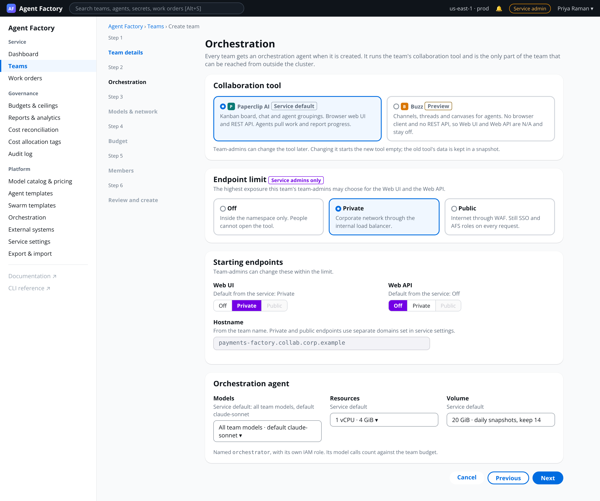

**S2 · Teams.** New columns *Collaboration tool*, *Orchestration* (phase of the orchestration agent), *Web UI*,
*Web API* (level, or *Off · N/A* for Buzz) and *Endpoint limit*; filters *Any tool* and *Any exposure*. The
detail panel gains an *Orchestration* tab with *Set endpoint limit*. Lowering the limit says that surfaces
above it turn off within 60 seconds and the team's choices are kept.

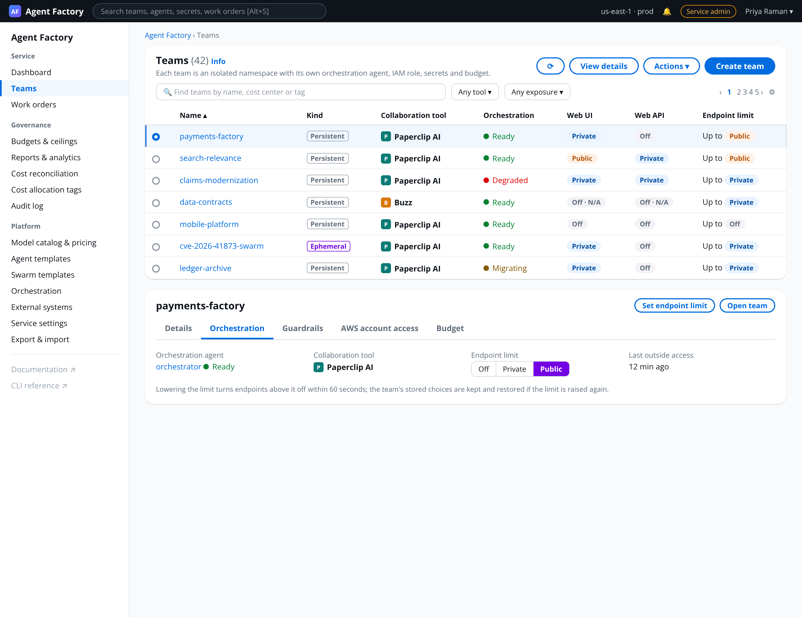

**S12 · Orchestration (service).** New page under *Platform*, replacing the S10 *Collaboration* tab. Tabs:
*Endpoints* (counts of public and private endpoints, tools in use, denied requests in 24 hours, and the
table of every endpoint outside the cluster: team, tool, surface, exposure, hostname, state, last access,
CSV download); *Tools and runtimes* (each tool: enabled, default, the runtime template it maps to, teams
using it); *Defaults* (endpoint limit, starting levels, orchestration model and resources for new teams);
*Kill switches* (public and private separately). During the migration a banner shows progress (section 8).

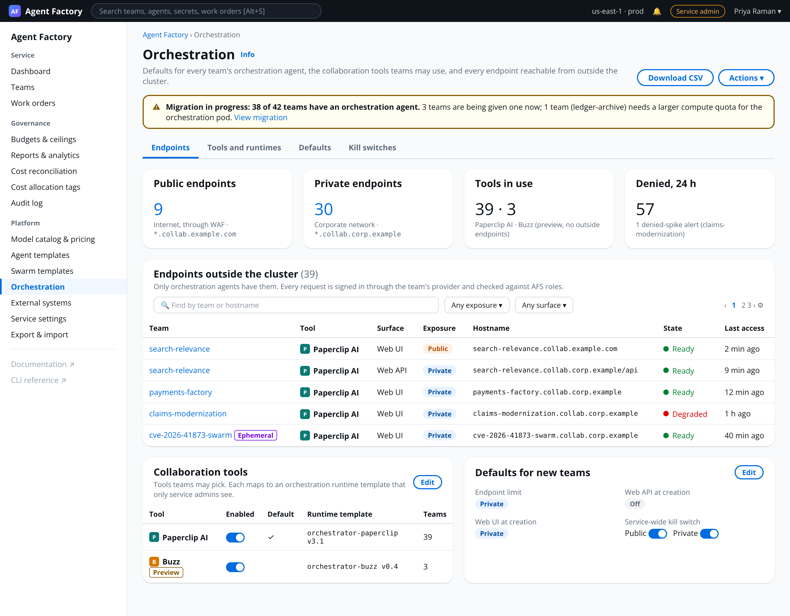

### 5.3 Team-admin

**T1 · Team overview.** The orchestration card sits under *Summary*, above budget and agents: name, badge,
phase, tool, Web UI and Web API levels with hostname, service limit, and *Open Paperclip AI*. The *Team
agents* tile counts workers only and how many are connected; the budget tile shows the orchestrator's share.

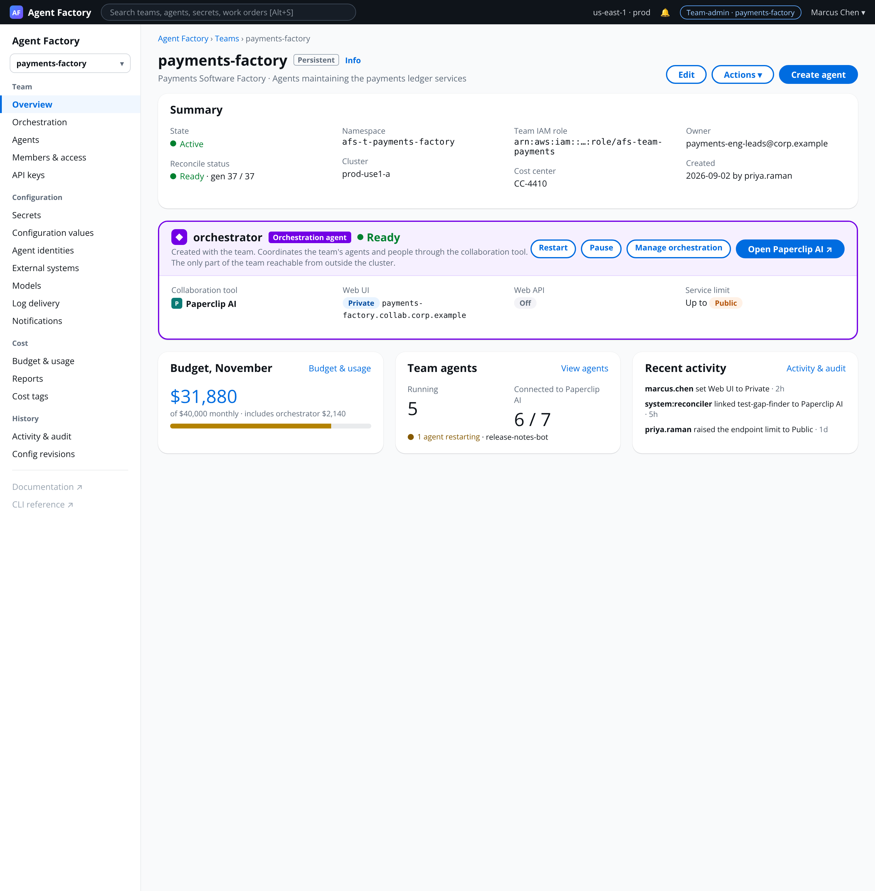

**T2 · Agents.** Two regions. The **orchestration card** (purple border) with *Restart*, *Pause*, *Manage
orchestration* and *Open Paperclip AI*, plus model, pod, connected agents and cost. Below it, **Team agents**:
the workers only, with a *Collaboration* column (Connected, Pending, Not connected) and a filter for it.
*Create agent* creates workers only.

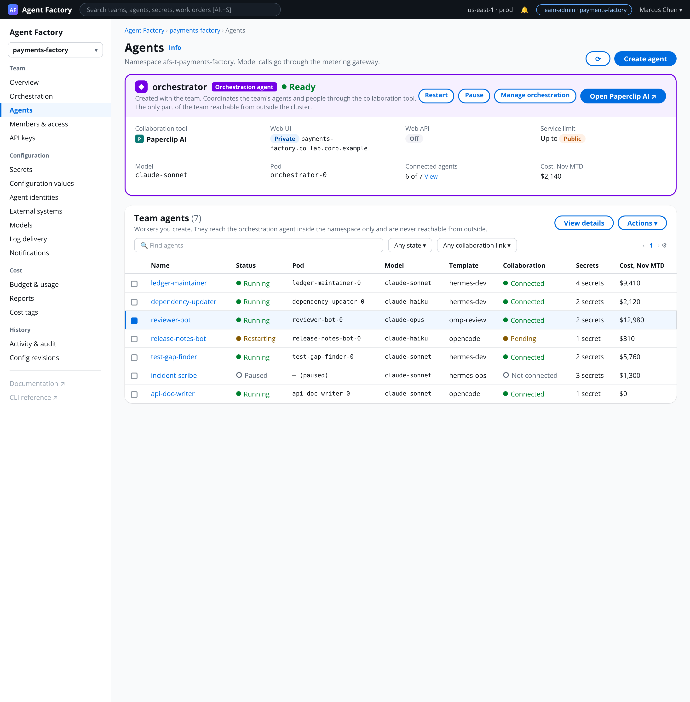

**T17 · Orchestration, *Collaboration* tab** (new; replaces T16). Header with the ◆ mark, *Actions* (*Change
tool*, *Rotate tool keys*, *Pause*, *Restart*; no delete) and the primary *Open <tool>* button (disabled with
its reason when the Web UI is off, the agent is not `Ready`, or the tool has no web UI). A banner states that
collaboration settings live only on this tab. Panels:

- **Collaboration tool**: tool and version, status and generation, agent registration mode, in-namespace
  address, conditions (`EndpointReady`, `ToolReady`, `RegistrationHealthy`, `UnmanagedToolAgents`).
- **Endpoints outside the cluster**: one tile each for *Web UI* and *Web API*, each with an Off / Private /
  Public control, what it exposes, who may use it, its URL and reachability (dot plus word, sign-in
  provider). Levels above the team's limit are greyed out; the line below states the limit.
- **Connected agents**: as T16 (connected flag, tool-side id, link state, last sync, connect and disconnect).
- **Tool-managed secrets**: secrets the tool created (*Managed by Paperclip* / *Managed by Buzz*) and the
  ones AFS generated for it (*Managed by AFS*), names and dates only.
- **Recent access**: sign-ins, people and denials at the endpoints for 7 days, with service admin entries
  marked (COL-31).

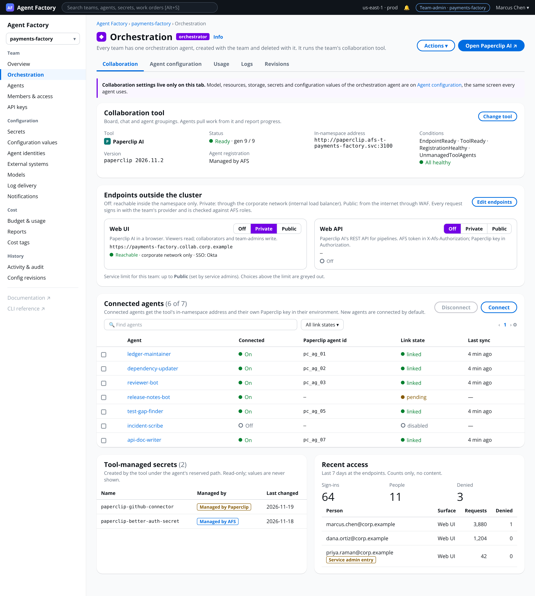

**T17 · *Edit endpoints*.** A modal with the two Off / Private / Public controls. Choosing *Public* shows a
warning that the surface becomes reachable from the internet, still behind WAF, sign-in and AFS roles, that
the change is audited and applies within 60 seconds. It shows the equivalent `afs orchestration
put-orchestration` command with `--if-match`.

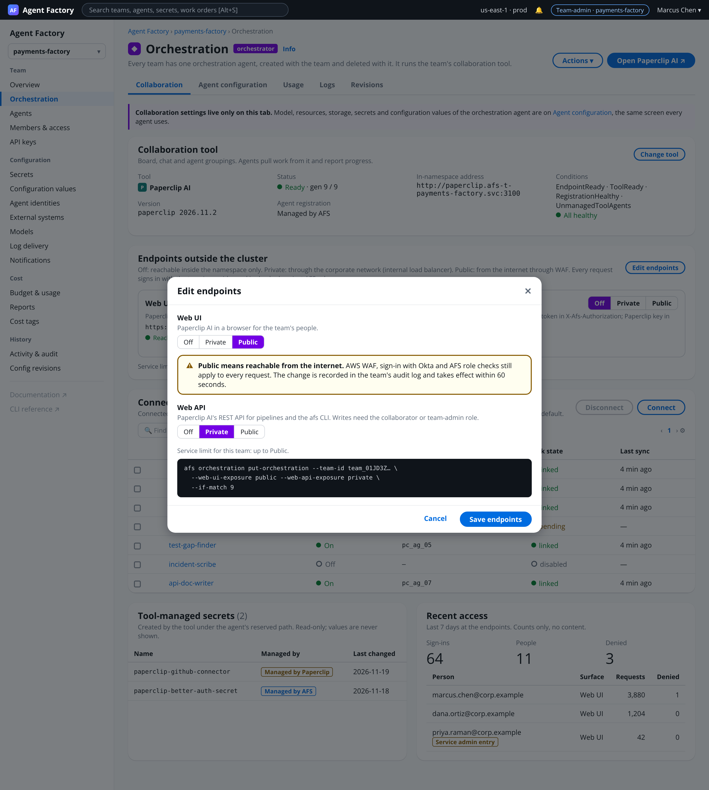

**T17 with Buzz.** Same page for a team using Buzz. Both tiles show **Off, disabled**, with "**N/A for Buzz.**
Buzz has no browser client, so the Web UI stays off and disconnected" and "**N/A for Buzz.** Buzz has no REST
API, so the Web API stays off". *Edit endpoints* and *Open Buzz* are disabled with the tooltip "N/A for Buzz:
no web UI or REST API outside the cluster". *Recent access* reads "No endpoints outside the cluster: N/A for
Buzz". Connected agents show each agent's Buzz public key.

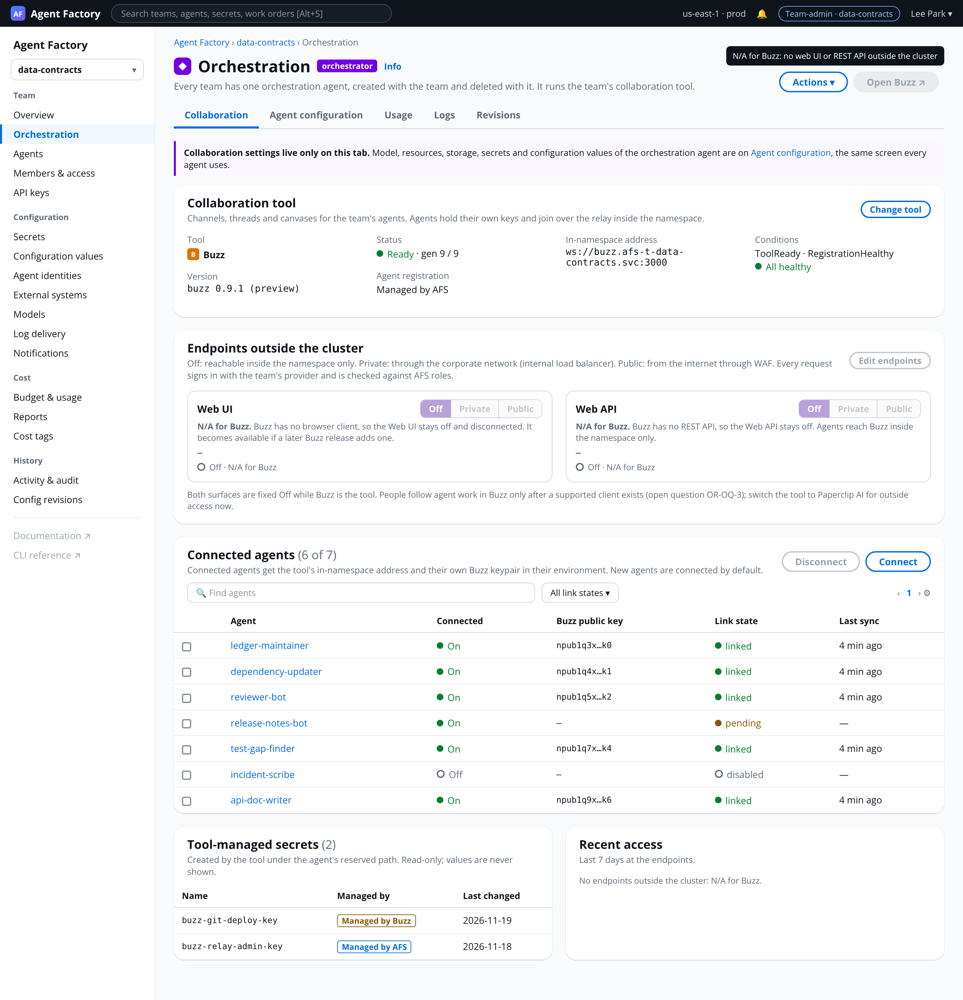

**T18 · Orchestration, *Agent configuration* tab** (new). The **shared agent configuration screen** used for
every agent (T2's detail, T3's edit), in its orchestration variant: name fixed (`orchestrator`), runtime shown
as "Orchestration runtime, managed by the service" (no template or harness name), IAM identity always
dedicated, snapshots cannot be turned off, no *Delete*. Model, persona, resources, volume, configuration
values and secret bindings are edited exactly as for any agent. The tool's boot secrets are counted but
listed on the *Collaboration* tab. The *Usage*, *Logs* and *Revisions* tabs are the shared ones too.

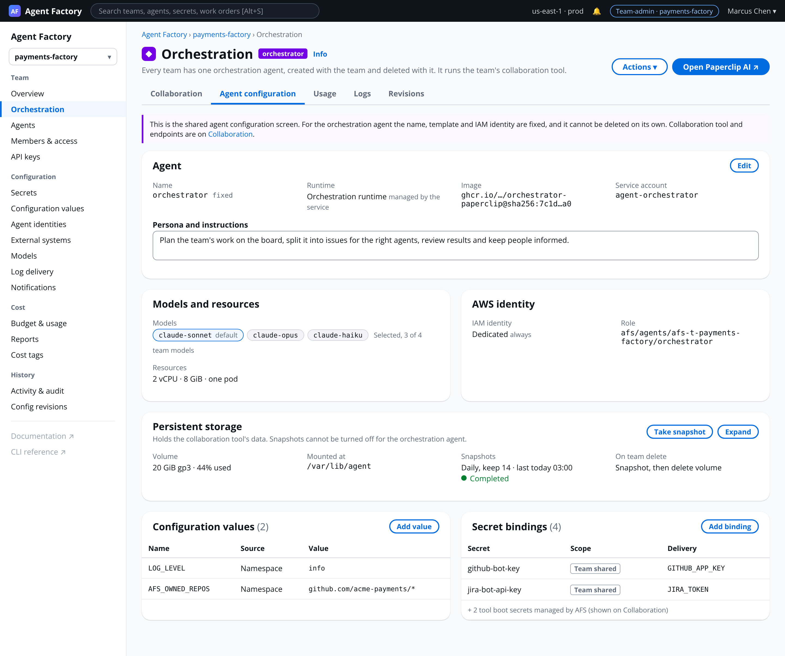

**T3 · Create agent.** The *Role* step is removed; every agent created here is a team agent, and the name
`orchestrator` is reserved. Collaboration is a **separate section** at the end of the form, in the
orchestration accent: *Connect to <tool>* (on by default), the in-namespace address, registration mode and
the environment names the agent receives. The CLI panel has no role option.

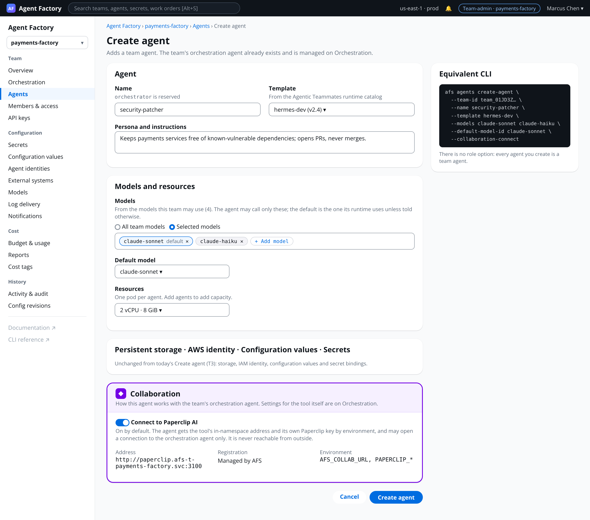

### 5.3a Model access (all agents)

**S4 · Model catalog & pricing** (changed). A *Models enabled for the service* panel on top: **All models**
(default; every Bedrock model in the catalog, including models the daily sync adds) or **Selected models**
(only those switched on in the table; new models start disabled). The catalog table gains *Service* (enabled
or disabled), *Price* (approved or waiting) and *Teams with access*; *Enable* and *Disable* work only in
*Selected* mode. A notice lists models that are enabled but not callable because no price is approved.

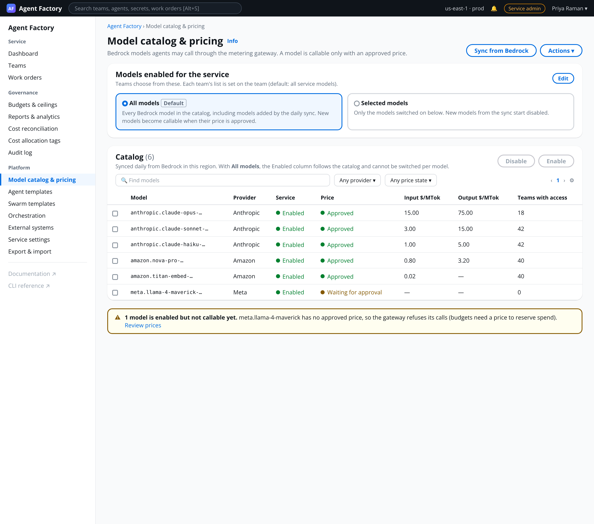

**S3 · Create team, step 3 *Models & network*** (changed). *Models for this team*, service admins only:
**All service models** (default; follows the service list, now and later) or **Selected models**, with the
models, their price state and when the team's inference profile is created. The same control is on the team's
detail page (S2 *Details*), replacing the plain list of `PutTeamModels`.

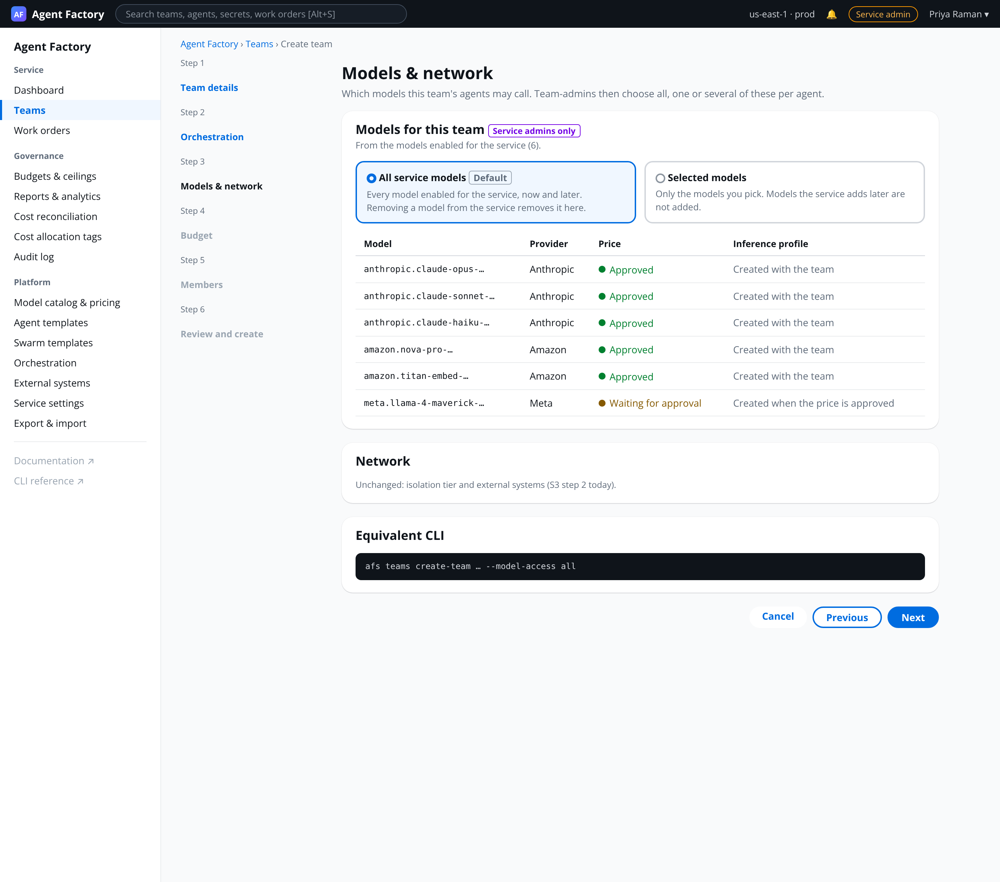

**T3 · Create agent** and **T18 · Agent configuration** (changed, shown above): *Models and resources* has
*Models* (**All team models** or **Selected models** as removable chips with *+ Add model*, listing only the
team's models) and *Default model* (one of them). The orchestration agent uses the same control. The CLI
equivalent is `--models <id> … | all` and `--default-model-id`. T2's *Model* column shows the default model and
"+2" when the agent has more.

### 5.4 Team viewer (and team collaborator)

**T2 read-only.** The same two regions with the read-only banner; *Create agent*, *Restart*, *Pause* and
*Actions* disabled with "Requires team-admin"; *Open Paperclip AI* works for anyone with
`collaboration:access`.

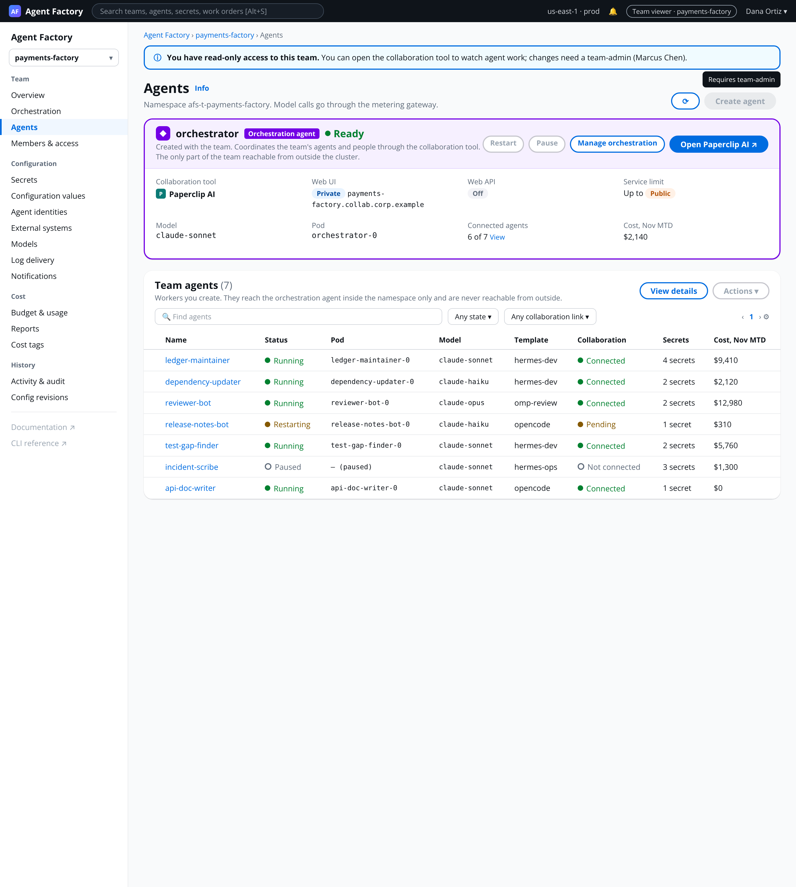

**V4 · Orchestration, read-only** (replaces V3). The *Collaboration* tab with every control disabled and
"Requires team-admin"; exposure levels, URLs, connected agents and access counts visible.

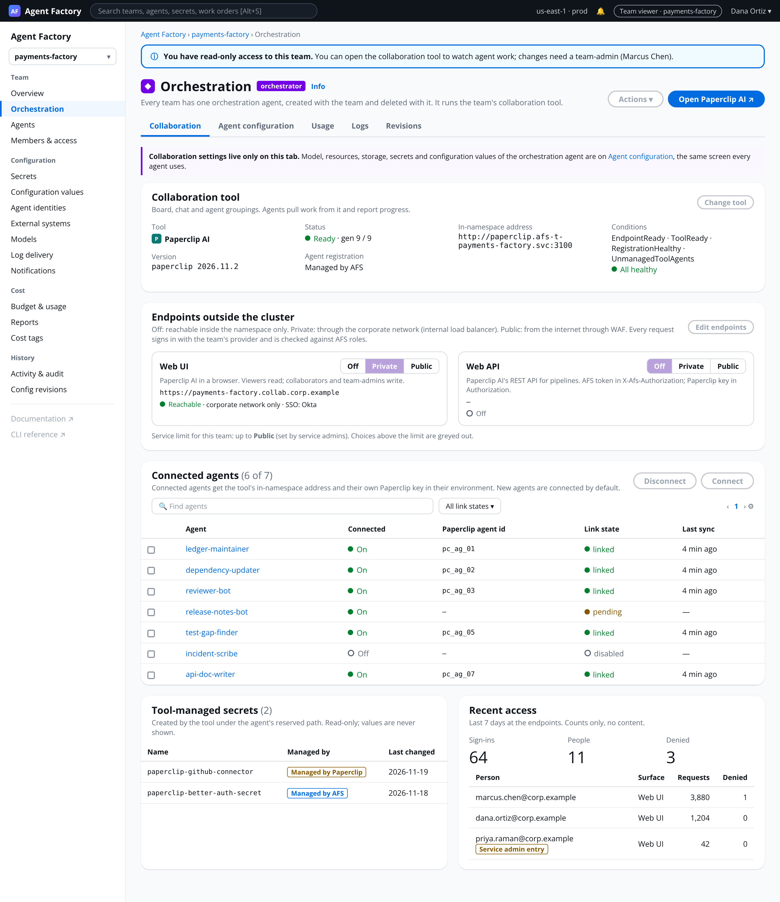

### 5.5 Screens removed or replaced

| 1.0.1 screen | Becomes |
|---|---|
| T16 · Collaboration (Paperclip) | T17 (*Collaboration* tab) |
| V3 · Collaboration, read-only | V4 |
| T3 *Role* step and Collaboration template rules | Removed; T3 *Collaboration* section for workers |
| T2 *Collaboration* badge and *Paperclip* column | Orchestration card; *Collaboration* column on workers |
| S2/S3 *May publish collaboration endpoints* checkbox | S3 step 2 *Endpoint limit*; S2 *Set endpoint limit* |
| S10 *Collaboration* tab | S12 · Orchestration |

## 6. Functional requirements

All requirements are in scope. Priorities order the build only: **P0** (mandatory orchestration agent,
migration, console regrouping), then **P1** (Private exposure, tool choice and change), then **P2** (Buzz).

### 6.1 The orchestration agent

| ID | Requirement | Pri |
|---|---|---|
| ORC-1 | `agents.role` is `worker` or `orchestration`. Every team created after this change has exactly one non-deleted orchestration agent from the commit of `CreateTeam` until the team is deleted. The database enforces "at most one" (unique index) and "at least one" for new teams (deferred constraint trigger, DB-US-58); the API never returns a new team without its agent | P0 |
| ORC-2 | `CreateTeam` creates the orchestration agent in the same transaction, with the tool's boot secrets generated in Secrets Manager first (as COL-7); a failure to write them returns `503 Unavailable` and creates nothing. `CreateAgent` with `role` other than `worker` returns `ValidationError` (`details.reason = role_reserved`), and with name `orchestrator` `ValidationError` (`details.reason = name_reserved`). `DeleteAgent` on the orchestration agent returns `409 Conflict` (`details.reason = orchestration_agent_required`). The agent is deleted only by team deletion (TEAM-9) | P0 |
| ORC-3 | **Defaults.** Name `orchestrator` (reserved: no other agent may take it); runtime template from the tool (ORC-6); models (all team models, default model from settings, section 6.9), resources and volume from the service settings of section 6.8, overridable in `CreateTeam`; dedicated IAM identity; daily snapshots, 14 kept, never off; on-delete *snapshot then delete* | P0 |
| ORC-4 | **Fixed fields.** Name, role, template (except through *Change tool*, ORC-11) and IAM identity mode cannot be changed on the orchestration agent (`ValidationError`, `details.reason = orchestration_field_fixed`). Models, persona, resources, volume size, snapshot retention, configuration values, secret bindings, pause and restart work as for any agent (AGT-1 to AGT-11) | P0 |
| ORC-5 | One agent, one identity, one pod (AGT-7, COL-4): the harness and the collaboration tool run in the one pod under one ServiceAccount, one IAM role, one gateway identity and one volume. Its model calls count against the team budget; when the budget is exhausted the tool keeps serving people and only model calls are refused (COL-8) | P0 |
| ORC-6 | **Hidden harness.** Agent templates gain capabilities `orchestration`, `tool:paperclip` and `tool:buzz` (replacing `paperclip`). Service setting `orchestration.tools` maps each tool to one template with `orchestration` and that tool capability, plus enabled and default flags. Team-facing API fields and screens show the tool and "Orchestration runtime", never the template or harness name; `GetAgent` returns `templateId` for the orchestration agent only to service admins and `runtime: "orchestration"` to everyone | P0 |
| ORC-7 | Work order and swarm teams also get an orchestration agent: `instantiate_work_order_team` creates it with the swarm template's `spec.orchestration` (`tool`, starting levels; defaults from settings), replacing PC-D29's optional `spec.collaboration`. Their volume on-delete rule is *delete* unless the template says otherwise, so short-lived teams do not keep snapshots | P1 |

### 6.2 Collaboration tool

| ID | Requirement | Pri |
|---|---|---|
| ORC-8 | `team_collaboration` (renamed in the API to the team's *orchestration*) gains `tool` (`paperclip` or `buzz`), chosen at `CreateTeam` among the enabled tools (default: the service default). Each tool has a **capability profile** in the service settings: `webUi` (bool), `webApi` (bool), `registration` (`manual`, `managed`), `inNamespacePort`. Paperclip AI: web UI, web API, both registration modes, 3100. Buzz: none, none, managed only, 3000 | P0 Paperclip, P2 Buzz |
| ORC-9 | **Tool-neutral agent environment.** A connected worker receives `AFS_COLLAB_TOOL` and `AFS_COLLAB_URL` (the in-namespace address) plus the tool's own variables: Paperclip `PAPERCLIP_API_URL`, `PAPERCLIP_AGENT_ID`, `PAPERCLIP_AGENT_API_KEY` (unchanged); Buzz `BUZZ_RELAY_URL` and `BUZZ_PRIVATE_KEY` (a binding of the agent secret `buzz-agent-private-key`, generated by the reconciler, `managedBy = afs`). Network rules of COL-11 apply with the tool's port | P0 Paperclip, P2 Buzz |
| ORC-10 | **Reserved names.** Secret names `buzz` and `buzz-*` follow the PC-D11 rules for `paperclip`, with `buzz-agent-private-key` AFS-managed only (no manual mode for Buzz); the reserved tool prefix is `<service>/<namespace>/<orchestration-agent>/<tool>/` | P2 |
| ORC-11 | **Change tool.** A team-admin (`collaboration:manage`) may change the tool to another enabled tool with `ChangeCollaborationTool`, confirmed by typing the team name in the console. AFS takes a snapshot of the orchestration volume (kept 90 days, labelled with the old tool), switches the agent to the new tool's template, starts the new tool with an empty data directory, generates its boot secrets, disables every surface the new tool does not support, revokes the old tool's agent keys and re-registers connected agents in the new tool. Content is not migrated. The agent's identity, volume, budget and AFS links stay. Refused on a suspended team (`409 team_suspended`) | P1 |
| ORC-12 | Buzz storage: the relay's PostgreSQL and Redis run inside the orchestration pod with data on its volume; object storage is the S3 prefix `<service>/<namespace>/orchestrator/buzz/` in the environment's agent-data bucket, reached only by the orchestration agent's role, KMS-encrypted and tagged with the team's tags (OR-OQ-6) | P2 |

### 6.3 Endpoints outside the cluster

| ID | Requirement | Pri |
|---|---|---|
| ORC-13 | Each surface (`webUi`, `webApi`) has an **exposure**: `off`, `private` or `public`. Off: reachable inside the namespace only. Private: reachable through the internal ALB from networks routed to the environment's VPC (corporate network, peered VPCs), never from the internet. Public: reachable through the internet-facing ALB (COL-15). Both go through `afs-edge`, with SSO, authorization, scanning, limits and records exactly as COL-16 to COL-31 | P0 public and off, P1 private |
| ORC-14 | **Limit.** `teams.max_collaboration_exposure` (`off`, `private`, `public`; service admins only; default the service setting) caps both surfaces. A request to set a surface above the limit returns `ValidationError` (`details.reason = exposure_above_limit`). While `orchestration.private_base_domain` is unset, a `private` choice is effective `off` with reason `base_domain_unset`, and the console says so. Lowering the limit makes the **effective** level `min(chosen, limit)` without changing the stored choice; raising it restores the choice. `GetTeamOrchestration` returns chosen, effective and the reasons (`team_limit`, `service_switch_public`, `service_switch_private`, `tool_not_supported`, `base_domain_unset`) | P0 |
| ORC-15 | **Tool support.** A surface the tool does not support is always effective `off`; setting it above `off` returns `ValidationError` (`details.reason = surface_not_supported_by_tool`). The console shows such a surface Off and disabled with "N/A for <tool>" and the reason (Buzz: no browser client; no REST API) | P0 |
| ORC-16 | **Hostnames.** Public: `<slug>.<orchestration.public_base_domain>` (the 1.0.1 `collab.base_domain`, renamed). Private: `<slug>.<orchestration.private_base_domain>`, in a Route 53 private hosted zone associated with the environment VPC (or delegated from corporate DNS) and a wildcard certificate. The edge serves a surface only on the hostname of its effective level: a request for a private surface on the public hostname, or the reverse, gets `404` with no detail. The apex callback rule (PC-D21) applies to each base domain | P1 |
| ORC-17 | **Internal ALB.** Platform Terraform adds an internal ALB in private subnets in front of the same `afs-edge` pods, with its own listener, TLS policy as COL-15, and a WAF web ACL with the core rule set, known bad inputs and the per-IP rate rule (no IP reputation or anonymous-IP lists, which do not apply to private sources). The edge distinguishes the two by `Host` only; both ALBs reach the edge only from their security groups | P1 |
| ORC-18 | **Kill switches.** Service settings `orchestration.public_endpoints` and `orchestration.private_endpoints` (both default on) turn every public or every private surface effective-off within 60 seconds (p95), keeping teams' choices | P0 public, P1 private |
| ORC-19 | **Only the orchestration agent.** COL-22's admission rules stay and name the orchestration pod; isolation tests prove that no worker, no other Service and no other port in a team namespace is reachable from either ALB, and that the harness API port is never exposed | P0 |

### 6.4 Console regrouping

| ID | Requirement | Pri |
|---|---|---|
| ORC-20 | Team navigation gains *Orchestration* after *Overview* and loses *Collaboration*. The *Orchestration* page has the tabs of section 5.3; its URL is `/teams/{teamId}/orchestration[/config\|usage\|logs\|revisions]`, and `/teams/{teamId}/collaboration` redirects to it | P0 |
| ORC-21 | **Visual separation.** The orchestration agent is shown in its own card (purple accent, ◆ mark, *Orchestration agent* badge) on T1 and T2 and is excluded from the *Team agents* table, counts, filters and bulk actions; its cost appears in the card and in team totals | P0 |
| ORC-22 | **Shared configuration, segregated collaboration.** The agent configuration component is one component used for workers and the orchestration agent, with an orchestration variant that applies ORC-4's fixed fields and hides *Delete*. It never renders tool, endpoint, link or tool-secret fields; those render only in the *Collaboration* tab and in the worker *Collaboration* section (T3 create, T2 detail). A component test asserts both rules | P0 |
| ORC-23 | Team viewers and collaborators see every orchestration screen read-only with "Requires team-admin" on disabled controls; *Open <tool>* follows `collaboration:access` and the effective Web UI level | P0 |
| ORC-24 | Every change on these screens shows its CLI equivalent (`afs orchestration put-orchestration`, `change-collaboration-tool`, `afs teams create-team --orchestration`) | P0 |

### 6.5 API

| ID | Requirement | Pri |
|---|---|---|
| ORC-25 | New operations (API contract §4.4d, to be added): `GetTeamOrchestration` (`GET /v1/teams/{teamId}/orchestration`, `collaboration:read`) returns `{agentId, agentName, phase, tool, toolVersion, registrationMode, limit, webUi{exposure, effective, reasons[], hostname, url}, webApi{…}, connectedAgents, version}`; `PutTeamOrchestration` (`PUT`, `If-Match`, `collaboration:manage`) sets `webUi.exposure`, `webApi.exposure`, `registrationMode`; `ChangeCollaborationTool` (`POST …/orchestration:change-tool`, `collaboration:manage`, body `{tool}`, `202` with the new generation); service-level `ListOrchestrationEndpoints` (`GET /v1/admin/orchestration-endpoints?exposure&tool&teamId`, `admin:settings`, CSV) | P0 (change tool P1) |
| ORC-26 | `CreateTeam` gains `orchestration {tool, webUiExposure, webApiExposure, modelId, resources, volume}` (all optional, defaults from settings) and `maxCollaborationExposure`; `UpdateTeam` sets `maxCollaborationExposure` (`teams:set-guardrails`). `Team` returns `orchestrationAgentId` | P0 |
| ORC-27 | **Deprecated, kept until 2.0.0:** `GetTeamCollaboration` and `PutTeamCollaboration` (booleans map to `public`/`off` on read; on write `true` means "the highest level within the limit", `false` means `off`); `ListCollaborationEndpoints` (alias of the new list, booleans only); `Team.mayExposeCollaboration` (read: limit ≠ `off`; write: `true` sets `public`, `false` sets `off`); `Agent.role = collaboration` on read becomes `orchestration`. Each response carries `Deprecation` and `Sunset` headers. Link operations (`ListCollaborationLinks`, `Connect…`, `Disconnect…`) and `RotateCollaborationKeys` are unchanged | P0 |
| ORC-28 | Events: `orchestration.created` (with the team), `orchestration.updated` (levels, registration), `orchestration.tool_changed`, `orchestration.endpoint_state_changed` (replaces `collaboration.endpoint_state_changed`, which is still emitted until 2.0.0); the other `collaboration.*` events keep their names. Every mutation is audited | P0 |

### 6.6 CLI

| ID | Requirement | Pri |
|---|---|---|
| ORC-29 | New service `orchestration`: `describe-orchestration`, `put-orchestration --web-ui-exposure off\|private\|public --web-api-exposure … [--registration-mode]`, `change-collaboration-tool --tool paperclip\|buzz`; `admin list-orchestration-endpoints`. `teams create-team --orchestration Tool=…,WebUiExposure=…,WebApiExposure=…,ModelId=…` and `--max-collaboration-exposure`. Help, examples, columns, goldens and `AccessDenied` tests for each | P0 |
| ORC-30 | `collaboration describe-collaboration`, `put-collaboration` and `admin list-collaboration-endpoints` keep working, print one deprecation line to stderr naming the replacement, and are removed in 2.0.0. `agents create-agent --role` is removed from help; passing it returns the API's `ValidationError` (exit 254). `collaboration invoke-api` picks the hostname of the Web API's effective level and fails with exit 254 and "Web API is off (N/A for Buzz)" when the tool has none | P0 |

### 6.7 Records and reports

| ID | Requirement | Pri |
|---|---|---|
| ORC-31 | Edge records and `collaboration_access` counts gain `exposure` (`public`, `private`); reports (COL-36) split sign-ins and requests by it | P1 |
| ORC-32 | The team's *Activity & audit* shows exposure and limit changes in words ("set Web UI to Private", "raised the endpoint limit to Public") | P0 |

### 6.8 Service settings (replace the `collab.*` keys of the Paperclip PRD §6.9)

| Key | Default | Allowed values | Replaces / used by |
|---|---|---|---|
| `orchestration.tools` | `{paperclip: {enabled: true, default: true, templateId}, buzz: {enabled: false, default: false, templateId}}` | each tool once; exactly one default; template must have `orchestration` and the tool capability | ORC-6, ORC-8 |
| `orchestration.public_base_domain` | value of `collab.base_domain` | DNS name; unset disables public exposure | `collab.base_domain`; ORC-16 |
| `orchestration.private_base_domain` | unset | DNS name; unset disables private exposure | ORC-16 |
| `orchestration.public_endpoints` | `true` | boolean | `collab.public_endpoints`; ORC-18 |
| `orchestration.private_endpoints` | `true` | boolean | ORC-18 |
| `orchestration.default_limit` | `private` | `off`, `private`, `public` | ORC-14 |
| `orchestration.default_web_ui_exposure` | `private` | not above `default_limit` | ORC-13 |
| `orchestration.default_web_api_exposure` | `off` | not above `default_limit` | ORC-13 |
| `orchestration.default_resources`, `.default_volume_gib` | `1 vCPU · 4 GiB`, `20` | resource presets; 10 to 1000 | ORC-3 |
| `models.service_access` | `all` | `all`, `selected` | MOD-1 |
| `models.default_team_access` | `all` | `all`, `selected` (a new team in `selected` mode starts with `models.default_team_models`) | MOD-2 |
| `models.default_team_models` | `[]` | enabled model ids | MOD-2 |
| `models.default_model_id` | the service's default model | an enabled model | MOD-3 (an agent's default model when the creator gives none) |
| `collab.allowed_source_cidrs`, `.session_ttl_minutes`, `.content_scan`, `.max_body_mb`, `.denied_spike_threshold` | unchanged | unchanged | Public ALB and edge (unchanged) |

### 6.9 Model access: all, one or several models (every agent)

Today the service keeps a model catalog with a per-model enabled flag (S4), the team has an explicit list
(`team_models`, `PutTeamModels`, service admins only), each agent names one `modelId`, and the gateway accepts
any of the team's models from any of its agents. This section makes each level a choice between **all** and a
**selection**, and makes the agent level enforceable.

| ID | Requirement | Pri |
|---|---|---|
| MOD-1 | **Service level.** Setting `models.service_access` is `all` (default) or `selected`. With `all`, every catalog model is enabled for the service, including models added later; the per-model enabled flag is ignored and read-only. With `selected`, the per-model flag decides (today's behaviour). The reconciler syncs the catalog daily from Bedrock in the environment's regions (`ListFoundationModels` and the cross-region inference profiles), adding new models with a price proposal (BUD-9); a model is **callable** only while it is enabled and has an approved price, because the gateway needs a price to reserve spend (BUD-2) | P0 |
| MOD-2 | **Team level.** A team's `modelAccess` is `all` (default: every model enabled for the service, now and later) or `selected` (an explicit list, today's `team_models`). Only service admins change it (`teams:set-guardrails`, as today). The reconciler keeps one application inference profile per callable model of the team, creating profiles when a model becomes callable for the team and removing them (after a 7-day grace for cost reports) when it stops | P0 |
| MOD-3 | **Agent level.** Each agent (worker, orchestration agent and swarm pool) has `models: {access: all \| selected, modelIds[], defaultModelId}`. `all` (default for new agents) means every model the team may use, now and later; `selected` names one or more of them. `defaultModelId` is required and must be in the agent's effective set; it is the model the runtime uses unless the agent chooses another. Team-admins set it (`agents:write`) | P0 |
| MOD-4 | **Delivery.** The agent receives, with zero impact on its container (SEC-6), `AFS_DEFAULT_MODEL` (AFS model id), `AFS_MODELS` (comma-separated effective ids) and `/etc/afs/models.json` (id, provider, max output tokens, per model). Changing the agent's models rolls the pod; a change in the team's or service's effective set updates the file and env on the next roll and is enforced by the gateway at once | P0 |
| MOD-5 | **Enforcement.** The gateway admits a call only for a model in the caller's effective set: service ∩ team ∩ agent (∩ pool for workers of a pool), callable (MOD-1). Otherwise `403 AccessDenied` with `details.reason` `model_not_enabled_for_service`, `model_not_enabled_for_team`, `model_not_enabled_for_agent` or `model_not_priced`. The gateway caches the sets for at most 60 s and refreshes on the change feed | P0 |
| MOD-6 | **Narrowing never edits a lower level.** Removing a model from the service or a team removes it from every effective set below within 60 s, but leaves stored agent selections as they are, so restoring the model restores access. An agent whose default model leaves its effective set gets condition `ModelUnavailable=True` naming it, an `agent.model_unavailable` event to the team's channels, and a warning on T2 and T18; its calls to other allowed models continue. An agent whose selection becomes empty is `Degraded` with the same condition | P0 |
| MOD-7 | **API.** `Agent` and `Pool` gain `models {access, modelIds, defaultModelId, effectiveModelIds†}`; `modelId` stays as a deprecated alias of `defaultModelId` until 2.0.0 (writing it alone sets `access = all` on create and only the default on update). `Team` gains `modelAccess`; `ListTeamModels` returns the effective list with `access`, `PutTeamModels` takes `{access, modelIds}`. `ListModels` returns `callable` and `priceState`. New service operation `PutServiceModelAccess` (`admin:models`) sets `models.service_access`. Events: `team.models_changed`, `agent.model_unavailable` | P0 |
| MOD-8 | **Console and CLI.** S4, S3 step 3, S2 detail, T3, T18 and the pool form as section 5.3a; every model control lists only models the level above allows, says how many, and shows the CLI equivalent. CLI: `agents create-agent`/`update-agent --models all \| <id> … --default-model-id <id>`, the same on pools; `teams put-team-models --access all \| selected [--model-ids …]`; `admin put-service-model-access --access all \| selected`; table columns `DefaultModel`, `Models` | P0 |

### 6.10 Changes to existing requirements

| Existing | Change |
|---|---|
| COL-1, COL-2 | Role `collaboration` becomes `orchestration`; mandatory, created with the team (ORC-1, ORC-2); template capability `paperclip` becomes `orchestration` + `tool:<tool>` (ORC-6) |
| COL-3, COL-5, COL-7 | Unchanged in substance; apply per tool (boot secrets come from the tool's profile) |
| COL-8 | Deleting the agent is no longer possible apart from the team (ORC-2) |
| COL-9, PC-D29 | Replaced by ORC-7 (every work order team gets one) |
| COL-10 | Default `connect = true` for every new worker, since every team has an orchestration agent; existing workers keep their flag |
| COL-15, COL-16, COL-20, COL-23 | Booleans become exposure levels with a limit and two ALBs (ORC-13 to ORC-18); `mayExposeCollaboration` becomes `maxCollaborationExposure` |
| PC-D19 | `collaboration_agent_missing` can no longer occur for teams created after 000022; kept for teams still migrating (section 8) |
| TEAM-1 (create team) | Also creates the orchestration agent; the S3 wizard gains a step |
| TEAM-9 | Team deletion deletes the orchestration agent last, after workers, so the tool can still serve during teardown |
| AGT-11 | Templates gain `orchestration` and `tool:*` capabilities; orchestration templates are not offered on T3 |
| Agent `modelId` (AGT, API contract §4.5) | Becomes `models {access, modelIds, defaultModelId}` (MOD-3); `modelId` is a deprecated alias |
| Team models (`team_models`, `PutTeamModels`, S3) | Gain the `all` mode, which becomes the default (MOD-2) |
| Model catalog (S4, `admin:models`) | Gains the service-level `all` mode (default) and a daily Bedrock sync (MOD-1) |
| Gateway contract §2 ("a model not enabled for the team → 403") | Checks service, team and agent sets and the price (MOD-5) |
| Initial PRD §5.2, §5.3 | Navigation and screens per section 5; T16 and V3 are replaced by T17, T18 and V4; S10 *Collaboration* tab by S12 |

## 7. User stories and acceptance criteria

Product stories continue the root numbering (US-27 to US-33 are the Paperclip PRD's). Repository stories
continue each repository's numbering and cite the product story they refine. Acceptance criteria are
Given / When / Then and are the basis of end-to-end tests in the dev environment.

### 7.1 Product stories

**US-34 · Every team starts with an orchestration agent.** As a service admin, I want a new team to come with
its orchestration agent, so that no team runs without coordination. *(ORC-1 to ORC-3, ORC-26, S3)*
- Given I create a team with default settings, then the response contains `orchestrationAgentId`, an agent
  named `orchestrator` with role `orchestration` exists, it is `Ready` within 10 minutes (p95), and T2 shows it
  in the orchestration card, not in *Team agents*.
- Given writing the boot secrets fails, when I create the team, then `503 Unavailable` and neither the team nor
  the agent exists.
- Given a team, when anyone calls `DeleteAgent` on its orchestration agent, then `409` with
  `details.reason = orchestration_agent_required`, and an audit record of the refusal.
- Given anyone calls `CreateAgent` with `role: orchestration` or `role: collaboration`, then `ValidationError`
  with `details.reason = role_reserved`; with name `orchestrator`, then `ValidationError` with
  `details.reason = name_reserved`.
- When the team is deleted, then the orchestration agent is deleted after the workers and its hostnames are
  held for 30 days (PC-D9).

**US-35 · See what orchestrates my team.** As a team member, I want the orchestration agent and its endpoints
shown apart from the other agents, so that I know where the team's board is and what is exposed. *(ORC-20 to
ORC-23)*
- Given any team role, when I open *Overview* or *Agents*, then the orchestration card shows the tool, the
  Web UI and Web API levels with their hostnames, and the service limit, above every other content except the
  summary.
- The *Team agents* table, its count and its bulk actions never include the orchestration agent.
- Given I am a viewer, then every control on those cards is disabled with "Requires team-admin" except
  *Open <tool>*, which opens the effective Web UI URL in a new tab.
- Given a bookmark to `/teams/{id}/collaboration`, then the console redirects to the *Collaboration* tab.

**US-36 · Configure the orchestration agent like any agent.** As a team-admin, I want to change its model,
resources and secrets on the screen I already know, without collaboration settings mixed in. *(ORC-4, ORC-22)*
- Given the *Agent configuration* tab, when I change the model and resources, then `UpdateAgent` is called
  with `If-Match`, the pod rolls, and the change is audited as for a worker.
- When I try to change the name, template or identity through the API, then `ValidationError` with
  `details.reason = orchestration_field_fixed`; the console shows those fields read-only.
- The tab shows no tool, endpoint, link or tool-secret field (component test), and no *Delete*.

**US-37 · Choose how far the tool is reachable.** As a team-admin, I want to set the Web UI and Web API to
Off, Private or Public within my team's limit. *(ORC-13 to ORC-16, ORC-18)*
- Given limit `public`, when I set Web UI to `private`, then within 60 seconds (p95) the private hostname
  serves the sign-in, the public hostname returns `404`, and a request from the internet to the private
  hostname cannot connect.
- Given limit `private`, when I set Web UI to `public`, then `ValidationError` with `exposure_above_limit`; the
  console shows *Public* greyed out.
- Given a service admin lowers my limit from `public` to `private` while my Web UI is `public`, then within 60
  seconds the effective level is `private`, my stored choice stays `public`, and the console says why; when
  the limit is raised again, the public hostname serves again.
- Given the service turns `orchestration.private_endpoints` off, then every private surface returns `404`
  within 60 seconds and teams' choices are kept.
- Given I choose *Public* in the console, then the warning of section 5.3 is shown before saving.

**US-38 · Pick and change the collaboration tool.** As a service admin and team-admin, I want Paperclip AI by
default and Buzz as an option, so that teams can use the tool that fits. *(ORC-6, ORC-8, ORC-11, ORC-15)*
- Given Buzz is disabled in `orchestration.tools`, then S3 shows it disabled with "Not enabled for this
  service" and `CreateTeam` with `tool: buzz` returns `ValidationError`.
- Given a team on Paperclip AI, when the team-admin changes the tool to Buzz and confirms, then a snapshot
  labelled with the old tool exists, the agent runs the Buzz runtime with an empty data directory, both
  surfaces are effective `off` with reason `tool_not_supported`, every connected worker has `BUZZ_RELAY_URL`
  and its own `BUZZ_PRIVATE_KEY` and no `PAPERCLIP_*` variable, and `orchestration.tool_changed` is emitted.
- No team screen names the harness or the runtime template; service admins see the template on S12.

**US-39 · Buzz is coordination inside the cluster only.** As security, I want Buzz never reachable from
outside the cluster until it has an API AFS can govern. *(ORC-15, ORC-12, J 2026-11-23)*
- Given a Buzz team, when anyone sets either surface above `off`, then `ValidationError` with
  `surface_not_supported_by_tool`.
- The console shows both surfaces Off and disabled with "N/A for Buzz" text naming the reason (no browser
  client; no REST API), and *Open Buzz* and *Edit endpoints* disabled with a tooltip.
- `ListOrchestrationEndpoints` lists no row for a Buzz team; the edge returns `404` for its hostnames.
- A worker with *Connect* off, or any pod in another namespace, cannot open TCP 3000 to the Buzz pod (Hubble
  denied flow).

**US-40 · Upgrade without losing work.** As a service admin, I want 1.0.1 teams moved to the new model
automatically. *(section 8)*
- Given a team with a 1.0.1 collaboration agent, after the upgrade it is that team's orchestration agent with
  the same name, volume, secrets, link rows and Paperclip data; `web_ui_enabled = true` reads as `public`,
  `false` as `off`; `mayExposeCollaboration = true` reads as limit `public`.
- Given a team without one, then within one hour of the upgrade it has an orchestration agent named
  `orchestrator` on the default tool, its existing workers are *not* connected automatically (COL-10), and
  the team-admins get a notification with a link to connect them.
- During the backfill, S12 shows progress and T17 shows "Orchestration agent being created" instead of an
  error.

**US-41 · Give agents all, one or several models.** As a service admin and a team-admin, I want model access
open by default and narrowable at each level, so that agents can use the right model for each task.
*(MOD-1 to MOD-8, J 2026-11-23)*
- Given a fresh environment, then `models.service_access = all`, new teams have `modelAccess = all`, and new
  agents have `models.access = all` with the service's default model as default.
- Given the daily sync adds a Bedrock model and a service admin approves its price, then within 60 s an agent
  in a team and agent set to `all` can call it through the gateway, and its team has an inference profile for it.
- Given an agent with `selected = [claude-sonnet, claude-haiku]`, when it calls `claude-opus`, then the gateway
  returns `403 AccessDenied` with `details.reason = model_not_enabled_for_agent` and records the denial.
- Given a model enabled with no approved price, when any agent calls it, then `403` with `model_not_priced`.
- Given a service admin removes `claude-haiku` from a team's selection, then that agent's calls to it are refused
  within 60 s, its stored selection still lists it (shown struck through with "Not available for this team"),
  and adding it back to the team restores access with no agent change.
- Given an agent's default model leaves its effective set, then `ModelUnavailable=True` names it, the team-admins
  are notified, and calls to its other models still succeed.
- `CreateAgent` with `modelId` only (1.0.1 clients) creates an agent with `access = all` and that default.

### 7.2 `-db` stories (migration 000022)

**DB-US-58 · Orchestration role and the one-per-team rule.** *(refines US-34, US-40)*
- `agents_role_check` allows `worker` and `orchestration`; 000022 updates existing `collaboration` rows to
  `orchestration` with the role-change guard disabled for the statement (owner only), then drops
  `collaboration` from the check. `agents_team_collaboration_uq` is replaced by `agents_team_orchestration_uq`
  (same predicate on the new value).
- `teams.orchestration_required boolean NOT NULL DEFAULT false`, then `ALTER … SET DEFAULT true`, so existing
  teams are `false` and new teams `true`. A `DEFERRABLE INITIALLY DEFERRED` constraint trigger on `teams`
  insert raises `23514` at commit when `orchestration_required` and no live orchestration agent exists. The
  backfill sets it `true` per team once its agent exists.
- Name `orchestrator` is reserved for role `orchestration` (`23514` otherwise). A delete guard raises `23514`
  (`orchestration_agent_required`) when an orchestration agent moves to `deleting` or `deleted` while its team
  is not `deleting` or `deleted`.
- Proven by: `TestOrchestrationAgent/*` (second insert `23505`, team without agent at commit `23514`, delete
  guard, reserved name, role migration of a seeded `collaboration` row).

**DB-US-59 · Exposure levels, limit and tool.** *(refines US-37, US-38, US-39)*
- `team_collaboration` gains `tool text NOT NULL DEFAULT 'paperclip' CHECK (tool IN ('paperclip','buzz'))`,
  `web_ui_exposure` and `web_api_exposure` (`text NOT NULL DEFAULT 'off' CHECK (… IN ('off','private','public'))`),
  backfilled from the booleans (`true` → `public`). The booleans stay until 2.0.0, kept in step by a trigger in
  both directions; `afs_app` gains column grants on the new columns.
- `teams.max_collaboration_exposure` (`off`, `private`, `public`, backfilled from `may_expose_collaboration`),
  added to `teams_guardrail_guard`; `may_expose_collaboration` kept in step until 2.0.0.
- A check trigger refuses a level above the team's limit (`23514`, `exposure_above_limit`) and any level above
  `off` for `tool = 'buzz'` (`23514`, `surface_not_supported_by_tool`), reading the tool profile from settings.
- `agent_templates.capabilities` accepts `orchestration`, `tool:paperclip`, `tool:buzz`; `paperclip` is
  rewritten to `orchestration` + `tool:paperclip`.
- The `orchestration.*` settings of section 6.8 are seeded, with `collab.base_domain` and
  `collab.public_endpoints` copied to their new keys and kept as read-only aliases until 2.0.0.
- RLS, change feed, revision and isolation tests extend to the new columns (`seedOtherTeams` unchanged).
- Proven by: `TestCollaborationExposure/*`, `TestServiceSettingRanges/orchestration.*`,
  `TestCrossTeamWritesChangeNothing/team_collaboration`.

**DB-US-60 · Edge routes by exposure.** *(refines US-37)*
- New `afs.orchestration_routes()` returns, per surface, the effective level, hostname and reasons, plus the
  tool and port; `afs.collab_routes()` stays for the 1.0.1 edge during a rolling upgrade and is dropped in
  2.0.0. `record_collab_access` accepts an `exposure` field. `afs_edge` gains `EXECUTE` on the new function only.
- `afs.create_orchestration_agent(team_id, tool, …)` (`SECURITY DEFINER`, `afs_app` only) inserts the agent,
  its `team_collaboration` row and audit in one call, used by `CreateTeam` and the backfill;
  `instantiate_work_order_team` calls it.
- Proven by: `TestEdgeRole/orchestration_routes`, `TestWorkOrderTeamHasOrchestrationAgent`.

**DB-US-61 · Model access levels.** *(refines US-41)*
- `teams.model_access text NOT NULL DEFAULT 'all' CHECK (… IN ('all','selected'))`, existing teams backfilled
  to `selected` (they have explicit `team_models` rows), guarded like the other guardrail columns.
- `agents.model_access` (`all`/`selected`, existing agents backfilled to `all`, which is today's gateway
  behaviour), `agents.default_model_id` (renamed from `model_id` through a new column and a sync trigger until
  2.0.0), and table `agent_models (team_id, agent_id, model_id)` with composite FK to the agent, FK to
  `models`, RLS and isolation rows; the same for pools (`pool_models`).
- View `afs.effective_agent_models` (service ∩ team ∩ agent ∩ callable), readable by `afs_gateway`,
  `afs_reconciler` and `afs_app`; the change feed fires on any input change.
- Settings `models.*` of section 6.8 seeded; `models.service_access` seeded `selected` on upgrade (keeps 1.0.1
  behaviour) and `all` on a new install.
- Proven by: `TestModelAccess/*` (each level's narrowing, empty selection, default outside the set),
  `TestRowLevelSecurityIsolatesTeams/agent_models`, `TestCrossTeamWritesChangeNothing/agent_models`.

### 7.3 `-restapi` stories

**RA-US-20 · Orchestration API.** *(refines US-34 to US-38)*
- The operations of ORC-25 to ORC-27 are in `api/openapi.yaml` with allowed and denied tests per role
  (viewer, collaborator, team-admin, service admin, security operator, workload).
- `CreateTeam` writes the boot secrets, calls `create_orchestration_agent`, and writes the team, agent, audit
  and outbox in one transaction; `DeleteAgent`, `CreateAgent` and `UpdateAgent` refusals of ORC-2 and ORC-4.
- Deprecated operations return the documented mapping with `Deprecation` and `Sunset` headers.

**RA-US-21 · Backfill.** *(refines US-40)*
- `afs-api orchestration-backfill` (run once by the Helm upgrade hook, idempotent, resumable) creates the
  agent for each team without one, in batches of 20, as actor `system:migration`, sets `orchestration_required`,
  and notifies team-admins; it reports progress through `ListOrchestrationEndpoints` metadata for S12.

**RC-US-21 · Render by tool.** *(refines US-38, US-39)*
- The reconciler renders the tool's Service and port, the tool's environment, the Buzz in-pod stores and S3
  prefix (ORC-12), network rules on the tool's port, and the tool-neutral agent variables (ORC-9); envtest
  proves a worker gets none of the tool-side objects and a Buzz team gets no route.
- *Change tool* (ORC-11) as a state machine with conditions `ToolChanging`, `SnapshotTaken`, `ToolReady`;
  interruption at any step resumes; envtest covers each step.
- Managed registration for Buzz: keypair generated in the reconciler, private key written straight to Secrets
  Manager, public key registered with the relay (fake relay in tests), never logged.

**RA-US-22 · Model access in the API, reconciler and gateway.** *(refines US-41)*
- MOD-7 operations and fields in `api/openapi.yaml` with allowed and denied tests per role; deprecated `modelId`
  mapping tests.
- Reconciler: daily Bedrock sync against a recorded fixture; inference profiles follow the team's callable set
  with the 7-day grace; `ModelUnavailable` condition and event; agent env and `/etc/afs/models.json` (envtest).
- Gateway: the four `details.reason` values with a table test per level; cache refresh within 60 s on the
  change feed; the gateway contract is updated in the same PR.

**EDGE-US-3 · Private and public hostnames.** *(refines US-37, US-39)*
- Host to (team, surface, level) from `orchestration_routes()`; a surface is served only on the hostname of
  its effective level; wrong-level host `404`; Buzz hosts `404`; kill switches within 60 seconds.
- Records and counts carry `exposure`. Coverage of the edge use-case package stays ≥ 90%.

**INF-US-2 · Internal entry.** *(refines US-37)*
- Terraform: internal ALB in private subnets, target group of the same edge pods, listener and TLS policy,
  WAF ACL of ORC-17, private hosted zone (or delegation record) and wildcard certificate for
  `private_base_domain`, access logs to S3. `terraform test` checks each, including that the internal ALB has
  no internet-facing scheme and that its security group admits only the VPC and corporate CIDRs configured.

### 7.4 `@afs/sdk` stories

**WEB-US-46 · SDK for orchestration.** *(refines US-34 to US-38)*
- Regenerated: `orchestration.get()`, `orchestration.put()`, `orchestration.changeTool()`,
  `admin.orchestrationEndpoints.list()`; `teams.create()` accepts `orchestration` and
  `maxCollaborationExposure`; `agents.create()` no longer accepts `role` in its type (runtime still sends it if
  given, for the API to refuse). Deprecated `collaboration.get/put` and `admin.collaborationEndpoints.list` are
  marked `@deprecated` in TSDoc. A helper `orchestration.endpointUrls(o)` returns the effective Web UI and Web
  API URLs or `null` with the reason. Contract replay tests pass. Minor version.

**WEB-US-49 · SDK model access.** *(refines US-41)* `agents.create()`/`update()` and `pools.*` accept `models`;
`teams.models.put({access, modelIds})`; `admin.models.putServiceAccess()`; `models.list()` returns `callable`
and `priceState`; `modelId` marked `@deprecated`.

### 7.5 Console stories

**WEB-US-47 · Orchestration page and cards.** *(refines US-35, US-36, US-37, US-39)*
- T17, T18, V4 and the cards on T1 and T2 as section 5; the redirect of ORC-20; the purple accent and ◆ mark
  used only for orchestration (visual test).
- The shared agent configuration component with the orchestration variant (ORC-22), with a test that renders
  it for an orchestration agent and finds no collaboration field, and one that renders the *Collaboration*
  tab and finds no model or resources field.
- Exposure controls gated by `can('collaboration:manage')` and the effective limit and tool support, still
  handling `AccessDenied`; *Public* warning; Buzz N/A texts; CLI equivalents.
- WCAG 2.2 AA (axe) on T1, T2, T17, T18, V4 and the modal; the segmented controls are a radio group with
  labels, and disabled options say why to assistive technology.

**WEB-US-48 · Team creation and service pages.** *(refines US-34, US-38, US-40)*
- S3 step 2, S2 columns and *Orchestration* tab, S12 with its four tabs and migration banner; T3 without the
  *Role* step and with the *Collaboration* section. Playwright end-to-end specs and visual baselines for each
  new screen, regenerated in CI; the 1.0.1 baselines for T16, V3 and the T3 role step are retired.

**WEB-US-50 · Model controls.** *(refines US-41)* The models control (all or chips, default model) on T3, T18,
the agent edit panel and the pool form; S4's service access panel; S3 step 3 and S2 detail team access; each
lists only what the level above allows and shows models that dropped out as struck through with the reason;
axe-clean; CLI equivalents.

### 7.6 CLI stories

**CLI-US-26 · Orchestration commands.** *(refines US-34, US-37, US-38)*
- The commands of ORC-29 with help, examples, table columns (`Tool`, `WebUi`, `WebApi`, `Limit`, `Effective`),
  goldens and `AccessDenied` tests (exit 254).

**CLI-US-27 · Deprecations.** *(refines US-40)*
- The deprecated commands of ORC-30 print one stderr line and still succeed; `invoke-api` follows the
  effective level and exits 254 for N/A surfaces with the AWS-style message.

**CLI-US-28 · Model access options.** *(refines US-41)* The flags of MOD-8 with help, examples, goldens and
`AccessDenied` tests; `--model-id` keeps working with a deprecation line on stderr.

## 8. Migration from the 1.0.1 design

Order follows the provider-first rule: contracts in this root, then `-db` 000022, `-restapi`, `@afs/sdk` and
the console, then the CLI. `-db` and `-restapi` ship together as **1.1.0** (lockstep); the SDK, console and
CLI as 1.1.0. Removals happen in 2.0.0.

| Step | Where | What | Reversible |
|---|---|---|---|
| M1 | `-db` 000022 | Role rename, exposure columns and limit backfilled from booleans, tool column, `orchestration_required`, new settings with copies of the `collab.*` values, new functions; old columns, function and settings kept in step | Yes (`.down.sql`; data mapping is lossless because booleans map to `public`/`off` and back) |
| M2 | `-restapi` 1.1.0 | New operations and deprecated aliases; edge reads `orchestration_routes()`; public ALB unchanged; internal ALB added by Terraform but no team uses `private` until `private_base_domain` is set | Yes (roll back the release; 000022 is compatible with 1.0.1 code because the booleans are kept in step) |
| M3 | Backfill hook | Creates `orchestrator` on the default tool for every team without one; existing workers stay unconnected; team-admins notified | Agents can be removed only by a service admin runbook (they are mandatory afterwards) |
| M4 | Console, SDK, CLI 1.1.0 | New screens and commands; old routes redirect; old commands warn | Yes |
| M5 | Service admins | Set `private_base_domain`, lower `default_limit` to `private` for new teams, review existing teams whose 1.0.1 choice became `public` and lower their limit where wanted | Yes |
| M5a | Service admins | Model access: upgraded environments keep `selected` at the service level and teams keep their lists; agents become `all` within their team's list (what the gateway already allowed). Service admins switch the service and teams to `all` when they choose | Yes |
| M6 | 2.0.0 | Drop booleans, `may_expose_collaboration`, `collab_routes()`, `collab.base_domain` and `collab.public_endpoints`, deprecated operations, events and CLI commands | No (major release) |

What does **not** change for existing teams: the agent's name, identity, volume and data, Paperclip boot
secrets and keys, link rows, hostnames under the public base domain, the `team_collaborator` bindings, the
edge sessions (users stay signed in through the upgrade).

**Cost impact.** Every team now runs one orchestration pod. At the default `1 vCPU · 4 GiB` and 20 GiB that is
about 200 extra pods for 200 teams, plus model calls the orchestrator makes, all counted in each team's budget.
Service admins can lower the default resources (section 6.8); work order teams delete the volume on teardown
(ORC-7).

## 9. Non-functional requirements

| Area | Requirement |
|---|---|
| Performance | `CreateTeam` returns in under 3 s (p95) including boot secret writes; the orchestration agent is `Ready` within 10 minutes (p95); exposure, limit and kill-switch changes apply within 60 s (p95); the edge adds < 20 ms p99 on either ALB |
| Scale | 200 teams, each with one orchestration pod; 50 concurrent people and 100 requests per second per team across both exposures; 5,000 concurrent streams |
| Availability | Edge 99.9% monthly behind each ALB; a team's orchestration agent is one pod (AGT-7) with restart under 5 minutes (p95); *Change tool* keeps the team usable (workers continue claimed work) and completes in under 15 minutes (p95) |
| Security | Only the orchestration pod's tool port is reachable from either ALB (isolation tests per release); private hostnames resolve only inside the VPC or corporate DNS; the internal ALB is never internet-facing (Terraform test and AWS Config rule); OWASP ASVS L2 and penetration test cover the private path before production; Buzz has no outside path at all |
| Privacy | No tool content in AFS storage, logs or events (COL-26), for both tools |
| Observability | Metrics by exposure and tool (requests, denials, sessions); `orchestration_agents_missing` gauge (must be 0 after migration, alert otherwise); *Change tool* duration and failures; backfill progress |
| Accessibility | WCAG 2.2 AA on every screen of section 5, including the segmented exposure controls and N/A explanations |
| Compatibility | 1.0.1 clients keep working against 1.1.0 for every operation except creating a collaboration agent and deleting the agent; both are refused with documented reasons |
| Recovery | Unchanged from the Paperclip PRD §8; *Change tool* snapshots are kept 90 days and restore the old tool with *Change tool* back plus a restore of that snapshot (runbook) |

## 10. Release plan

| Milestone | Scope | Exit criteria |
|---|---|---|
| O0 Design review | This PRD and the mockups | J approves the UI and the decisions of section 12.1 |
| O1 Mandatory orchestration | Contracts v1.4.0; `-db` 000022; MOD-1 to MOD-8; ORC-1 to ORC-6, ORC-9 (Paperclip), ORC-13 (public and off), ORC-14, ORC-15, ORC-18 (public), ORC-19 to ORC-30, ORC-32; backfill; console T1, T2, T3, T17, T18, V4, S2, S3, S12 (public only) | Every dev team has an orchestration agent; 1.0.1 data intact; usability check of OG2 passed |
| O2 Private endpoints | ORC-13 private, ORC-16, ORC-17, ORC-18 private, ORC-31; Terraform internal ALB | A team-admin moves the Web UI to Private and reaches it from the corporate network only; pen test of the private path booked |
| O3 Tool choice | ORC-7, ORC-8 with the tool profile, ORC-11 (Paperclip to Paperclip version changes and the change flow, behind Buzz disabled) | *Change tool* round trip in dev with snapshot restore |
| O4 Buzz | ORC-8 to ORC-12 for Buzz; Buzz runtime template; US-38, US-39 | A Buzz team's agents coordinate through the relay; both surfaces N/A and unreachable |

## 11. Dependencies

| Dependency | Needed for | Owner |
|---|---|---|
| Orchestration runtime images per tool, published by digest: Paperclip (`agentic-team-w-paperclip`, exists) and Buzz (new: harness + `buzz-relay` + in-pod PostgreSQL and Redis), both reading the tool-neutral variables of ORC-9 | ORC-6, ORC-8, ORC-12 | Agentic Teammates project |
| Hermes as an ACP agent for `buzz-acp`, or another harness the Buzz runtime uses (hidden either way) | O4 | Agentic Teammates project |
| Buzz relay admin API to add and remove members by public key, and a way to close open registration | ORC-9 managed registration, O4 | Buzz upstream |
| Private DNS zone (or corporate delegation) and certificate for `private_base_domain`; routing from the corporate network to the VPC (Transit Gateway or Direct Connect) | ORC-16, ORC-17 | Platform, network team |
| Identity providers: redirect URI on the private callback host | ORC-16 | Enterprise identity team |
| Security approval of the private path and of the default limit `private` | ORC-14, O2 | Security |

## 12. Decisions, risks and open questions

### 12.1 Decisions (Claude, for J's review)

| # | Question | Decision |
|---|---|---|
| OR-D1 | Name and role value | Role `orchestration`, agent name `orchestrator` for new teams. Agents converted from 1.0.1 keep their names, because secret paths derive from the agent name and names are immutable (ADR-005) |
| OR-D2 | Can a team-admin delete or replace it? | No. Pause and restart only; it is deleted with the team. A broken agent is fixed by editing it or by *Change tool* |
| OR-D3 | Who picks the harness? | Service admins, through the tool-to-template mapping (`orchestration.tools`). Team screens say "Orchestration runtime"; only S12 shows template names, and template names do not name the harness |
| OR-D4 | What does "Private" mean? | Reachable through an internal ALB from networks routed to the environment VPC (corporate network, peered VPCs), with the same SSO and AFS authorization as public. It is still "outside the EKS cluster and AWS account" for people on the corporate network, which is the access J asked for |
| OR-D5 | Defaults | Target for new teams: limit `private`, Web UI `private`, Web API `off`. Existing teams keep 1.0.1 behaviour (`public` where on) so nothing breaks at upgrade. Because Private needs O2, 000022 seeds `default_limit` and `default_web_ui_exposure` as `public` in an environment that has `collab.base_domain` and no `private_base_domain`, and as `private` otherwise; service admins move to `private` after O2 (M5) |
| OR-D6 | Changing tool | Allowed for team-admins, snapshot then start empty; no content migration between tools, because neither tool offers an import of the other's data |
| OR-D7 | Buzz endpoints | Both N/A and fixed Off (J, 2026-11-23): no REST API, no browser client. The API refuses anything else, so a later Buzz release needs a PRD change, not only a setting |
| OR-D8 | API shape | New `/orchestration` resource; the `/collaboration` resource and booleans stay as deprecated aliases until 2.0.0. Links and key rotation keep their `collaboration` names because they are about the tool, not the agent |
| OR-D9 | Permissions | No new permissions; `collaboration:*` covers the orchestration resource. Adding `orchestration:*` would double the matrix for no new distinction |
| OR-D10 | Versioning | 1.1.0 for every component (minor): refusing `role: collaboration` on create and refusing delete are behaviour changes, accepted as minor because 1.0.1 has no production users yet. Removals in 2.0.0 |
| OR-D11 | Visual language | One accent (purple) and one mark (◆) reserved for orchestration across the console, so its separation is visual as well as structural |
| OR-D13 | What does "all models" mean at each level? | A live rule, not a copy: `all` follows the level above as it changes, so a model the service adds and prices reaches agents with no team or agent edit. `selected` is a fixed list that never grows by itself |
| OR-D14 | Why a default model per agent? | Runtimes need one model to start with; the harness may switch among the agent's allowed models per task. AFS enforces the set, not the choice |
| OR-D15 | Upgrade behaviour for models | Keep 1.0.1 access: the service stays `selected`, teams keep their lists, agents get `all` within the team (the 1.0.1 gateway already allowed any team model). New installs start `all` everywhere (J's default) |
| OR-D12 | Work order teams | Also get one (J: "every team"), with on-delete *delete* to avoid snapshot cost for short-lived teams |

### 12.2 Risks

| # | Risk | Owner | Response |
|---|---|---|---|
| OR-R1 | One extra pod and its model calls per team raise cost | Product, FinOps | Small default resources; counted in team budgets; visible on T1 and T2; pause allowed |
| OR-R2 | The private path is assumed safe and gets weaker review | Security | Same edge, SSO, authorization and scanning as public; WAF on the internal ALB; pen test covers it (O2) |
| OR-R3 | Buzz is a developer preview and may change protocol or storage | Platform | Disabled by default; pinned by digest; behind O4; no outside path |
| OR-R4 | Backfill creates many agents at once | Platform | Batches of 20, resumable, during a maintenance window; quota pre-check per team |
| OR-R5 | Teams lose content when changing tool | Product | Typed confirmation, snapshot kept 90 days, warning text on the dialog |
| OR-R6 | Deprecated aliases linger | Product | `Sunset` header dated with 2.0.0; CLI and SDK warnings; usage metric on deprecated calls |

### 12.3 Open questions

| # | Question | Owner | Needed by | Default |
|---|---|---|---|---|
| OR-OQ-1 | Should new teams default to limit `private`, or keep `public` like 1.0.1? | J, security | O1 | `private` (OR-D5) |
| OR-OQ-2 | Should the orchestrator's harness API (Hermes API server) ever be exposable as a third surface, for example for chat from other tools? | J | After O4 | No (non-goal) |
| OR-OQ-3 | How do people follow a Buzz team's work with both surfaces N/A? | J, Buzz upstream | O4 | They do not, through AFS; Buzz is for agent coordination until it gains a web client or API that can sit behind `afs-edge` |
| OR-OQ-4 | How does AFS add an agent's public key to a Buzz community and close open registration? | `-restapi`, Buzz upstream | O4 | Relay admin call from the reconciler with an AFS-managed admin key; flag `ToolReady=False, OpenRegistration` if it cannot be closed |
| OR-OQ-5 | If Buzz ships a browser client, does NIP-42 key signing work behind the edge's SSO, or do people need AFS-issued Nostr keys? | J, security | Future PRD | Out of scope here |
| OR-OQ-6 | Buzz object storage: per-team S3 prefix with the orchestrator's role (assumed), or in-pod MinIO on the volume? | `-restapi`, Agentic Teammates | O4 | S3 prefix (ORC-12) |
| OR-OQ-7 | Should service admins be able to set a different tool per environment (dev Buzz, prod Paperclip)? | J | O3 | Yes, by `orchestration.tools` per environment; no extra feature |
| OR-OQ-8 | Should *Change tool* be service-admin only? | J | O3 | Team-admin with typed confirmation (OR-D6) |
| OR-OQ-9 | Should team-admins (not only service admins) narrow their own team's model list? | J | O1 | No; service admins only, as today (`teams:set-guardrails`); team-admins narrow per agent |
| OR-OQ-10 | Should "all models" include models that need extra AWS terms (for example Marketplace or provider EULAs) automatically? | J, security | O1 | No: the sync adds them disabled until a service admin accepts the terms, even in `all` mode |

## 13. Glossary

| Term | Meaning |
|---|---|
| Orchestration agent | The one mandatory agent per team (`orchestrator`) that runs the harness and the collaboration tool in one pod and alone may be reached from outside the cluster |
| Collaboration tool | Paperclip AI (default) or Buzz, running inside the orchestration agent's pod |
| Orchestration runtime | The agent template for a tool, chosen by service admins; it fixes the harness |
| Surface | The tool's Web UI or Web API |
| Exposure | A surface's level: Off, Private (internal ALB) or Public (internet ALB) |
| Endpoint limit | The highest exposure service admins allow a team |
| Team agents | The team's workers: every agent except the orchestration agent |
| N/A | A surface the tool does not have; always Off and disabled, with the reason shown |

## 14. Review record

`review-prd` pass, 2026-11-23 (dev-flow). Verdict after fixes: **Ready for J's design review** (then
contracts, then spec per repository).

| Dimension | Status | Note |
|---|---|---|
| Problem clarity | ✅ Pass | Five concrete problems with the 1.0.1 flow, each tied to a screen or requirement; Buzz facts and assumptions separated |
| Scope definition | ✅ Pass | Six goals with measures; seven explicit non-goals, including outside access to Buzz |
| Functional completeness | ✅ Pass | ORC-1 to ORC-32 and MOD-1 to MOD-8 cover OG1 to OG7; section 6.10 names every 1.0.1 requirement that changes; section 8 covers migration per repository |
| NFR coverage | ✅ Pass | Performance, scale, availability, security, privacy, observability, accessibility, compatibility, recovery; cost impact in section 8 |
| Acceptance criteria | ✅ Pass | Given / When / Then per product story (US-34 to US-40) and repository story, with timings, error codes and `details.reason` values |
| Dependency identification | ✅ Pass | Runtime images, Buzz upstream, network and DNS, identity providers, security approval |
| Open questions | ✅ Pass | OR-OQ-1 to OR-OQ-8, each with owner, milestone and default |

Second pass after J's model-access change (2026-11-23): MOD-1 to MOD-8, US-41, DB-US-61, RA-US-22, WEB-US-49,
WEB-US-50, CLI-US-28, OR-D13 to OR-D15, OR-OQ-9 and OR-OQ-10 added; goal OG7 added; the existing per-model
enabled flag, `team_models` and the gateway's team check are reused, not replaced.

Fixed in the first pass: permissions named `agents:delete` and `agents:create` do not exist (the contract has
`agents:write`); the reserved name `orchestrator` raised `409` in one place and `ValidationError` in another;
the delete guard's error code was unclear; new teams in O1 would have had their Web UI effectively off,
because the default limit is `private` before the private path exists (OR-D5 and ORC-14 now say how the
seed avoids it); the S3 mockup's resources did not match the service default; the S12 migration banner
described a conversion that the migration does in one step.
