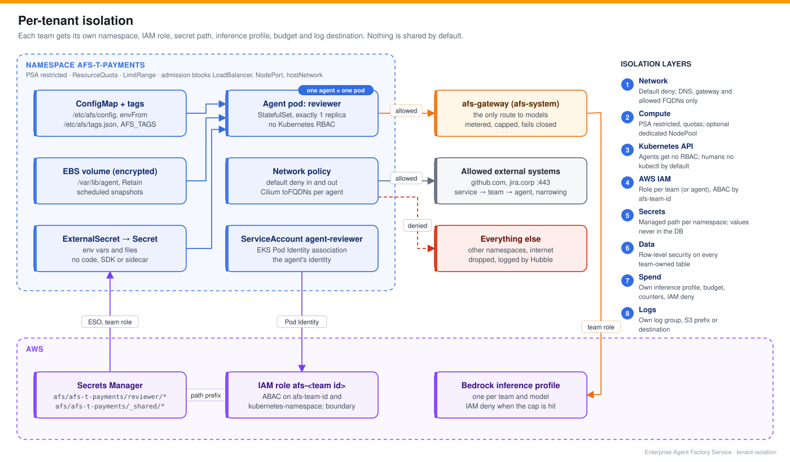
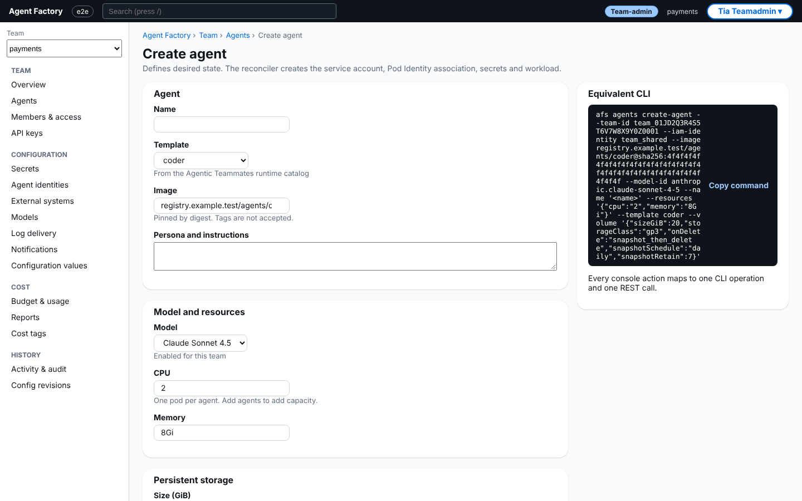

# Adopting the Agent Factory Service

This guide is for the people who bring AFS into an enterprise and the teams that start using it. It explains
what a team gets, how a rollout usually goes, and how to stand up a first agent. Each step links to the
detailed guide in the repository that owns it.

## What a team gets

A team on AFS gets its own software factory: an EKS namespace running its AI agents, isolated from every
other team, with:

- **Agents** that run continuously, one pod and one identity each, with a persistent encrypted volume.
- **Secrets** that agents receive as environment variables or files, without any code change, and that no
  person can read back.
- **Model access** to Amazon Bedrock through the AFS gateway, metered per call, with a **hard budget**.
- **Human access** through the enterprise IdP, with team admins and read-only team viewers.
- **Reports** of usage, cost, activity and external traffic, by agent, model, day or cost-allocation tag.
- **Audit and history** of every change, with the ability to restore an earlier revision.



## Who does what

| Role | Typical owner | Responsibilities |
|---|---|---|
| Platform engineer | Platform or cloud team | Deploys the database, control plane and console; operates them |
| Service admin | Platform team | Sets guardrails: identity providers, models and prices, budget ceilings, external systems, required tags, swarm templates |
| Team admin | Engineering lead of a team | Creates agents, adds members, manages secrets, budgets and configuration |
| Team viewer | Everyone else on the team | Sees agents, status, usage, reports and audit; never secret values |
| Security operator | Security team | Files and tracks CVE remediation work orders |

## Rollout path

1. **Provision.** A platform engineer creates RDS PostgreSQL 17, runs the database roles bootstrap and the
   migrations ([-db getting started](https://github.com/stainedhead/enterprise-agent-factory-service-db/blob/main/user-docs/getting-started.md)),
   then deploys `afs-api`, `afs-reconciler`, `afs-gateway` and `afs-billing` with the Helm chart and Terraform
   ([-restapi deployment](https://github.com/stainedhead/enterprise-agent-factory-service-restapi/blob/main/user-docs/deployment.md))
   and hosts the console ([-website configuration](https://github.com/stainedhead/enterprise-agent-factory-service-website/blob/main/user-docs/configuration.md)).
2. **Set guardrails.** A service admin connects Okta or Entra ID, enables Bedrock models and their prices,
   sets the required cost-allocation tags and the external systems catalog.
3. **Pilot.** Onboard one or two long-running development teams. Give each a budget ceiling and a first
   team admin.
4. **Expand.** Add teams through the console, the CLI or a pipeline using the SDK. Use group bindings so
   membership follows the IdP.
5. **Swarms and work orders.** Once teams are steady, publish swarm templates and let the security team
   run CVE remediation through work orders.

## Your first agent

### With the console

1. Sign in with your enterprise account. The header shows your role and team.
2. A service admin creates the team (**Teams → Create team**) with a budget ceiling and its first admin.
3. As team admin, open **Agents → Create agent**: choose a template, an image pinned by digest, a model,
   resources and a volume. The page shows the equivalent `afs` command.
4. Add secrets under **Secrets → Create secret** and bind them to the agent.
5. Set the team budget under **Budget & usage**.



Details: [using the console](https://github.com/stainedhead/enterprise-agent-factory-service-website/blob/main/user-docs/console.md).

### With the CLI

```bash
afs configure                       # endpoint, output format, default team
afs configure sso && afs sso login  # sign in through your IdP

# a service admin creates the team
afs teams create-team --slug payments --display-name "Payments" --kind persistent \
  --max-budget-usd 500.00 --first-admin '{"email":"ada@example.com"}' --wait

# the team admin sets a budget, adds a secret and creates an agent
afs budgets put-budget --team-id team_... --period monthly --amount-usd 400 --thresholds 50 80 100
afs secrets create-secret --team-id team_... --name github-bot-key --scope team --secret-value file://key.pem
afs agents create-agent --team-id team_... --name coder --template claude-code \
  --image registry.example.com/agents/coder@sha256:... --model-id anthropic.claude-sonnet-4-5 --wait
```

Details: [afs getting started](https://github.com/stainedhead/enterprise-agent-factory-service-cli/blob/main/user-docs/getting-started.md)
and the [command reference](https://github.com/stainedhead/enterprise-agent-factory-service-cli/blob/main/user-docs/reference/README.md).

### From a pipeline

Use `@afs/sdk` (published to GitHub Packages as `@stainedhead/afs-sdk`) with a team API key:
[installing the SDK](https://github.com/stainedhead/enterprise-agent-factory-service-website/blob/main/user-docs/sdk.md)
and [SDK examples](https://github.com/stainedhead/enterprise-agent-factory-service-website/blob/main/user-docs/sdk-examples.md).

## What your agent sees

Nothing AFS-specific is required inside the container. The pod receives:

- `AWS_ENDPOINT_URL_BEDROCK_RUNTIME` and `ANTHROPIC_BASE_URL` pointing at the gateway, so standard Bedrock and
  Anthropic SDKs work unchanged ([gateway contract](../docs/contracts/gateway-contract.md)).
- Bound secrets as env vars or files, configuration in `/etc/afs/config`, tags in `/etc/afs/tags.json`.
- Cross-account AWS profiles in `/etc/afs/aws/config` when the agent has a dedicated role.
- A structured, non-retryable `402 BudgetExceeded` when the budget is spent.

## Help and feedback

Open an issue in the repository that owns the behavior (see [getting started](getting-started.md#where-to-go)).
To contribute a fix or a feature, read [CONTRIBUTING.md](../CONTRIBUTING.md).
